# 다중 산란 데이터에서의 GSS-FPM: 데이터를 어떻게 만들었고 높이를 어떻게 복원했나

**질문.** GSS-FPM은 LED 배열 푸리에 프티코그래피 영상으로 반사 표면의 높이를 복원합니다. GSS-FPM의 순방향 모델은 *단일 반사*를 가정합니다. 작은 면 하나가 빛을 한 번만 반사한다는 뜻입니다. 실제 빛은 벽과 바닥 사이에서, 또는 80 nm 산화막 속을 지나 다른 곳에서 여러 번 산란될 수 있습니다. 데이터에 이런 다중 산란이 들어 있어도 GSS-FPM이 높이를 복원할까요?

**그림 하나로 본 답.** 그림 1은 같은 시편을 두 방식으로 만든 데이터를 비교합니다. 하나는 단일 반사 모델로 만든 데이터(F), 다른 하나는 정확한 다중 산란 계산으로 만든 데이터(R)입니다.
- GSS-FPM은 모든 시편군과 두 데이터 모두에서 위상 복원(PR)보다 정확합니다.
- 다중 산란 데이터에서는 GSS-FPM 오차가 1D 가장자리에서 1.5배, 비주기 2D 시편에서 1.7배, 조밀 2D 셀에서 2.0배로 늘어납니다.
- 1D 가장자리에서는 높이를 λ/2 잘못 고른 경우가 없습니다. 막이 있는 2D 시편에서는 이런 오류가 생깁니다(4개 중 2개, 6개 중 1개).

**정확 계산 가장자리 표(7절).** 가장자리 하나를 정확 계산해 만든 보정을 넣으면, 1D 가장자리에서 GSS-FPM 오차가 절반이 됩니다(R 데이터 6.2 → 3.1 nm, 높이-PR의 4.6 nm보다 낮음). 조밀 2D 셀에서도 낮아집니다(35 → 25 nm). BF만 쓰는 2D 시편군 v5에서는 오히려 나빠져서(18 → 23 nm), 지금은 1D 가장자리에만 씁니다.

**다른 논문 방법(6절).** 같은 영상에 기존 복원 방법 세 가지를 돌렸습니다.
- FPT 방식 PR과 높이를 직접 맞추는 PR(높이-PR)은 PR보다 정확합니다. FPM-INR은 그렇지 않습니다.
- 높이-PR은 GSS-FPM과 같은 λ/2 시작점에서 출발합니다. 1D 가장자리에서는 GSS-FPM과 비슷하거나 더 낫습니다(R 데이터 4.6 대 6.2 nm).
- 2D에서는 크게 뒤집니다(v5 R 데이터 57 대 18 nm, branch 오류 6개 중 5개 대 1개).

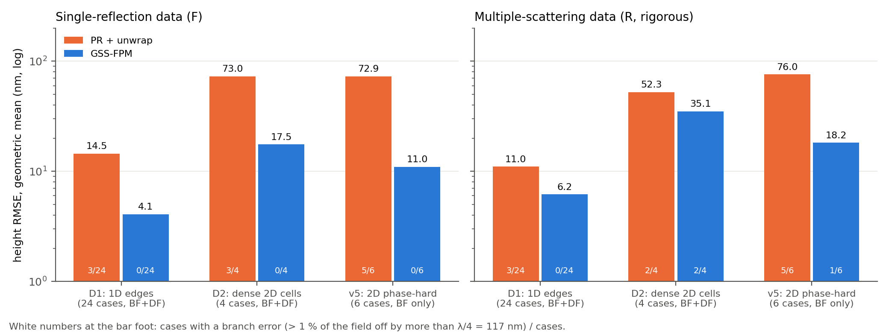

**그림 1.** 시편군별 높이 RMSE의 기하평균. 주황색은 PR + 언랩, 파란색은 GSS-FPM입니다. 왼쪽은 단일 반사 데이터(F), 오른쪽은 다중 산란 데이터(R)입니다. 막대 아래 흰 숫자는 branch 오류가 난 케이스 수입니다. branch 오류는 평가 영역의 1 % 넘게 λ/4 = 117 nm 이상 틀린 경우를 말합니다. 소스: `research/build_gss_fpm_multiscatter_report_20261117.py` (`fig_summary`). 산출물: `reports/gss_fpm_multiscatter_20261117/figures/fig7_summary.png`. 수치: `reports/gss_fpm_multiscatter_20261117/numbers.json`.

| 시편군 | 데이터 | PR + 언랩 (nm) | GSS-FPM (nm) | GSS-FPM R/F | branch 오류 케이스, PR / GSS-FPM |
|---|---|---:|---:|---:|---|
| D1: 1D 가장자리, 24개, BF+DF | F | 14.5 | **4.08** | | 3 / 0 |
| | R | 11.0 | **6.17** | 1.51 | 3 / 0 |
| D2: 조밀 2D 셀, 4개, BF+DF (참고용) | F | 73.0 | **17.5** | | 3 / 0 |
| | R | 52.3 | **35.1** | 2.01 | 2 / 2 |
| v5: 2D 위상 난제, 6개, BF만 | F | 72.9 | **11.0** | | 5 / 0 |
| | R | 76.0 | **18.2** | 1.66 | 5 / 1 |

## 1. 같은 데이터의 두 가지 버전

두 데이터는 산란 물리만 다르고 나머지는 모두 같습니다.

- **광학계:**
  - 파장 470 nm;
  - 대물렌즈 NA 0.28;
  - LED 93개, 조명 NA 최대 0.468(명시야 29개, 암시야 64개), 무편광;
  - 시야 6.5 µm, 카메라 0.65 µm 픽셀 10 × 10개;
  - 같은 동공(작은 디포커스·비점수차·코마·아포다이제이션 포함);
  - 같은 대역 제한 픽셀 적분.
- **잡음:** 보정된 광자 수·읽기 잡음·배경 모델이 같고, 잡음을 뽑는 규칙도 같습니다.
- **LED 분할:** 맞춤에 85개, 검증용으로 8개를 씁니다.
- **시편:** 80 nm 컨포멀 SiO$_2$ 막이 덮인 실리콘입니다. 최대 높이차는 150~200 nm로 λ/4 = 117 nm를 넘습니다. 위상이 $\phi = -4\pi h/\lambda$이므로 높이는 λ/2 = 235 nm만큼 모호합니다.
  - **D1:** y 방향으로 변하지 않는 가장자리 프로파일 12개(블록, 계단, 이중 블록)와 이를 90° 돌린 쌍 12개.
  - **D2:** 주기 1.625 µm 조밀 셀 4종을 4 × 4로 타일링한 것.
  - **v5:** 비주기 체커·계단 6개.

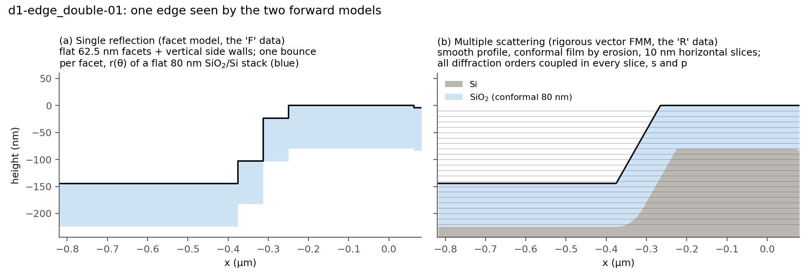

**그림 2.** 같은 가장자리를 두 순방향 모델이 보는 방식.
- **(a) 단일 반사(F 데이터).** 표면을 62.5 nm 평평한 면과 수직 옆벽으로 이루어진 계단으로 봅니다. 각 면은 평평한 80 nm SiO$_2$/Si 적층의 반사 계수 $r(\theta)$로 한 번 반사합니다. 이 계수에는 *평평한* 막 안에서 여러 번 오가는 반사가 이미 들어 있습니다. 가림을 적용하고, 표면을 Kirchhoff 방식으로 적분합니다.
- **(b) 다중 산란(R 데이터).** 1.56 nm 간격으로 샘플링한 매끄러운 프로파일에 실제 컨포멀 막을 입힙니다. 이를 10 nm 수평 층으로 자르고 벡터 푸리에 모드법(FMM)으로 풉니다. 두 편광 모두에서 모든 회절 차수를 모든 층에서 결합해 계산합니다.

소스: `research/build_gss_fpm_multiscatter_report_20261117.py` (`fig_forward_models`), 형상은 `research/gss_fpm_rev_rigorous.py`. 산출물: `reports/gss_fpm_multiscatter_20261117/figures/fig1_forward_models.png`.

### 다중 산란(R) 데이터를 계산한 방법

1. **형상.**
   - 표면 $h(x,y)$를 1.5625 nm 간격으로 샘플링합니다.
   - 막은 컨포멀합니다. 고체 안에서 공기까지 거리가 $t = 80$ nm보다 가까운 점은 모두 산화막입니다. 따라서 Si 윗면은 $h$를 반지름 $t$의 반구로 침식한 것입니다:
     $$s(\mathbf{x}) = \min_{|\mathbf{d}|\le t}\Big[h(\mathbf{x}+\mathbf{d}) - \sqrt{t^2-|\mathbf{d}|^2}\Big].$$
   - 그래서 면 모델과 달리, 가파른 벽에서는 수직으로 잰 막 두께가 얇아지고 모서리는 둥글어집니다.
2. **층 분할.**
   - $z=0$에 맞춘 $z = k\cdot 10$ nm 위치와, 설계된 평면 높이 및 그 Si 계면에서 수평으로 자릅니다.
   - 각 층의 유전율은 층 가운데 높이의 물질로부터 6.25 nm 픽셀 면적 평균으로 정합니다:
     $$\varepsilon = \varepsilon_{\mathrm{Si}}\,f_{\mathrm{Si}} + \varepsilon_{\mathrm{ox}}\,(f_{\mathrm{solid}}-f_{\mathrm{Si}}) + (1-f_{\mathrm{solid}}).$$
3. **해석기.**
   - 벡터 푸리에 모드법(RCWA라고도 함)인 FMMAX 1.7.1을 씁니다. 6.5 µm 시야 전체를 한 주기로 봅니다.
   - FMMAX가 모드 방향을 정하는 규칙은 손실 없는 층에서 부호를 잘못 고를 수 있습니다. 실행 시점에 우리가 만든 `signfix2` 규칙으로 고쳐서 씁니다.
   - 시편군별 설정:
     - **D1:** 정확한 1D Li 인수분해를 쓴 1D 기저 $|m|\le 157$(차수 315개).
     - **D2:** 1.625 µm 셀 격자에서 FFT(Laurent) 방식, 차수 793개.
     - **v5:** FFT 방식, 차수 1245개.
   - 각 LED마다 단위 s·p 편광 입력으로 풉니다. 결과는 반사된 각 차수의 복소 진폭이며 $z=0$ 기준입니다.
4. **영상 형성(F 데이터와 공유).**
   - 대물 NA 안의 차수만 같은 동공을 통과하고, 역변환해 카메라 면으로 보냅니다.
   - 카메라는 $|E_x|^2+|E_y|^2$를 기록하고, s·p 입력의 평균을 냅니다(무편광 LED, 편광 무관 카메라).
   - 이어서 같은 경로 진폭, 대역 제한 픽셀 적분, 잡음 모델을 적용합니다.
5. **수렴.**
   - **D1은 수렴했습니다.** 마지막 차수 단계에서 영상 변화가 BF 0.07~0.32 %, DF 0.29~0.79 %입니다. 층 두께를 절반으로 줄이면 0.38 % 바뀌고, FFT와 Li 인수분해의 차이는 0.95 %입니다.
   - **D2는 몇 % 수준으로 수렴했습니다.** 학습 셀에서 차수 793개와 1800개의 차이가 2~4 %이고, D2 암시야 기준값은 2~3.5 % 수준에서 결론이 나지 않았습니다.
   - **v5는 명시야에서 10~25 % 수준의 불확실성이 있습니다**(두 방식의 결과가 서로 다름). 그래서 BF 기준으로만 씁니다.
   - 따라서 깨끗한 다중 산란 시험은 D1이고, D2와 v5는 보조 근거입니다.

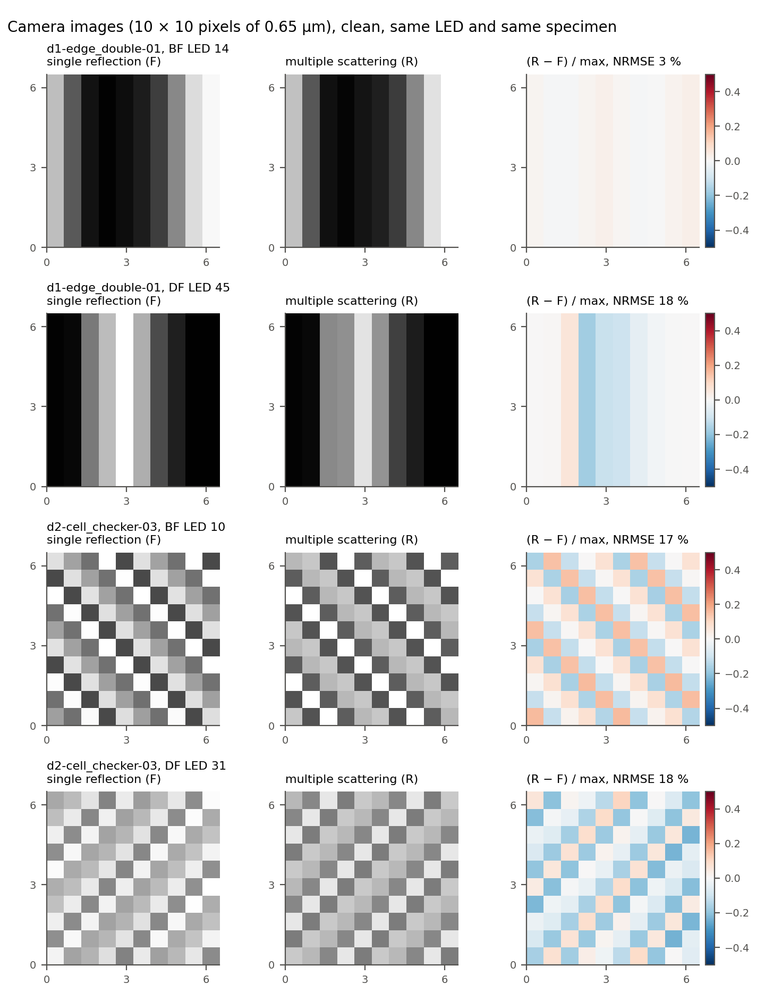

**그림 3.** 같은 시편·같은 LED의 깨끗한 카메라 영상을 두 데이터로 비교한 것입니다. D1에서는 다중 산란이 명시야 영상을 조금, 암시야 영상을 더 많이 바꿉니다. D2에서는 둘 다 더 크게 바뀝니다.

| 시편군 | BF 영상 차이 ‖F−R‖/‖R‖ | DF 영상 차이 | DF 밝기 F/R |
|---|---:|---:|---:|
| D1 (24) | 3.9 % | 15.9 % | 1.10 |
| D2 (4) | 13.9 % | 25.8 % | 1.20 |
| v5 (6) | 11.6 % | — | — |

값은 BF(또는 DF) LED를 묶어 계산한 NRMSE의 케이스별 중앙값입니다. 소스: `research/build_gss_fpm_multiscatter_report_20261117.py` (`fig_images`, `image_gap`). 산출물: `reports/gss_fpm_multiscatter_20261117/figures/fig2_images.png`.

## 2. 반사된 빛은 어디로 가나

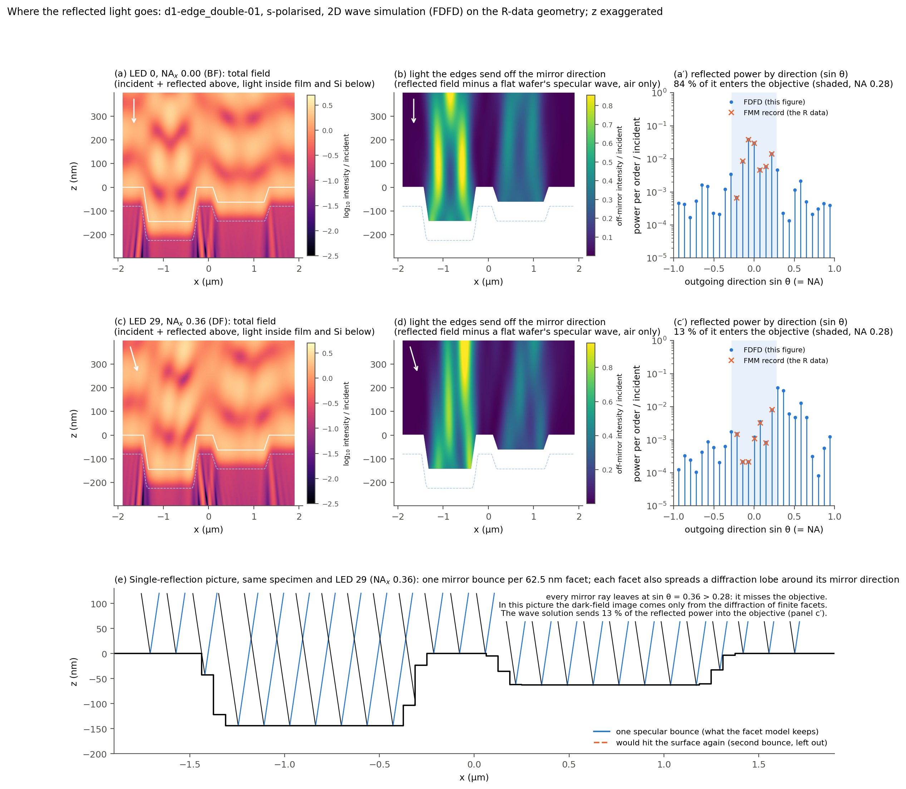

**그림 4.** D1 이중 트렌치 시편에서 반사된 빛. R 데이터와 같은 형상으로 따로 계산한 2D 주파수 영역 파동 해(FDFD, s편광)입니다.
- **(a, c) 전체 장.** 표면 위에서는 입사파와 반사파가 간섭합니다. 빛은 막과 실리콘 속으로도 들어갑니다.
- **(b, d) 거울 방향을 벗어난 빛.** 반사장에서 평평한 웨이퍼의 거울 반사파를 뺀 것으로, 트렌치 가장자리가 거울 방향 밖으로 보내는 빔입니다.
- **(a′, c′) 나가는 방향별 반사 에너지.** 수직 입사(LED 0)에서는 반사 에너지의 84 %가 대물렌즈에 들어갑니다. 암시야 LED 29(NA 0.36)에서는 13 %만 들어갑니다.
- **(e) 단일 반사 그림.** LED 29의 거울 반사 광선은 모두 sin θ = 0.36으로 나가 대물렌즈를 벗어납니다. 면 모델에서 암시야 영상은 유한한 면에서 생기는 회절에서만 나옵니다.

FDFD로 구한 차수 진폭은 R 데이터의 FMM 기록과 1.9 %(LED 0), 3.7 %(LED 29) 안에서 일치합니다. 평평한 웨이퍼는 해석적 Airy 계수와 2 % 안에서 맞습니다. 소스: `research/fdfd_d1_fieldmap.py`, `research/build_gss_fpm_multiscatter_report_20261117.py` (`fig_light_paths`). 산출물: `reports/gss_fpm_multiscatter_20261117/figures/fig8_light_paths.png`, `.../fdfd_checks.json`.

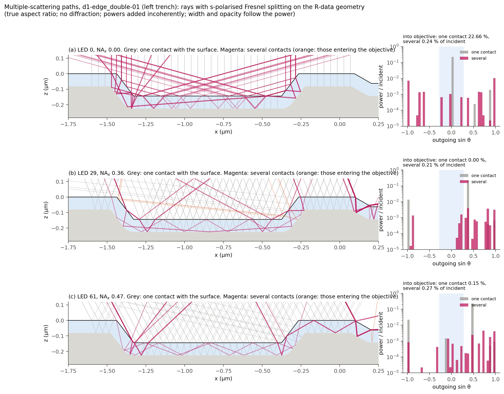

**그림 5.** 같은 형상 위에서 광선으로 본 다중 산란 경로입니다(가로세로 실제 비율). 광선은 경계마다 s편광 Fresnel 에너지에 따라 반사와 굴절로 나뉩니다. 표면에 한 번만, 또는 평평한 한 조각에만 닿은 광선은 회색입니다. 면 모델이 담고 있는 부분입니다. 여러 곳에 닿은 광선은 자홍색이고, 그중 대물렌즈에 들어가는 것은 주황색입니다.

면 모델이 놓치는 경로는 다음과 같습니다:
- 경사면에서 반사된 뒤 맞은편 벽이나 바닥에 다시 부딪히는 경로;
- 경사면으로 막에 들어가 다른 곳에서 나오는 경로;
- 트렌치 바닥 막 속을 가로지르는 경로.

대물렌즈에 들어가는 빛의 양을 입사광 대비로 보면 다음과 같습니다:
- 수직 입사에서는 거의 모두 한 번만 닿은 빛입니다(22.7 % 대 0.24 %).
- 암시야 LED에서는 한 번만 닿은 광선이 렌즈를 벗어납니다(LED 29 0 %, LED 61 0.15 %). 여러 번 닿은 광선은 입사광의 0.21 %, 0.27 %를 렌즈에 넣습니다.

광선 그림은 회절을 빼고 에너지를 위상 없이 더한 근사입니다. 80 nm 막은 파장보다 얇으므로, 막 속 지그재그는 "빛이 막을 따라 옆으로 이동한다"는 뜻으로만 읽어야 합니다. 정량적인 파동 답은 그림 4입니다.

소스: `research/ray_paths_d1.py`, `research/build_gss_fpm_multiscatter_report_20261117.py` (`fig_ray_paths`). 산출물: `reports/gss_fpm_multiscatter_20261117/figures/fig9_multiscatter_paths.png`, `.../ray_summaries.json`.

그림 3~5를 함께 보면, 두 데이터가 암시야와 가장자리에서 가장 크게 다른 이유가 드러납니다. 그곳에서 모이는 빛이 단일 반사 모델에 없는 경로에 달려 있기 때문입니다.

## 3. 높이를 복원하는 방법

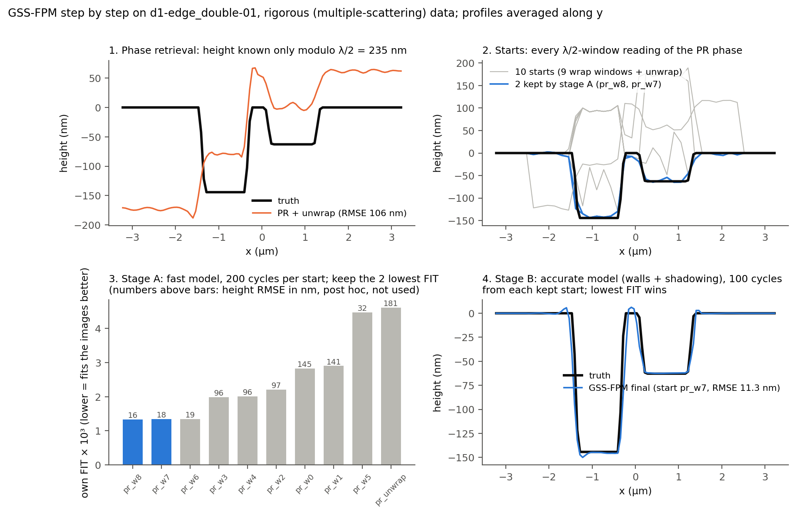

**그림 6.** 다중 산란 데이터의 D1 케이스 하나에서 GSS-FPM이 거치는 단계. 프로파일은 y 방향 평균입니다. 소스: `research/build_gss_fpm_multiscatter_report_20261117.py` (`fig_pipeline`), 입력은 `runs/gss_fpm_edge_df_2026-11-17/inversion/F-all/`. 산출물: `reports/gss_fpm_multiscatter_20261117/figures/fig3_pipeline.png`.

1. **위상 복원(PR, 비교 기준이기도 함).**
   - 40 × 40 파동 격자 위의 복소 반사장 하나를, 알려진 이동 동공을 통해 모든 맞춤 영상에 맞춥니다. Wirtinger 기울기와 Adam으로 세 시작점에서 맞추고, FIT가 가장 낮은 것을 고릅니다.
   - 위상을 언랩해 $h = -\lambda\phi/(4\pi)$로 바꾸고, 테두리 기준으로 높이를 맞춘 뒤 104 격자로 올립니다.
   - PR은 얇은 물체 모델이어서 옆벽, 가림, 각도에 따른 막 응답이 없습니다. 그림 6에서는 공간 언랩이 영역 일부를 틀린 λ/2 가지에 놓습니다(RMSE 106 nm).
2. **시작점.** PR 위상은 높이를 λ/2 단위로만 정합니다. 이를 열 가지로 읽어 시작점으로 둡니다: wrap 창 9개(`pr_w0`~`pr_w8`)와 공간 언랩.
3. **A단계(가지 선택).**
   - 각 시작점에서 빠른 면 모델을 200사이클 맞춥니다. 옆벽·가림이 없고 융합 GPU 커널을 씁니다.
   - 표현은 32 × 32개의 겹치는 가우시안 가중 국소 평면으로, 하나의 2.5D 높이장을 이룹니다.
   - 자기 FIT가 가장 낮은 시작점 2개를 남깁니다. 정답은 쓰지 않습니다. 그림 6 막대 위 숫자는 사후 참고값입니다.
4. **B단계(정밀 맞춤).**
   - 남은 PR 시작점마다 정확한 면 모델(옆벽 + 가림)을 데이터와 같은 208 격자로 렌더링하고, 비등방 TV 2.6으로 100사이클 맞춥니다.
   - 자기 FIT가 낮은 쪽을 결과로 씁니다.
5. **손실.**
   - 손실은 절대 세기에 대한 배경 인식 Anscombe 거리이며, 이득은 맞추지 않습니다:
     $$\mathcal{L} = \tfrac12\,\mathrm{mean}\Big[\tfrac{4N}{c}\big(\sqrt{I_{\mathrm{pred}} + b/N + \epsilon} - \sqrt{I_{\mathrm{obs}} + \epsilon}\big)^2\Big],\qquad \epsilon = \frac{3/8+\sigma_r^2}{N}.$$
   - 여기서 $N$은 광자 규모, $b$는 배경, $\sigma_r$은 읽기 잡음, $c$는 고정 척도입니다.

파이프라인은 고정된 v2입니다(`models/surfelsplat_fpm_twostage_g208c0_20261115/`). **복원에는 R 데이터에서도 항상 단일 반사 면 모델을 씁니다.** 그래서 R 결과는 모델 불일치의 대가를 잽니다.

기준 높이와 테두리 규칙:
- D1과 v5는 평가 방식과 같게 기준 보정을 하지 않습니다(평평한 테두리 = 0).
- D2는 셀이 시야를 다 채워 테두리가 없습니다. 모든 조건에 같은 방식으로 (복원 − 정답)의 전체 중앙값을 빼서 높이 기준을 맞춥니다.

## 4. 결과

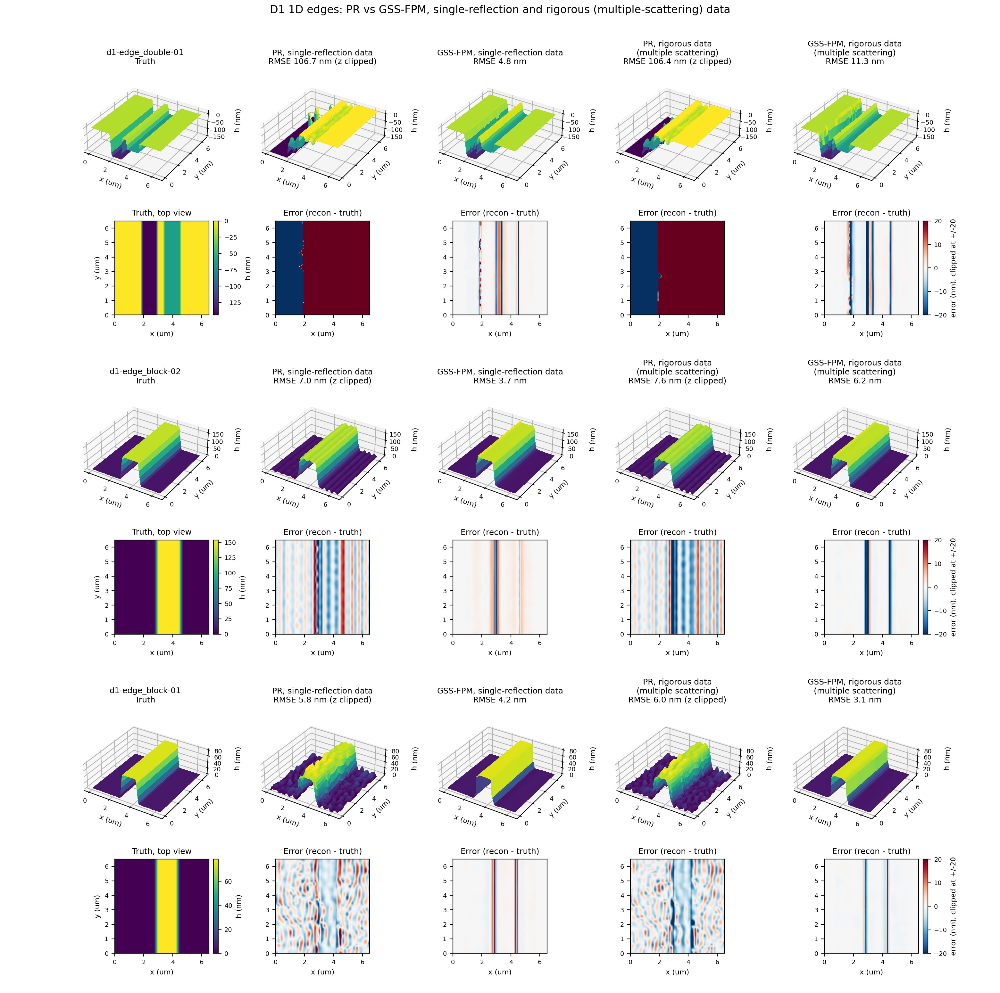

**그림 7.** D1 세 케이스(R/F가 가장 나쁜·중간·가장 좋은 경우). 열은 정답 | PR(F) | GSS-FPM(F) | PR(R) | GSS-FPM(R) 순서입니다. 오차 지도는 ±20 nm에서 자릅니다. 정답에서 크게 벗어난 PR 표면은 z 방향으로 잘라서 그렸습니다("z clipped"). 소스: `research/gss_fpm_film2d_q3_figure.py`, PR 높이는 `research/gss_fpm_film2d_q3_pr_export.py`. 산출물: `runs/gss_fpm_film2d_2026-11-17/q3/q3_d1_pr_3d.png`.

**D1(24개).**
- GSS-FPM 높이 RMSE는 F 데이터 4.08 nm, R 데이터 6.17 nm(R/F 1.51)이고, 두 데이터 모두 branch 오류가 없습니다.
- 늘어난 오차는 가장자리에 있습니다:
  - 가장자리 띠 8.9 → 13.8 nm;
  - 평평한 면 1.09 → 0.77 nm(나빠지지 않음).
- 케이스별 R/F는 0.72~3.41이고, 24개 중 16개에서 R이 더 나쁩니다. 형태별 R/F는 블록 1.18, 계단 2.20, 이중 블록 1.34입니다. R에서 늘어난 오차는 벽 위에 있습니다.
- PR은 14.5 / 11.0 nm이고, 두 데이터 모두 3개 케이스에서 branch 오류가 납니다.

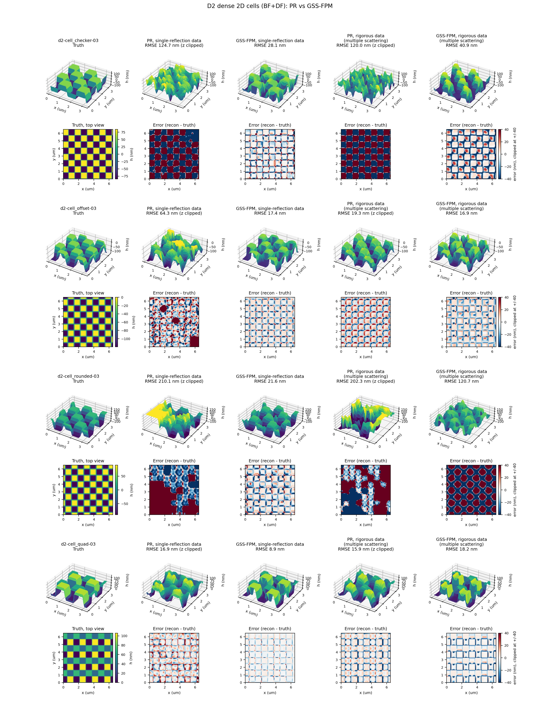

**그림 8.** D2 조밀 셀. 3D는 가운데 2 × 2 타일, 오차 지도(±40 nm)는 전체 시야입니다. 산출물: `runs/gss_fpm_film2d_2026-11-17/q3/q3_d2_pr_3d.png`.

**D2(4개, 참고용).** F 데이터에서도 이 셀들에서는 파이프라인이 잡음 하한에 닿지 못합니다:
- 자기 FIT가 잡음 하한의 6~13배이고, 100사이클에서도 계속 내려가는 중입니다;
- 가장자리가 0.81 µm마다 나옵니다;
- 합성 NA가 1.625 µm 셀의 고조파를 약 2개만 통과시킵니다.

그래서 D2의 절대 정확도는 주장하지 않고, 같은 파이프라인에서의 R/F 비율만 보고합니다.
- GSS-FPM은 17.5 → 35.1 nm(R/F 2.01)입니다.
- R 데이터에서 `cell_rounded`는 영역 약 1/3이 틀린 λ/2 가지에 놓이고(120.7 nm), `cell_checker`는 2.2 %가 그렇습니다. `cell_offset`은 그대로입니다(0.97).
- PR은 73.0 / 52.3 nm입니다.

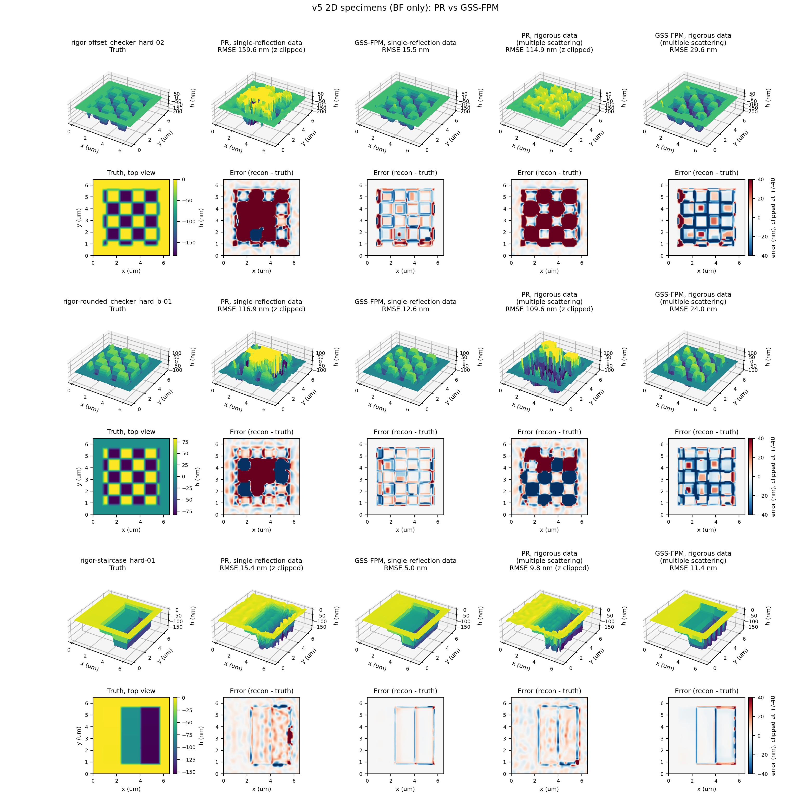

**그림 9.** v5 비주기 시편, BF 전용 조건, 세 케이스. 산출물: `runs/gss_fpm_film2d_2026-11-17/q3/q3_v5_pr_3d.png`.

**v5(6개, BF만).**
- GSS-FPM은 11.0 → 18.2 nm(R/F 1.66)입니다. R 데이터에서는 체커의 낮은 블록이 일관되게 20~40 nm 너무 깊게 나옵니다.
- 한 케이스(`offset_checker_hard-02`)에 작은 branch 오류(영역의 1.1 %)가 있습니다.
- PR은 72.9 / 76.0 nm이고, 두 데이터 모두 6개 중 5개에서 branch 오류가 납니다.

## 5. 의미

- **GSS-FPM 대 PR.** GSS-FPM이 모든 시편군과 두 데이터 모두에서 이깁니다. 기하평균 RMSE 기준으로 1.5배(D2 R)에서 6.7배(v5 F) 낮습니다. PR은 주로 λ/2 가지 선택에서 실패하고, GSS-FPM의 시작점 선택과 맞춤이 이를 해결합니다.
- **다중 산란의 대가는 1.5~2배이고, 주로 가장자리에서 생깁니다.** 1D 가장자리에서는 정확 계산 데이터로도 GSS-FPM이 잘 복원합니다. branch 오류가 없고, 평평한 면은 1 nm 이하, 가장자리 띠는 13.8 nm입니다.
- **막이 있는 2D는 아직 해결되지 않았습니다.** 정확 계산 데이터에서 branch 오류가 생깁니다(D2 4개 중 2개, v5 6개 중 1개). 2D 모델 오차는 주로 막에서 옵니다. 맨 웨이퍼에서는 면 모델과 정확 계산의 차이가 9~12 %인데, 막이 있으면 26~38 %입니다. 매개변수 없는 국소 막 보정(수직·컨포멀 두께, 무편광 r)으로는 이 차이가 줄지 않았습니다(G1-D2 실패). 빠진 물리는 비국소적입니다. 그림 4·5에서 보듯, 빛이 막을 따라 옆으로 가거나 벽과 바닥 사이를 오가는 경로입니다.

**주의할 점.**
- 케이스 수가 적습니다(24 / 4 / 6).
- D2는 F 데이터에서도 조밀 셀에서 파이프라인이 수렴하지 않아 참고용입니다.
- D2와 v5의 정확 계산 기준값에는 몇 %(D2)에서 10~25 %(v5 BF)의 불확실성이 있습니다.
- v5는 BF만 씁니다.
- FDFD와 광선 그림은 D1 시편 하나의 s편광만 다룹니다.

**다음 단계.**
- 순방향 모델에 비국소 가장자리 처리를 넣습니다. 7절의 정확 계산 가장자리 응답 표입니다. 1D 오차를 절반으로 줄이고 D2도 낮추지만, v5에서는 그렇지 않습니다.
- 다른 논문 방법은 6절에 있습니다. GSS-FPM의 시작점을 쓴 높이-PR이 1D 가장자리에서 GSS-FPM과 비슷합니다. 따라서 면 모델 물리가 필요하다는 근거는 2D 시편에 달려 있습니다.

## 6. 같은 영상에서의 다른 논문 방법

면마다 막 반사율을 계산하고, 그림자를 처리하고, λ/2 가지를 고르는 방법은 아직 발표된 것이 없습니다. 실행 가능한 방법은 모두 우리 PR과 같은 얇은 물체 모델을 씁니다. 동공을 거쳐 보이는 복소 반사율 하나로 시편을 나타내는 모델입니다. 방법끼리는 물체 표현, 손실 함수, 정규화 방식만 다릅니다. 이 중 가장 가까운 세 계열을 GSS-FPM과 PR이 본 영상 그대로에 돌렸습니다.

- **FPT 구성** (Wang 등, *Opt. Express* 2023: NA 0.28 반사형 BF+DF 웨이퍼 장치).
  - 코드가 공개되지 않아 직접 구현했습니다.
  - 40 × 40 복소 물체와 진폭(√I) 손실을 씁니다.
  - 정규화: |O|의 TV와 위상의 원형 TV입니다(Shen 등, IEEE TCI 2026).
  - 높이는 PR처럼 언랩 후 구합니다.
- **FPM-INR** (Zhou 등, *Optica* 2023). 공개 신경망 `hwzhou2020/FPM_INR`을 2D로 옮겼습니다.
  - 특징 격자와 작은 MLP가 진폭과 위상을 냅니다.
  - smooth-L1 진폭 손실을 쓰고, 한 단계에 LED 하나씩 학습합니다.
  - 위상 출력이 연속이라 언랩이 필요 없습니다.
- **높이-PR** (Wittwer 등, *Optica* 2022; Gao & Cao, *Opt. Lett.* 2022).
  - 높이 h를 exp(−i4πh/λ)로 직접 맞추고, TV(h)로 정규화합니다.
  - 시작점은 평평한 시작점과, GSS-FPM이 쓰는 정답 없이 만든 λ/2 시작점 10개입니다.
  - GSS-FPM에서 하나만 뺀 비교에 가장 가깝습니다. 시작점은 같고, 물리만 픽셀 높이 지도 위의 얇은 물체 모델입니다.

**공정성.**
- 세 방법 모두 PR의 순방향 연산자를 씁니다. 알려진 동공, 같은 맞춤 LED와 영상, 픽셀 적분, 40 × 40 격자입니다.
- 시작점은 각 방법이 학습에 쓰는 목적함수로, 맞춤 LED에서만 고릅니다. 정답은 쓰지 않습니다.
- 방법마다 하이퍼파라미터는 하나입니다. FPT와 높이-PR은 정규화 가중치, FPM-INR은 특징 격자 크기입니다.
  - D1 정확 계산 데이터 12개(복제 01–02)의 *정답*으로 골랐습니다. 고른 값은 FPT 1e-5, 높이-PR 1e-2, FPM-INR 10입니다.
  - FPT와 높이-PR은 처음에 후보 중 가장 큰 값을 골랐습니다. 그래서 후보를 두 개씩 늘렸고, 다시 고른 값은 범위 안쪽이었습니다. 이 변경은 다른 정답을 열기 전에 기록했습니다.
  - GSS-FPM은 정확 계산 데이터로 튜닝한 적이 없으니, 이 튜닝은 기준선에 유리합니다. 그래서 D1은 튜닝에 쓰지 않은 12개 결과도 따로 보고합니다.
- 시험 사례 하나에서 세 방법 모두 PR만큼 영상을 맞춥니다(FPT 0.00095, 높이-PR 0.00095, FPM-INR 0.00097, PR 0.00095).
- FPT의 수직 입사 영상 시작점은 일부 사례에서 값이 발산했습니다. 진폭이 0인 곳에서 위상 TV의 기울기가 정의되지 않기 때문입니다. 평가 전에 기록한 규칙에 따라 그 시작점은 빼고 나머지 두 시작점을 썼습니다.

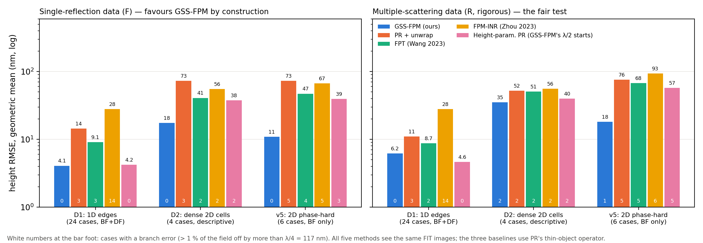

**그림 10.** 다섯 방법의 시편군별 높이 RMSE 기하평균. 왼쪽은 단일 반사(F) 데이터, 오른쪽은 다중 산란(R) 데이터입니다. 흰 숫자는 branch 오류가 난 케이스 수입니다. 소스: `research/gss_fpm_q4_figure.py` (`fig_bars`). 수치: `research/gss_fpm_q4_baselines.py summary`가 쓴 `runs/gss_fpm_baselines_2026-11-18/summary.json`. 산출물: `runs/gss_fpm_baselines_2026-11-18/figures/fig10_baselines.png`.

| 다중 산란(R) 데이터, nm (branch 오류 케이스) | D1, 24개 | D1, 튜닝 제외 12개 | D2, 4개 (참고용) | v5, 6개 |
|---|---:|---:|---:|---:|
| GSS-FPM (우리) | 6.2 (0) | 6.9 (0) | **35.1** (2) | **18.2** (1) |
| PR + 언랩 | 11.0 (3) | 12.8 (2) | 52.3 (2) | 76.0 (5) |
| FPT 구성 | 8.7 (2) | 10.3 (0) | 50.5 (2) | 67.7 (5) |
| FPM-INR | 28.1 (14) | 40.7 (8) | 56.0 (2) | 93.3 (6) |
| 높이-PR, GSS-FPM 시작점 | **4.6** (0) | **4.6** (0) | 40.0 (2) | 57.4 (5) |

단일 반사(F) 데이터에서도 순서는 같습니다. D1은 GSS-FPM 4.1, 높이-PR 4.2, FPT 9.1, PR 14.5, FPM-INR 28.0 nm이고, v5는 11.0 / 39.4 / 47.2 / 72.9 / 67.0 nm입니다.

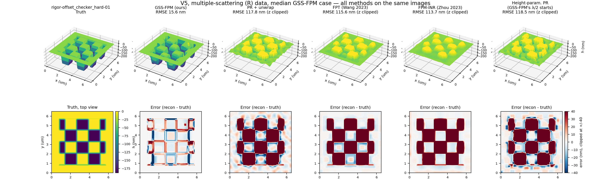

**그림 11.** v5 R 데이터에서 GSS-FPM 기준 중앙값 사례(`offset_checker_hard-01`). 위는 표면, 아래는 ±40 nm에서 자른 오차 지도입니다. 기준선 세 방법은 모두 깊이 180 nm 구멍을 볼록한 모양으로 복원합니다. λ/2 가지를 잘못 고른 것이고, RMSE는 약 115 nm입니다. GSS-FPM은 구멍을 그대로 복원합니다(15.6 nm). 소스: `research/gss_fpm_q4_figure.py` (`fig_surfaces`, `research/gss_fpm_film2d_q3_figure.py` 재사용). 산출물: `runs/gss_fpm_baselines_2026-11-18/figures/fig11_v5_baselines_3d.png`.

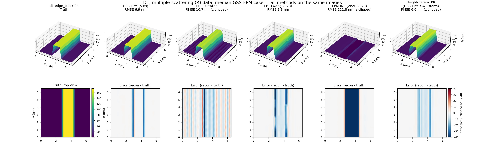

**그림 12.** D1 R 데이터에서 GSS-FPM 기준 중앙값 사례(`edge_block-04`). GSS-FPM 6.9 nm, 높이-PR 6.6 nm, FPT 8.8 nm, PR 10.7 nm입니다. FPM-INR은 블록을 아예 놓칩니다(122.8 nm, 가지 오류). 산출물: `runs/gss_fpm_baselines_2026-11-18/figures/fig11_d1_baselines_3d.png`.

**해석.**
- **FPT와 높이-PR은 세 시편군 모두의 R 데이터에서 PR보다 낫고, FPM-INR은 어디서도 낫지 않습니다.** FPM-INR은 위상이 연속이라 언랩이 필요 없습니다. 그래도 D1 24개 중 14개에서 λ/2 가지를 잘못 고릅니다. 위상이 연속이라고 가지가 맞는 것은 아닙니다.
- **1D 가장자리에서는 높이-PR이 GSS-FPM과 비슷합니다.**
  - R 데이터에서 4.6 대 6.2 nm, 튜닝 제외 12개에서 4.6 대 6.9 nm입니다. F 데이터에서는 4.2 대 4.1 nm입니다. 둘 다 branch 오류가 없습니다.
  - 높이-PR은 GSS-FPM의 λ/2 시작점과, D1 정답으로 튜닝한 TV 사전정보를 씁니다. 따라서 1D 가장자리에서 GSS-FPM이 PR을 앞서는 이유는 대부분 면 모델 물리가 아니라 가지 시작점과 선택 과정입니다.
  - 7절의 정확 계산 가장자리 표를 넣으면 이 데이터에서 GSS-FPM이 3.1 nm로 내려가 높이-PR보다 확실히 낫습니다.
- **2D에서는 면 모델 물리가 결정적입니다.**
  - v5 R 데이터: GSS-FPM은 18.2 nm에 branch 오류 1개, 가장 좋은 기준선(높이-PR)은 57.4 nm에 6개 중 5개입니다.
  - D2 R 데이터(참고용): GSS-FPM 35.1 nm, 높이-PR 40.0 nm이고, 둘 다 4개 중 2개에서 branch 오류가 납니다.
- **미리 정한 판정.**
  - "PR보다 낫다"(R 데이터): FPT와 높이-PR은 세 시편군 모두, FPM-INR은 해당 없음.
  - "GSS-FPM에 근접"(1.2배 이내): 높이-PR이 D1(더 낮음)과 D2에서 해당. v5에서는 해당하는 기준선이 없습니다.

**주의할 점.** FPT는 코드가 공개되지 않은 구성을 우리가 구현한 것입니다. 카메라가 10 × 10 픽셀뿐이라 FPM-INR은 저장소 일정보다 6배 길게 학습했습니다. 기준선의 하이퍼파라미터는 D1 정답으로 튜닝했고, 시편군은 작습니다. 프로토콜: `research/gss_fpm_q4_baselines_protocol_2026-11-18.md`.

## 7. 순방향 모델에 넣은 정확 계산 가장자리 응답 표

**면 모델에 반사를 더 넣지 않은 이유.** 여러 번 튀는 반사를 광선으로 다루는 모델은 구조의 깊이와 폭이 파장보다 훨씬 클 때만 맞습니다. 여기서는 단차가 λ/2보다 얕습니다(가장 깊은 200 nm 단차에서도 $kd \le 2.7$). 그래서 면 모델에 반사 항을 하나 더 넣어도 물리적으로 맞는 범위가 없습니다. 대신 가장자리 하나의 다중 산란 응답을 정확 계산에서 가져와, 면 모델에 보정으로 더했습니다.

**표를 만드는 방법(edge domain decomposition).**
- 주기적인 두 가지 폭의 블록 시편을 1D로 정확 계산했습니다(FMMAX, Li 정식화, 112차, 10 nm 슬라이스, 80 nm 산화막을 표면을 따라 입힌 구조).
  - 단차 높이 $\Delta z$: 25–200 nm에서 8개. 가장자리 기울기 폭: 50, 150, 300 nm.
  - LED 93개 전부. 절반은 직접 풀었고, 나머지 절반은 거울 대칭으로 얻었습니다.
- 블록 폭이 두 가지라서, 회절 차수마다 올라가는 가장자리와 내려가는 가장자리의 응답을 분리할 수 있습니다. 정반사 차수는 이렇게 분리되지 않아 ±1, ±2차에서 보간합니다.
- 저장하는 값은 잔차입니다. 정확 계산에서, 해석기가 실제로 자른 형상 위의 면 모델 값을 뺀 것입니다. LED와 차수마다 2 × 2 편광(Jones) 행렬로 두고, 기준점은 가장자리 중심입니다. 거울 대칭과 전치 대칭으로 나머지 세 방향의 가장자리를 얻습니다.
- 높이 지도에 적용하는 방법:
  - 행이나 열을 따라 같은 부호로 이어진 높이 점프 묶음 하나를 가장자리 하나로 봅니다. 높이는 $\Delta z$, 폭은 $\sigma$(점프의 2차 모멘트)입니다.
  - 잔차를 표에서 찾고($\Delta z$는 3차 보간으로 $\Delta z = 0$에서 0, $\sigma$는 선형), 그 가장자리 자리의 위상을 붙여 모든 가장자리에 대해 더합니다.
  - 2D 지도는 1D 가장자리의 행과 열로 다룹니다(띠 근사). 모서리에는 따로 항이 없습니다.
- 복원에서는 이 항을 결함 보정(defect correction)으로 씁니다. 현재 높이로 계산하되 기울기는 흘리지 않고, 높이가 3 nm 넘게 움직이면 다시 계산합니다.
  - 1단계(λ/2 시작점 10개 중 2개 고르기)는 기존 파이프라인과 공유합니다. 2단계와 FIT 최소로 고르는 마지막 선택에 보정된 순방향을 씁니다.
  - 바탕은 *무편광* 면 모델(s와 p의 평균)입니다. 그래서 비교 대상은 포스터 모델(s만)과, 표 없는 무편광 모델 두 가지입니다.

**높이 결과 전에 한 확인.**
- C1: 평평한 막에서 면 모델 바탕과 정확 계산의 정반사가 $10^{-6}$ 이내로 같습니다.
- 표에 쓰지 않은 시편에서 정확 계산 대비 영상 NRMSE(무편광 → 표 사용):
  - 떨어진 가장자리 두 개: BF 3.4 / 5.8 % → 0.2 / 0.3 %, DF 8.6 / 22.1 % → 0.7 / 0.6 %.
  - 표에 없는 높이와 기울기 폭의 블록: BF 2.7 / 2.4 % → 0.3 / 0.6 %, DF 9.3 / 7.8 % → 2.9 / 2.4 %.
- 격자 확인: 104칸 표와 208칸 표로 만든 영상이 잡음 하한 2.5 % 안에서 같습니다.

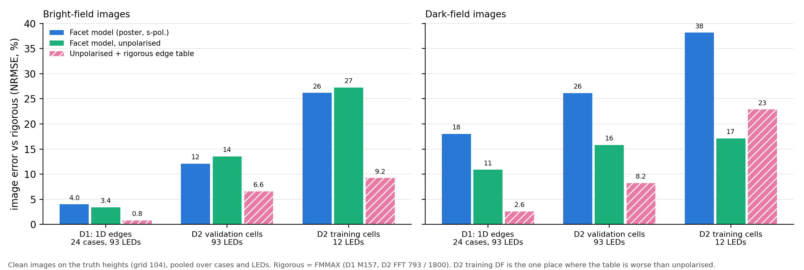

**그림 13.** 순방향 시험(G1-E). 정답 높이에서 만든 깨끗한 영상과 정확 계산 영상 사이의 오차를 모은 값입니다. 파란색은 포스터 모델(s편광 면 모델), 초록색은 무편광 면 모델, 분홍색(빗금)은 무편광 모델에 가장자리 표를 더한 것입니다. 소스: `research/gss_fpm_edge_table_figure.py` (`fig_forward`). 수치: `research/gss_fpm_edge_table.py g1`이 쓴 `runs/gss_fpm_edge_table_2026-11-18/g1_e_grid104.json`. 산출물: `runs/gss_fpm_edge_table_2026-11-18/figures/fig13_edge_table_forward.png`.

- **미리 정한 순방향 기준을 통과합니다.** D2 검증 셀에서 무편광 대비 오차가 BF 51 %, DF 48 % 줄고, D1에서도 둘 다 줄어듭니다(BF 3.4 → 0.8 %, DF 10.9 → 2.6 %).
- **예외 하나.** D2 학습 셀(LED 12개)에서는 DF 오차가 17 %에서 23 %로 늘어납니다.

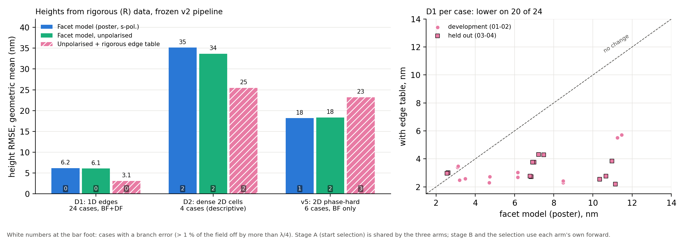

**그림 14.** 정확 계산(R) 데이터에서 순방향 세 가지로 복원한 높이(G2-E). 왼쪽은 시편군별 높이 RMSE의 기하평균이고, 흰 숫자는 branch 오류가 난 케이스 수입니다. 오른쪽은 D1 케이스별로 포스터 모델과 가장자리 표를 비교한 것이고, 네모는 튜닝에서 뺀 12개입니다. 소스: `research/gss_fpm_edge_table_figure.py` (`fig_heights`). 수치: `research/gss_fpm_edge_table_g2.py`가 쓴 `runs/gss_fpm_edge_table_2026-11-18/g2_e.json`. 산출물: `runs/gss_fpm_edge_table_2026-11-18/figures/fig14_edge_table_heights.png`.

| R 데이터, nm (branch 오류 케이스) | D1, 24 | D1, 튜닝 제외 12 | D2, 4 (참고용) | v5, 6 |
|---|---:|---:|---:|---:|
| 면 모델 (포스터, s편광) | 6.17 (0) | 6.87 (0) | 35.1 (2) | **18.2** (1) |
| 면 모델, 무편광 | 6.09 (0) | 6.67 (0) | 33.7 (2) | 18.4 (2) |
| 무편광 + 가장자리 표 | **3.12** (0) | **3.18** (0) | **25.4** (2) | 23.2 (3) |
| 높이-PR, GSS-FPM 시작점 (6절) | 4.6 (0) | 4.6 (0) | 40.0 (2) | 57.4 (5) |

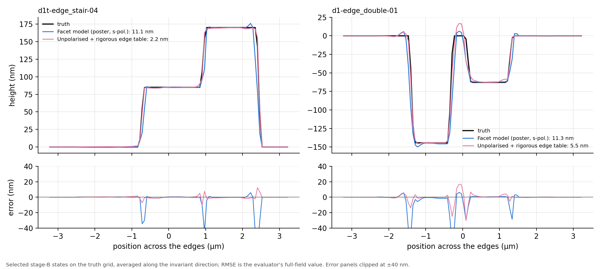

**그림 15.** D1 두 케이스의 가장자리를 가로지르는 높이 단면. 정답(검정), 포스터 모델(파랑), 가장자리 표(분홍). 아래는 오차이고 ±40 nm에서 자릅니다. 소스: `research/gss_fpm_edge_table_figure.py` (`fig_profiles`), 높이는 `runs/gss_fpm_edge_df_2026-11-17/inversion/<arm>/evaluation/<case>__ts4ws2-hard-fused-r5-g208c0__height.npz`. 산출물: `runs/gss_fpm_edge_table_2026-11-18/figures/fig15_d1_profiles.png`.

**해석.**
- **1D 가장자리: 오차가 절반이 됩니다.** 24개에서 6.17 → 3.12 nm, 튜닝 제외 12개에서 6.87 → 3.18 nm입니다. 24개 중 20개에서 낮아졌고 branch 오류는 없습니다. 나빠진 4개는 쉬운 블록 케이스입니다(2.6–3.1 → 3.0–3.5 nm).
  - 이득은 모두 가장자리에서 나옵니다. 가장자리 띠는 13.8 → 6.8 nm, 평판은 0.77 → 0.74 nm입니다.
  - 그림 15가 이유를 보여 줍니다. 포스터 모델은 벽을 정답에서 62.5 nm 칸 한두 개만큼 옆에 놓습니다. 표를 넣으면 벽이 제자리에 섭니다.
  - 이제 1D 가장자리에서도 GSS-FPM이 높이-PR보다 낫습니다(3.1 대 4.6 nm). 6절에서는 둘이 비슷했으니, 표를 넣으면 1D에서도 면 모델 물리가 효과를 냅니다.
- **조밀 2D 셀(D2): 낮아지지만 풀리지는 않습니다.** 35.1 → 25.4 nm이고, quad 셀은 18.2 → 7.9 nm입니다. branch 오류는 그대로입니다. rounded 셀은 모든 경우에서 시야의 36–42 %가 틀린 가지에 있습니다.
- **v5(2D, BF만): 나빠집니다.** 18.2 → 23.2 nm이고, branch 오류 케이스가 1개에서 3개로 늡니다(모두 작아서 시야의 6.3 % 이하).
  - 2단계 두 시작점이 모두 나빠지고, 보정된 모델 자신의 FIT도 올라갑니다(예: `offset_checker_hard-01`에서 0.0023 → 0.0030). 보정된 순방향이 이 데이터에 덜 맞는 것이므로 시작점 선택 탓이 아닙니다.
  - v5는 표를 순방향에서 한 번도 확인하지 못한 시편군입니다. 정확 계산 기록이 v5 시편 하나, LED 16개분만 있습니다.
  - 가능한 원인(아직 시험하지 않음):
    - 띠 근사에 모서리 항이 없음;
    - BF만 쓰는 신호의 대부분을 실은 정반사 차수를 보간으로 채움;
    - 표 범위 위쪽 끝(200 nm)에 가까운 180 nm 구멍;
    - v5 기준 데이터 자체의 오차(10–25 %).
- **비용.** 2단계 한 번이 포스터 모델의 1.9배(v5)–2.5배(D2) 걸립니다. 대부분은 s와 p를 따로 계산하는 무편광 바탕 때문입니다. 1단계는 그대로라서 시편 하나 전체로는 11–27 % 더 걸립니다.

**판정.**
- 1D 가장자리 시편에는 표를 씁니다.
- 2D 시편에는 2D 순방향 확인을 통과할 때까지 쓰지 않습니다.

**주의할 점.**
- 표와 R 데이터가 같은 계열의 해석기(FMMAX)에서 나왔습니다. 그래서 D1 이득의 일부는 그 해석기에 맞춘 효과일 수 있습니다. FDFD는 D1 FMMAX 차수와 1.9 / 3.7 % 안에서 일치하므로(2절) 49 % 이득보다 훨씬 작지만, 다른 해석기나 실측 데이터로 독립 확인이 필요합니다.
- 시편군이 작고(24 / 4 / 6), D2는 참고용입니다.
- 프로토콜과 기록: `research/gss_fpm_edge_table_protocol_2026-11-18.md`.

## 재현

- 데이터, 복원, 내보내기: `research/gss_fpm_q3.py`, `research/gss_fpm_q3_data.py`, `runs/gss_fpm_film2d_2026-11-17/q3/` (프로토콜 `research/gss_fpm_film2d_protocol_2026-11-17.md`).
- 정확 계산 해석기와 시편: `research/gss_fpm_rev_rigorous.py`, `research/slide470v5_rigorous.py`, `research/slide470v5_fmmax.py`.
- 보고서 그림과 수치: `python research/build_gss_fpm_multiscatter_report_20261117.py`. 이 스크립트는 `research/fdfd_d1_fieldmap.py`의 출력과 `research/ray_paths_d1.py`도 사용합니다.
- 다른 방법(6절): `research/gss_fpm_q4_baselines.py` (단계 launch / worker / evaluate / summary; 프로토콜 `research/gss_fpm_q4_baselines_protocol_2026-11-18.md`), 결과 `runs/gss_fpm_baselines_2026-11-18/`, 그림 `python research/gss_fpm_q4_figure.py`.
- 가장자리 표(7절): `research/gss_fpm_edge_table.py` (단계 solve / base / build / checks / g1), 순방향 연결 `research/gss_fpm_rev_forward.py` (`edge_table`), 복원 설정 `research/gss_fpm_d1x.py`, `research/gss_fpm_q3.py`, `research/slide470v5_bf_queue.py`, 요약 `research/gss_fpm_edge_table_g2.py`, 그림 `python research/gss_fpm_edge_table_figure.py`; 결과 `runs/gss_fpm_edge_table_2026-11-18/`.
