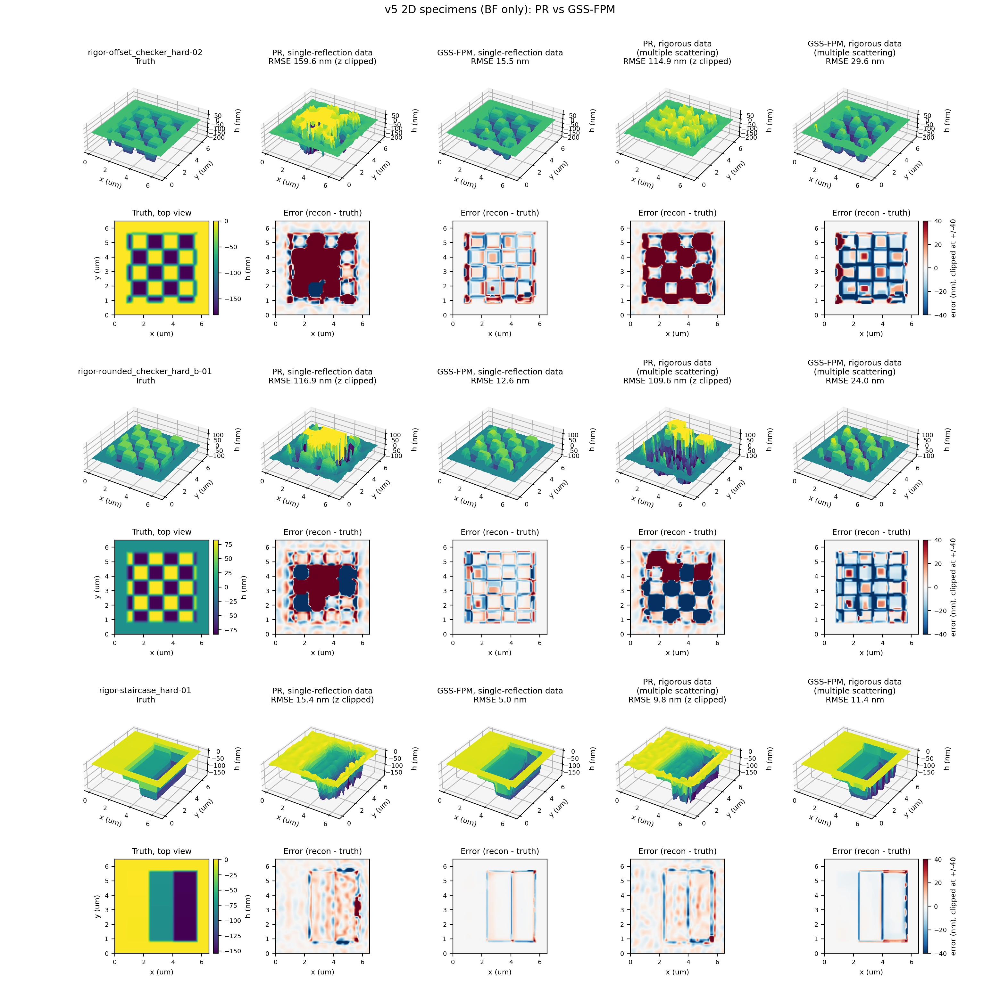
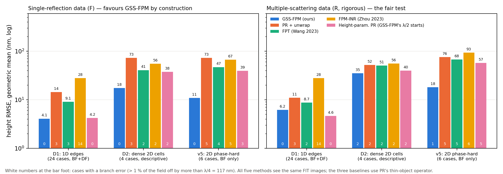

# GSS-FPM on multiple-scattering data: how the data were made and how heights are recovered

**Question.** GSS-FPM reconstructs a reflective surface's height from LED-array Fourier ptychographic images. Its forward model assumes *single reflection*: each small facet reflects once. Real light can scatter several times — between a wall and a floor, or through the 80 nm oxide film from one place to another. Does GSS-FPM still recover the height when the data contain this multiple scattering?

**Answer in one figure.** Figure 1 compares, on the same specimens, data made by a single-reflection model (F) with data made by a rigorous multiple-scattering solver (R). GSS-FPM beats phase retrieval (PR) on every set and on both kinds of data. Multiple scattering raises the GSS-FPM error 1.5× on 1D edges, 1.7× on non-periodic 2D specimens and 2.0× on dense 2D cells. On 1D edges no height lands on the wrong λ/2 branch. On 2D specimens with the film, wrong-branch errors appear (2 of 4 and 1 of 6 cases).

**Other published methods (Section 6).** Three published reconstruction families were run on the same images. FPT-style PR and height-parameterised PR beat PR; FPM-INR does not. Height-parameterised PR started from GSS-FPM's own λ/2 starts matches GSS-FPM on 1D edges (R data 4.6 vs 6.2 nm), but not in 2D (v5 R data 57 vs 18 nm, branch errors in 5 vs 1 of 6 cases).

**Figure 1.** Geometric-mean height RMSE per specimen set, PR + unwrap (orange) versus GSS-FPM (blue). Left: single-reflection data (F). Right: multiple-scattering data (R). White numbers: cases with a branch error, meaning more than 1 % of the evaluated field is off by more than λ/4 = 117 nm. Source: `research/build_gss_fpm_multiscatter_report_20261117.py` (`fig_summary`). Artifact: `reports/gss_fpm_multiscatter_20261117/figures/fig7_summary.png`. Numbers: `reports/gss_fpm_multiscatter_20261117/numbers.json`.

| Set | Data | PR + unwrap (nm) | GSS-FPM (nm) | GSS-FPM R/F | Branch-error cases, PR / GSS-FPM |
|---|---|---:|---:|---:|---|
| D1: 1D edges, 24 cases, BF+DF | F | 14.5 | **4.08** | | 3 / 0 |
| | R | 11.0 | **6.17** | 1.51 | 3 / 0 |
| D2: dense 2D cells, 4 cases, BF+DF (descriptive) | F | 73.0 | **17.5** | | 3 / 0 |
| | R | 52.3 | **35.1** | 2.01 | 2 / 2 |
| v5: 2D phase-hard, 6 cases, BF only | F | 72.9 | **11.0** | | 5 / 0 |
| | R | 76.0 | **18.2** | 1.66 | 5 / 1 |

## 1. Two versions of the same data

Both data versions share everything except the scattering physics:

- **Optics:**
  - wavelength 470 nm;
  - objective NA 0.28;
  - 93 LEDs up to illumination NA 0.468 (29 bright-field, 64 dark-field), unpolarised;
  - 6.5 µm field on 10 × 10 camera pixels of 0.65 µm;
  - the same pupil, with its small defocus, astigmatism, coma and apodisation;
  - the same band-limited pixel integration.
- **Noise:** the same calibrated photon, read-noise and background model, with the same noise-draw rule.
- **LED split:** 85 LEDs for fitting and 8 held out.
- **Specimens:** silicon with a conformal 80 nm SiO$_2$ film. Heights reach 150–200 nm peak to valley, beyond λ/4 = 117 nm. Because the phase is $\phi = -4\pi h/\lambda$, the height is ambiguous by λ/2 = 235 nm.
  - **D1:** 12 y-invariant edge profiles (blocks, stairs, double blocks) plus their 12 x-invariant twins.
  - **D2:** four dense cells of period 1.625 µm tiled 4 × 4.
  - **v5:** six non-periodic phase-hard checkers and staircases.

**Figure 2.** The same edge as seen by the two forward models.
- **(a) Single reflection (F data).** The surface is a staircase of flat 62.5 nm facets with vertical side walls. Each facet reflects once with the reflection coefficient $r(\theta)$ of a flat 80 nm SiO$_2$/Si stack, which already includes the bounces inside a *flat* film. Shadowing is applied, and the surface is integrated with the Kirchhoff method.
- **(b) Multiple scattering (R data).** A smooth 1.56 nm-sampled profile with a true conformal film, cut into 10 nm horizontal slices and solved with a vector Fourier modal method (FMM) that couples every diffraction order in every slice, for both polarisations.

Source: `research/build_gss_fpm_multiscatter_report_20261117.py` (`fig_forward_models`); geometry from `research/gss_fpm_rev_rigorous.py`. Artifact: `reports/gss_fpm_multiscatter_20261117/figures/fig1_forward_models.png`.

### How the multiple-scattering (R) data were computed

1. **Geometry.**
   - The surface $h(x,y)$ is sampled every 1.5625 nm.
   - The film is conformal: every point of the solid closer than $t = 80$ nm to the air is oxide. The Si top is therefore the erosion of $h$ by a hemisphere of radius $t$:
     $$s(\mathbf{x}) = \min_{|\mathbf{d}|\le t}\Big[h(\mathbf{x}+\mathbf{d}) - \sqrt{t^2-|\mathbf{d}|^2}\Big].$$
   - Unlike the facet model, the film is thinner measured vertically on steep walls, and it rounds the corners.
2. **Slices.**
   - Horizontal slices are cut at $z = k\cdot 10$ nm, anchored to $z=0$, plus every designed plateau level and its Si interface.
   - In each slice the permittivity is area-averaged on 6.25 nm pixels from the material at mid-height:
     $$\varepsilon = \varepsilon_{\mathrm{Si}}\,f_{\mathrm{Si}} + \varepsilon_{\mathrm{ox}}\,(f_{\mathrm{solid}}-f_{\mathrm{Si}}) + (1-f_{\mathrm{solid}}).$$
3. **Solver.**
   - We use FMMAX 1.7.1, a vector Fourier modal method also known as RCWA. The whole 6.5 µm field is treated as one period.
   - FMMAX's mode-direction rule can pick the wrong sign in lossless layers. We patch it at run time with our `signfix2` rule.
   - Settings per set:
     - **D1:** a 1D basis $|m|\le 157$ (315 orders) with the exact 1D Li factorisation.
     - **D2:** the FFT (Laurent) formulation with 793 orders on the 1.625 µm cell lattice.
     - **v5:** the FFT formulation with 1245 orders.
   - Each LED is solved for unit s- and p-polarised input. The output is the complex amplitude of every reflected order, referenced to $z=0$.
4. **Image formation (shared with the F data).**
   - Orders inside the objective NA pass the same pupil and are inverse-transformed to the camera plane.
   - The camera records $|E_x|^2+|E_y|^2$, averaged over s and p input (unpolarised LED, polarisation-blind camera).
   - The same path amplitudes, band-limited pixel integration and noise model then apply.
5. **Convergence.**
   - **D1 is converged.** The last order step changes images by 0.07–0.32 % (BF) and 0.29–0.79 % (DF). Halving the slice thickness changes them by 0.38 %, and FFT vs Li factorisation differ by 0.95 %.
   - **D2 is converged to a few per cent.** 793 vs 1800 orders differ by 2–4 % on the training cells, and the D2 dark-field reference is unresolved at the 2–3.5 % level.
   - **v5 is uncertain at the 10–25 % level** in bright field (two formulations disagree). It is used only as a BF reference.
   - D1 is therefore the clean multiple-scattering test, and D2 and v5 are supporting evidence.

**Figure 3.** Clean camera images of the same specimen and LED in both data versions. In D1, multiple scattering changes bright-field images little and dark-field images more. In D2 the differences are larger in both.

| Set | BF image difference ‖F−R‖/‖R‖ | DF image difference | DF brightness F/R |
|---|---:|---:|---:|
| D1 (24) | 3.9 % | 15.9 % | 1.10 |
| D2 (4) | 13.9 % | 25.8 % | 1.20 |
| v5 (6) | 11.6 % | — | — |

Values are the median over cases of the NRMSE pooled over the BF (or DF) LEDs. Source: `research/build_gss_fpm_multiscatter_report_20261117.py` (`fig_images`, `image_gap`). Artifact: `reports/gss_fpm_multiscatter_20261117/figures/fig2_images.png`.

## 2. Where the reflected light goes

**Figure 4.** The reflected light on the D1 double-trench specimen. This is an independent 2D frequency-domain wave solution (FDFD, s-polarised) on the same geometry as the R data.
- **(a, c) Total field.** Above the surface the incident and reflected waves interfere. Light also enters the film and the silicon.
- **(b, d) Off-mirror light.** This is the reflected field minus a flat wafer's mirror wave: the beams the trench edges send off the mirror direction.
- **(a′, c′) Reflected power by outgoing direction.** At normal incidence (LED 0) 84 % of the reflected power enters the objective. At the dark-field LED 29 (NA 0.36) only 13 % does.
- **(e) Single-reflection picture.** Every mirror ray of LED 29 leaves at sin θ = 0.36 and misses the objective. In the facet model the dark-field image comes only from the diffraction of finite facets.

The FDFD order amplitudes match the FMM records of the R data within 1.9 % (LED 0) and 3.7 % (LED 29). A flat wafer matches the analytic Airy coefficient within 2 %. Source: `research/fdfd_d1_fieldmap.py`, `research/build_gss_fpm_multiscatter_report_20261117.py` (`fig_light_paths`). Artifacts: `reports/gss_fpm_multiscatter_20261117/figures/fig8_light_paths.png`, `.../fdfd_checks.json`.

**Figure 5.** Multiple-scattering paths in a ray picture on the same geometry, at true aspect ratio. Rays split at every interface into reflected and refracted parts with s-polarised Fresnel powers. Rays that touch the surface only once, or only on one flat piece, are grey; this is what the facet model keeps. Rays that touch it at several places are magenta (orange where they enter the objective).

The paths it misses are:
- a slope reflection that hits the opposite wall or the floor;
- light that enters the film on a slope and leaves it elsewhere;
- light that crosses the trench floor inside the film.

The amounts of collected light, as a share of the incident light:
- At normal incidence the collected light is almost all single-contact: 22.7 % versus 0.24 %.
- At the dark-field LEDs, single-contact rays miss the objective: 0 % (LED 29) and 0.15 % (LED 61). Multiple-contact rays put 0.21 % and 0.27 % of the incident light into it.

The ray picture omits diffraction and adds powers incoherently. The 80 nm film is thinner than a wavelength, so the in-film zig-zag only means "light moves sideways inside the film". Figure 4 is the quantitative wave answer.

Source: `research/ray_paths_d1.py`, `research/build_gss_fpm_multiscatter_report_20261117.py` (`fig_ray_paths`). Artifacts: `reports/gss_fpm_multiscatter_20261117/figures/fig9_multiscatter_paths.png`, `.../ray_summaries.json`.

Together, Figures 3–5 show why the two data versions differ most in dark field and at edges. There, the collected light depends on paths the single-reflection model does not have.

## 3. How heights are recovered

**Figure 6.** GSS-FPM step by step on one D1 case with multiple-scattering data. Profiles are averaged along y. Source: `research/build_gss_fpm_multiscatter_report_20261117.py` (`fig_pipeline`), reading `runs/gss_fpm_edge_df_2026-11-17/inversion/F-all/`. Artifact: `reports/gss_fpm_multiscatter_20261117/figures/fig3_pipeline.png`.

1. **Phase retrieval (PR), also the baseline.**
   - One complex reflectance field on the 40 × 40 wave grid is fitted to all fit images through the known shifted pupil. The fit uses Wirtinger gradients with Adam from three starts, and the lowest FIT is kept.
   - The phase is unwrapped and converted by $h = -\lambda\phi/(4\pi)$, gauged to the frame and upsampled to the 104 grid.
   - PR is a thin-object model: no walls, no shadowing, no angle-dependent film response. In Figure 6 its spatial unwrap puts part of the field on the wrong λ/2 branch (RMSE 106 nm).
2. **Starts.** The PR phase fixes the height only modulo λ/2. Ten readings of it are kept as starts: nine wrap windows (`pr_w0`–`pr_w8`) and the spatial unwrap.
3. **Stage A (branch choice).**
   - From each start, a fast facet model is fitted for 200 cycles. It has no walls and no shadowing and uses a fused GPU kernel.
   - The representation is 32 × 32 overlapping Gaussian-weighted local planes, which form one 2.5D height field.
   - The two starts with the lowest own FIT are kept. The truth is never used; the numbers above the bars in Figure 6 are post-hoc.
4. **Stage B (accurate refinement).**
   - From each kept PR start, the accurate facet model (walls + hard shadowing) is rendered on the 208 data grid. It is fitted for 100 cycles with anisotropic TV 2.6.
   - The candidate with the lowest own FIT is the result.
5. **Loss.**
   - The loss is a background-aware Anscombe distance on absolute intensities, with no gain fit:
     $$\mathcal{L} = \tfrac12\,\mathrm{mean}\Big[\tfrac{4N}{c}\big(\sqrt{I_{\mathrm{pred}} + b/N + \epsilon} - \sqrt{I_{\mathrm{obs}} + \epsilon}\big)^2\Big],\qquad \epsilon = \frac{3/8+\sigma_r^2}{N}.$$
   - Here $N$ is the photon scale, $b$ the background, $\sigma_r$ the read noise and $c$ a fixed scale.

The pipeline is the frozen v2 (`models/surfelsplat_fpm_twostage_g208c0_20261115/`). **The inversion always uses the single-reflection facet model**, also on R data, so the R results measure the cost of model mismatch.

Gauge and frame rules:
- D1 and v5 use no gauge (flat frame at 0), as their evaluators do.
- D2 has no frame, because the cells fill the field. Its gauge is the full-field median of (recon − truth), applied the same way to every arm.

## 4. Results

**Figure 7.** D1, three cases (worst, middle and best R/F). Columns: truth | PR (F) | GSS-FPM (F) | PR (R) | GSS-FPM (R). Error maps are clipped at ±20 nm. PR surfaces far off the truth are clipped in z ("z clipped"). Source: `research/gss_fpm_film2d_q3_figure.py`, PR heights from `research/gss_fpm_film2d_q3_pr_export.py`. Artifact: `runs/gss_fpm_film2d_2026-11-17/q3/q3_d1_pr_3d.png`.

**D1 (24 cases).**
- GSS-FPM height RMSE is 4.08 nm on F data and 6.17 nm on R data (R/F 1.51), with no branch error on either.
- The penalty sits at the edges:
  - edge band 8.9 → 13.8 nm;
  - plateaus 1.09 → 0.77 nm, i.e. not worse.
- Per case, R/F ranges from 0.72 to 3.41, and R is worse on 16 of 24 cases. By family, R/F is 1.18 for blocks, 2.20 for stairs and 1.34 for double blocks. The extra R error sits on the walls.
- PR is 14.5 / 11.0 nm with branch errors in 3 cases on each data version.

**Figure 8.** D2 dense cells, central 2 × 2 tiles in 3D, full field in the error maps (±40 nm). Artifact: `runs/gss_fpm_film2d_2026-11-17/q3/q3_d2_pr_3d.png`.

**D2 (4 cells, descriptive).** Even on F data the pipeline does not reach the noise floor on these cells:
- the own FIT is 6–13× the noise floor and still falling at 100 cycles;
- edges come every 0.81 µm;
- the synthetic NA passes only about two harmonics of the 1.625 µm cell.

Absolute D2 accuracy is therefore not claimed; only the same-pipeline R/F ratio is reported.
- GSS-FPM is 17.5 → 35.1 nm (R/F 2.01).
- On R data, `cell_rounded` lands on the wrong λ/2 branch over about a third of the field (120.7 nm), and `cell_checker` over 2.2 % of it. `cell_offset` is unchanged (0.97).
- PR is 73.0 / 52.3 nm.

**Figure 9.** v5 non-periodic specimens, BF-only arms, three cases. Artifact: `runs/gss_fpm_film2d_2026-11-17/q3/q3_v5_pr_3d.png`.

**v5 (6 cases, BF only).**
- GSS-FPM is 11.0 → 18.2 nm (R/F 1.66). The low blocks of the checkers come out systematically 20–40 nm too deep on R data.
- One case (`offset_checker_hard-02`) has a small branch error (1.1 % of the field).
- PR is 72.9 / 76.0 nm with branch errors in 5 of 6 cases on both.

## 5. What this means

- **GSS-FPM versus PR.** GSS-FPM wins on every set and on both data versions, by 1.5× (D2 R) to 6.7× (v5 F) in geometric-mean RMSE. PR fails mostly on the λ/2 branch; GSS-FPM's start-and-fit selection fixes that.
- **Multiple scattering costs 1.5–2×, mostly at edges.** On 1D edges GSS-FPM still reconstructs well from rigorous data: no branch errors, plateaus under 1 nm, edge band 13.8 nm.
- **2D with the film is not solved.** Wrong-branch errors appear on rigorous data (D2 2/4, v5 1/6). The 2D model gap is mostly the film: bare-wafer facet vs rigorous differs 9–12 %, with film 26–38 %. Zero-parameter local film corrections (vertical or conformal thickness, unpolarised r) did not close it (G1-D2 failed). The missing physics is non-local — light moving sideways through the film and between wall and floor, as in Figures 4 and 5.

**Caveats.**
- The case counts are small (24 / 4 / 6).
- D2 is descriptive, because the pipeline does not converge on these dense cells even with F data.
- The D2 and v5 rigorous references carry a few-per-cent (D2) to 10–25 % (v5 BF) uncertainty.
- v5 is BF only.
- The FDFD and ray pictures cover one D1 specimen in s-polarisation.

**Next.**
- A non-local edge treatment in the forward model: a rigorous edge-response table (edge domain decomposition), in progress.
- Other published methods are in Section 6. Height-parameterised PR with GSS-FPM's starts matches GSS-FPM on 1D edges, so the case for the facet physics rests on 2D specimens.

## 6. Other published methods on the same images

No published method models per-facet film reflectance, shadowing or the λ/2 branch. Every runnable method uses the same thin-object model as our PR: one complex reflectance seen through the pupil. The methods differ in how the object is represented, which loss is used and how the result is regularised. We ran the three closest families on exactly the images that GSS-FPM and PR saw.

- **FPT configuration** (Wang et al., *Opt. Express* 2023: the reflective BF+DF wafer setup at NA 0.28).
  - No code was released, so we implemented it.
  - Complex 40 × 40 object and an amplitude (√I) loss.
  - Regulariser: TV on |O| plus circular TV on the phase (Shen et al., IEEE TCI 2026).
  - Height after unwrapping, as in PR.
- **FPM-INR** (Zhou et al., *Optica* 2023), a 2D port of the public network `hwzhou2020/FPM_INR`.
  - A feature grid plus a small MLP gives amplitude and phase.
  - Smooth-L1 amplitude loss, one LED per step.
  - The phase output is continuous, so height needs no unwrapping.
- **Height-parameterised PR** (Wittwer et al., *Optica* 2022; Gao & Cao, *Opt. Lett.* 2022).
  - The height h is fitted directly through exp(−i4πh/λ), with TV(h).
  - Starts: a flat start plus the ten ground-truth-free λ/2 branch starts that GSS-FPM itself uses.
  - It is the closest ablation of GSS-FPM: the same starts, but thin-object physics on a pixel height map.

**Fairness.**
- All three use PR's forward operator: known pupil, the same fitting LEDs and images, pixel integration, 40 × 40 grid.
- Each start is chosen by the method's own training objective on the fitting LEDs. No truth is used for that choice.
- Each method has one hyperparameter: the regulariser weight for FPT and height-PR, the feature-grid size for FPM-INR.
  - It was tuned on the *truth* of 12 rigorous D1 cases (replicates 01–02). The chosen values are FPT 1e-5, height-PR 1e-2 and FPM-INR 10.
  - FPT and height-PR first chose the largest value tried. Their grids were extended by two values and the choice became interior. This was logged before any other reference was opened.
  - The tuning favours the baselines, since GSS-FPM was never tuned on rigorous data. D1 is therefore also reported on the 12 held-back cases.
- On a smoke case all three reach PR's fitting loss (FPT 0.00095, height-PR 0.00095, FPM-INR 0.00097, PR 0.00095).
- FPT's start from the normal-incidence image went non-finite on some cases: zero amplitude makes the phase-TV gradient undefined. A rule logged before the affected jobs were evaluated drops such a start, and the other two FPT starts are used.

**Figure 10.** Geometric-mean height RMSE per set for the five methods, on single-reflection (left) and multiple-scattering (right) data. White numbers: cases with a branch error. Source: `research/gss_fpm_q4_figure.py` (`fig_bars`); numbers: `runs/gss_fpm_baselines_2026-11-18/summary.json`, written by `research/gss_fpm_q4_baselines.py summary`. Artifact: `runs/gss_fpm_baselines_2026-11-18/figures/fig10_baselines.png`.

| Multiple-scattering (R) data, nm (branch-error cases) | D1, 24 | D1, 12 held back | D2, 4 (descriptive) | v5, 6 |
|---|---:|---:|---:|---:|
| GSS-FPM (ours) | 6.2 (0) | 6.9 (0) | **35.1** (2) | **18.2** (1) |
| PR + unwrap | 11.0 (3) | 12.8 (2) | 52.3 (2) | 76.0 (5) |
| FPT configuration | 8.7 (2) | 10.3 (0) | 50.5 (2) | 67.7 (5) |
| FPM-INR | 28.1 (14) | 40.7 (8) | 56.0 (2) | 93.3 (6) |
| Height-param. PR, GSS-FPM's starts | **4.6** (0) | **4.6** (0) | 40.0 (2) | 57.4 (5) |

On single-reflection (F) data the order is the same: D1 GSS-FPM 4.1, height-PR 4.2, FPT 9.1, PR 14.5, FPM-INR 28.0 nm; v5 11.0 / 39.4 / 47.2 / 72.9 / 67.0 nm.

**Figure 11.** v5, R data, the median GSS-FPM case (`offset_checker_hard-01`). Top: surfaces; bottom: error maps clipped at ±40 nm. All three baselines turn the 180 nm-deep pits into bumps, which is the wrong λ/2 branch (about 115 nm RMSE). GSS-FPM keeps the pits (15.6 nm). Source: `research/gss_fpm_q4_figure.py` (`fig_surfaces`, reusing `research/gss_fpm_film2d_q3_figure.py`). Artifact: `runs/gss_fpm_baselines_2026-11-18/figures/fig11_v5_baselines_3d.png`.

**Figure 12.** D1, R data, the median GSS-FPM case (`edge_block-04`). GSS-FPM 6.9 nm, height-PR 6.6 nm, FPT 8.8 nm and PR 10.7 nm. FPM-INR misses the block entirely (122.8 nm, wrong branch). Artifact: `runs/gss_fpm_baselines_2026-11-18/figures/fig11_d1_baselines_3d.png`.

**Reading.**
- **FPT and height-PR beat PR on every set's R data; FPM-INR beats it on none.** FPM-INR's continuous phase avoids unwrapping, but it lands on the wrong λ/2 branch in 14 of 24 D1 cases. A continuous phase is not the same as the correct branch.
- **On 1D edges, height-PR matches GSS-FPM.**
  - R data: 4.6 vs 6.2 nm, and 4.6 vs 6.9 nm on the 12 held-back cases. F data: 4.2 vs 4.1 nm. Neither has branch errors.
  - Height-PR uses GSS-FPM's own λ/2 starts and a TV prior tuned on D1 truth. On 1D edges, most of GSS-FPM's lead over PR therefore comes from its branch starts and selection, not from the facet physics.
- **In 2D the facet physics decides.**
  - v5 R data: GSS-FPM 18.2 nm with one branch-error case; the best baseline (height-PR) 57.4 nm with five of six.
  - D2 R data (descriptive): GSS-FPM 35.1 nm, height-PR 40.0 nm, both with 2 of 4 branch-error cases.
- **Pre-registered verdicts.**
  - "Beats PR" on R data: FPT and height-PR on all three sets; FPM-INR on none.
  - "Approaches GSS-FPM" (within 1.2×): height-PR on D1 (lower) and on D2; no baseline on v5.

**Caveats.** FPT is our implementation of a configuration without released code. FPM-INR was trained ×6 longer than the repository's schedule, because our camera has only 10 × 10 pixels. The baselines' hyperparameters were tuned on D1 truth. The sets are small. Protocol: `research/gss_fpm_q4_baselines_protocol_2026-11-18.md`.

## Reproduction

- Data, inversions and exports: `research/gss_fpm_q3.py`, `research/gss_fpm_q3_data.py`, `runs/gss_fpm_film2d_2026-11-17/q3/` (protocol `research/gss_fpm_film2d_protocol_2026-11-17.md`).
- Rigorous solver and specimens: `research/gss_fpm_rev_rigorous.py`, `research/slide470v5_rigorous.py`, `research/slide470v5_fmmax.py`.
- Report figures and numbers: `python research/build_gss_fpm_multiscatter_report_20261117.py`, which also calls `research/fdfd_d1_fieldmap.py` outputs and `research/ray_paths_d1.py`.
- Other methods (Section 6): `research/gss_fpm_q4_baselines.py` (stages launch / worker / evaluate / summary; protocol `research/gss_fpm_q4_baselines_protocol_2026-11-18.md`), outputs `runs/gss_fpm_baselines_2026-11-18/`, figures `python research/gss_fpm_q4_figure.py`.
