# 프라이버시 렌즈리스 카메라: 마스크 거리 0.5·0.7·0.8에서 장면 디테일이 얼마나 남는가

## 결론

마스크 거리마다 디코더를 하나씩 학습했어요. 입력은 촬영 데이터의 Wiener 복원 결과예요. 세 디코더 모두 같은 구조와 학습 설정을 쓰고 처음부터 학습했으며, 같은 테스트 장면 300장으로 평가했어요.

- **전체 화질은 0.5 > 0.7 > 0.8이에요.**
  - 256 해상도에서 PSNR 차이는 0.5와 0.7 사이가 0.3 dB, 0.7과 0.8 사이가 0.5 dB예요.
  - 시드 3개에서 흔들림은 ±0.05 dB라, 이 순서는 시드 흔들림이 아닌 실제 차이예요.
- **512 해상도에서는 가는 디테일 복원이 0.5와 0.7에서 같고, 0.8은 중·고주파 전 대역에서 낮아요.**
- **256 대신 512 recon으로 학습하면, 복원되는 디테일의 한계가 약 0.35에서 약 0.45 cycles/px로 늘어나요.**
  - 주파수는 256 격자 기준이고, 0.5가 나이퀴스트 한계예요.
  - 0.3 cycles/px에서 coherence가 약 0.1에서 0.3–0.4로 올라요.
- **256에서 본 현상 하나는 512에서 사라졌어요.** 256에서는 0.7이 가장 가는 디테일을 제일 잘 복원하는 것처럼 보였는데, 512에서는 그 우위가 없어요. 광학의 차이라기보다 256 recon 데이터에서만 생긴 현상일 가능성이 커요.
- **정정:** 이 프로젝트의 이전 실험은 모두 Wiener 복원이 아니라 raw 센서 촬영본으로 학습한 것이었어요.
  - raw 디코더는 512에서 20.19 / 19.59 dB였어요(마스크 0.5 / 0.7).
  - recon 디코더는 21.62 / 20.84 dB예요(512 출력을 256으로 줄여 평가).

## 데이터와 정렬

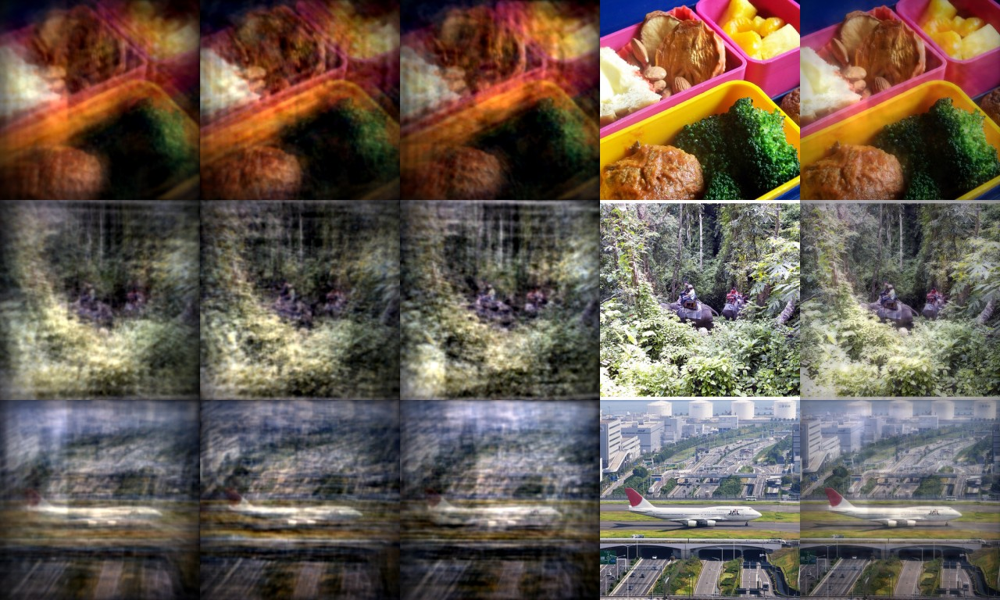

그림 1. 학습 장면 3개. 열은 마스크 0.5·0.7·0.8의 정렬된 Wiener 복원, 화면에 띄운 정답(COCO `sqcrop_1024`), 그리고 정렬을 확인하기 위해 0.5 입력과 정답을 50:50으로 섞은 이미지예요. 소스: `PrivacyLensless/register.py`, `PrivacyLensless/cache.py`; 산출물: `processed/privacy_lensless/recon{04,06,07}/`.

- **데이터:** 거리마다 3000쌍이고, 세 거리 모두 같은 정답 ID(00000–02999)를 써요.
- **분할:** 테스트 300장(seed 0 고정)이고, 거리와 해상도에 관계없이 같은 장면이에요.
- **정렬:** 거리마다 전역 어파인 변환 하나로 정답 좌표를 recon 픽셀에 맞췄어요. 블러를 준 정답과의 NCC가 최대가 되도록, 거친 단계부터 세밀한 단계로 맞췄어요.
  - 맞춘 변환은 거의 항등 변환이에요. 장면 크기는 약 252/256px(512에서는 506/512)이고, 회전은 4–11 mrad예요.
  - 평균 NCC는 recon이 0.79–0.82, raw가 0.65예요.
- **노출 정규화와 mixup은 쓰지 않았어요.** recon PNG는 장마다 밝기를 따로 정규화(0.1–99.8 퍼센타일)해서 저장돼, 장면 밝기에 더 이상 선형이 아니에요. 평균 밝기와 선형 정답의 상관이 0.79로, raw(0.966)보다 낮아요.

## 학습 설정

모든 런은 같은 설정을 쓰고, 마스크 거리·입력 해상도·시드만 바꿨어요.

- **모델:** NAFNet(기본 폭)이고, 거리마다 처음부터 학습했어요.
- **손실:** $\mathcal{L}=\mathrm{MSE}+0.05\,\mathrm{LPIPS}_{\mathrm{vgg}}+0.2\,\lVert\mathcal{F}(o)-\mathcal{F}(y)\rVert_1$이고, $\mathcal{F}$는 정규직교 2-D FFT예요.
  - raw 데이터에서는 FFT 항이 중간 대역 coherence를 0.24에서 0.35로 올렸어요(마스크 0.5).
- **옵티마이저:** AdamW(lr 2e-4, cosine 스케줄, 100 epoch 기준)이고, EMA 가중치(decay 0.999)를 써요.
- **배치 크기:** 256 해상도는 8, 512 해상도는 4예요.
- **체크포인트:** 테스트 PSNR이 가장 높은 epoch를 저장해요. 모든 런이 일찍 최고점을 찍고 과적합돼요. 256은 epoch 16–18, 512는 epoch 12–13이에요.

**대역 coherence**는 반경 주파수 대역마다 정답 디테일을 맞게 복원한 비율이에요. 흑백 이미지에 Hann 창을 씌워 계산해요.

$$C(f)=\frac{\left|\sum_{|k|\in f} F_o(k)\,F_g^*(k)\right|^2}{\sum_{|k|\in f}|F_o(k)|^2\;\sum_{|k|\in f}|F_g(k)|^2}$$

## 결과 1 — 256 해상도: 거리별 순서는 시드를 바꿔도 같다

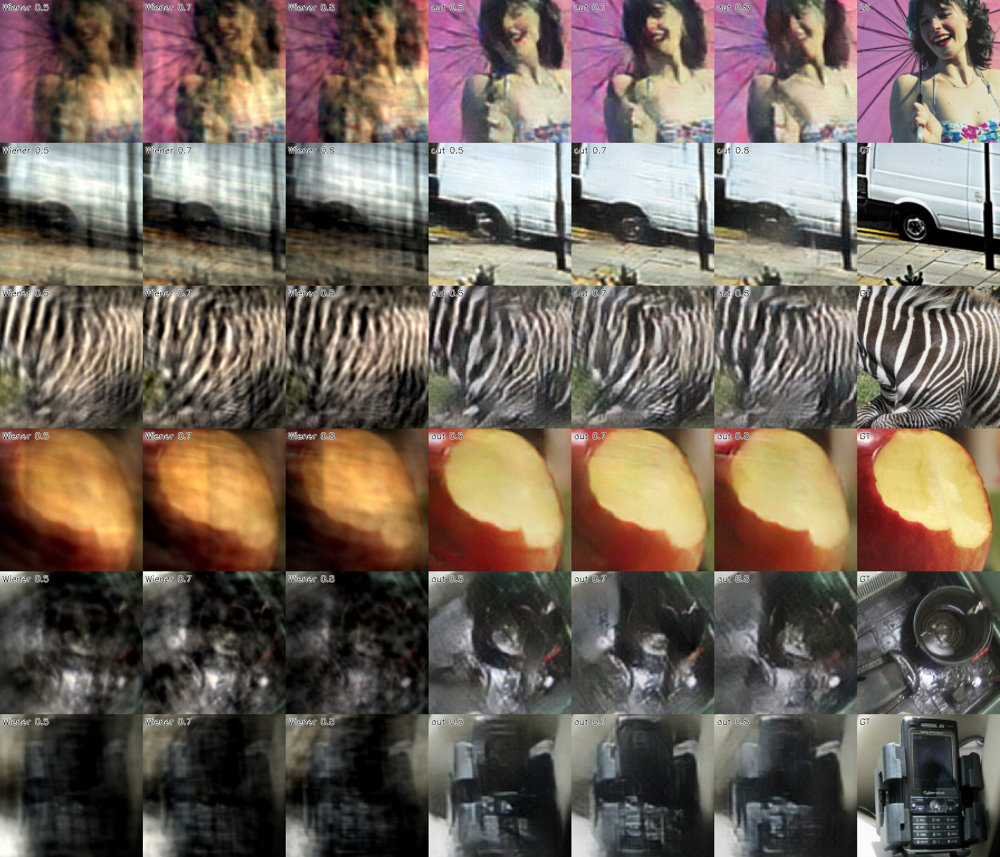

그림 2. 테스트 장면 6개의 중앙 확대(nearest 2배). 열은 Wiener 입력 0.5·0.7·0.8, 디코더 출력 0.5·0.7·0.8, 정답이에요. 소스: `PrivacyLensless/compare_recon.py`; 산출물: `outputs/PL_recon0{4,6,7}_naf-ef_20261107-174145/`.

- 우산살, 얼굴, 밴 바퀴, 얼룩말 줄무늬, 베어 문 사과 같은 큰 구조는 복원돼요.
- 글씨, 키패드, 머리카락 결은 어느 거리에서도 복원되지 않아요.

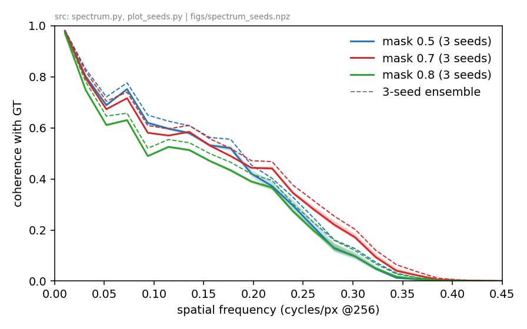

그림 3. 테스트 300장의 256 해상도 대역 coherence예요. 실선은 시드 3개 평균, 음영은 시드 간 최소–최대 범위, 점선은 시드 3개 출력의 평균이에요. 소스: `PrivacyLensless/spectrum.py`, `PrivacyLensless/plot_seeds.py`; 산출물: `figs/spectrum_seeds.npz`.

| 마스크 거리 | seed 0 | seed 1 | seed 2 | 평균 | 3시드 앙상블 |
|---|---|---|---|---|---|
| 0.5 | 21.17 | 21.15 | 21.21 | **21.18** | 21.52 |
| 0.7 | 20.88 | 20.85 | 20.93 | **20.89** | 21.22 |
| 0.8 | 20.38 | 20.35 | 20.44 | **20.39** | 20.71 |

256 해상도 테스트 PSNR(dB). 소스: `PrivacyLensless/ens_psnr.py`.

- **0.5 > 0.7 > 0.8 순서는 모든 시드에서 같아요.** 그림 3에서 시드 범위를 나타내는 음영이 거리 사이 차이보다 훨씬 좁아요.
- **0.8은 0.05–0.2 cycles/px에서 다른 두 거리보다 coherence가 0.05–0.1 낮아요.**
- **시드 3개의 출력을 평균하면 추가 학습 없이 PSNR이 +0.3 dB 오르고,** 모든 대역에서 coherence도 올라가요.
- **256에서는 0.22–0.33 cycles/px에서 0.7이 가장 높아요.** 그림 5에서 보듯 이 우위는 512에서 사라져요.

## 결과 2 — 512 해상도: 디테일이 늘고, 0.5 ≈ 0.7 > 0.8

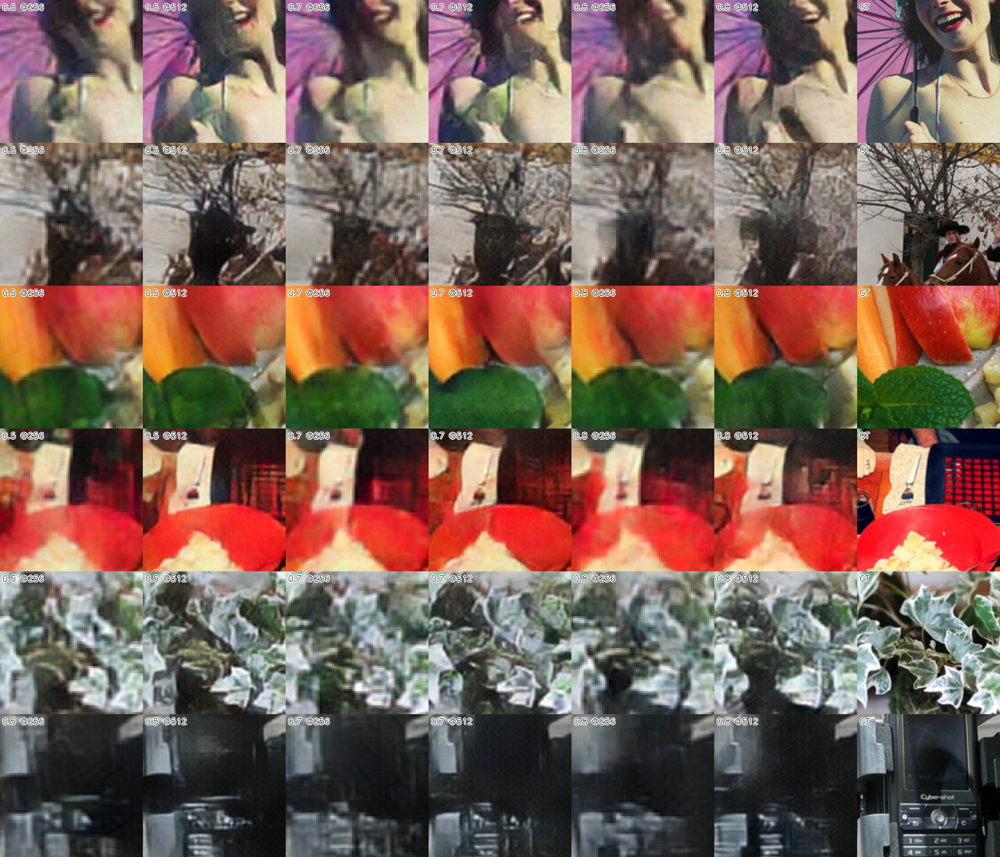

그림 4. 512 기준 중앙 160px 확대예요. 거리마다 256 디코더 출력(nearest 2배)과 512 디코더 출력을 나란히 두었고, 마지막 열은 정답이에요. 소스: `PrivacyLensless/zoom512.py`; 산출물: `weights/PL_recon512_0{4,6,7}_naf-ef_*.pth`.

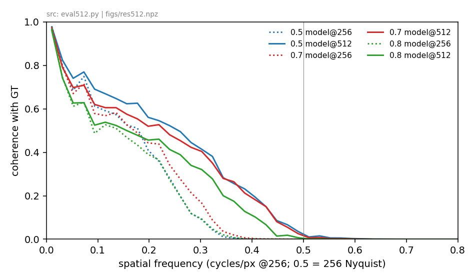

그림 5. 대역 coherence이고, 주파수는 256 격자 기준 cycles/px예요(0.5 = 256 나이퀴스트). 점선은 256 디코더, 실선은 512 디코더를 512 원본 해상도에서 평가한 결과예요. 소스: `PrivacyLensless/eval512.py`; 산출물: `figs/res512.npz`.

| 마스크 거리 | 256 디코더 | 512 디코더 → 256 | 512 디코더, 512 원본 |
|---|---|---|---|
| 0.5 | 21.17 / 0.605 | **21.62 / 0.639** | 21.11 |
| 0.7 | 20.88 / 0.599 | 20.84 / **0.609** | 20.41 |
| 0.8 | 20.38 / 0.573 | 20.27 / **0.577** | 19.87 |

PSNR(dB) / SSIM, seed 0. "512 디코더 → 256" 열은 512 출력을 면적 평균으로 줄여, 256 디코더와 같은 256 정답에 비교한 값이에요.

- **512 디코더는 세 거리 모두에서 디테일을 훨씬 많이 복원해요.**
  - coherence가 약 0.35가 아니라 약 0.45 cycles/px까지 이어져요.
  - 0.3 cycles/px에서 마스크 0.5는 0.10에서 0.40으로, 마스크 0.8은 0.10에서 0.32로 올라요.
  - 그림 4에서 담쟁이 잎 윤곽, 나뭇가지, 키패드 줄, 붓, 어깨끈은 512 출력에서만 보여요.
- **PSNR은 마스크 0.5에서만 올라요(+0.45 dB). 0.7과 0.8은 SSIM이 조금 오르고 PSNR은 그대로예요.** PSNR은 저주파에 좌우돼서 가는 디테일이 늘어도 거의 움직이지 않아요.
- **512에서 0.5와 0.7은 0.25 cycles/px 이상에서 같고, 그 아래에서는 0.5가 앞서요. 0.8은 0.1–0.45 cycles/px에서 0.05–0.1 낮아요.**

## 학습 순서대로 본 모든 디코더 — 전체 프레임과 중앙 확대

이 프로젝트에서 학습한 모든 디코더를 학습한 순서대로, 같은 배치로 그렸어요. 열은 마스크 거리마다 (입력, 출력)이고 마지막이 정답이에요. 행은 그림 2와 같은 테스트 장면 6개예요. 타일마다 원래 해상도를, 출력마다 장별 PSNR을 적었어요.

- **전체 프레임:** 512px 타일이에요. 512 런은 1:1로, 256 런은 nearest 2배로 표시했어요.
- **중앙 확대:** 프레임 중앙 50%를 256px 타일로 보여요. 512 런은 1:1(512px 중 256px), 256 런은 nearest 2배(256px 중 128px)예요.
- **정답:** COCO `sqcrop_1024` 정답을 런의 해상도로 면적 평균 축소한 이미지예요.
- **raw 런:** 마스크 0.8 데이터가 raw 런을 다 돌린 뒤에 들어와서, raw 런은 0.5와 0.7만 있어요.

| # | 시작 | 입력(해상도) | 런 | PSNR 0.5 | PSNR 0.7 | PSNR 0.8 |
|---|---|---|---|---|---|---|
| 1 | 11-06 08:04 | 센서 원본 5472×3648을 어파인 변환해 512×512로 | 이전 Wiener-NAF 체크포인트에서 이어서 학습한 NAFNet; 처음부터 학습하기로 해서 epoch 0 뒤 중단 | 18.22 (ep0) | 17.91 (ep0) | – |
| 2 | 11-06 08:13 | 센서 원본 5472×3648을 어파인 변환해 512×512로 | Restormer(트랜스포머), 배치 2; 느리고 NAFNet보다 뒤처져 epoch 5에서 중단 | 18.84 (ep5) | 18.34 (ep5) | – |
| 3 | 11-06 08:32 | 센서 원본 5472×3648을 어파인 변환해 512×512로 | NAFNet, 처음부터 학습(기준선) | 19.79 (ep15) | 19.18 (ep19) | – |
| 4 | 11-06 12:41 | 센서 원본 5472×3648을 어파인 변환해 512×512로 | CGNet(CascadedGaze), 처음부터 학습 | 19.73 (ep26) | 18.96 (ep14) | – |
| 5 | 11-07 02:14 | 센서 원본 5472×3648을 어파인 변환해 512×512로 | 과적합 대응용 경량 NAFNet(1.75M 파라미터); 과소적합 | 17.99 (ep27) | 17.70 (ep29) | – |
| 6 | 11-07 02:45 | 센서 원본 5472×3648을 어파인 변환해 512×512로 | 중간 크기 NAFNet(11.6M 파라미터); 여전히 기본 NAFNet보다 낮음 | 18.50 (ep15) | 18.10 (ep17) | – |
| 7 | 11-07 07:57 | 센서 원본 5472×3648을 어파인 변환해 512×512로 | NAFNet + 선형광 mixup(p 0.5) + EMA 0.999 | 20.10 (ep25) | 19.56 (ep23) | – |
| 8 | 11-07 07:57 | 센서 원본 5472×3648을 어파인 변환해 512×512로 | NAFNet + mixup + EMA + FFT 손실 0.2(raw 최고) | 20.19 (ep21) | 19.59 (ep23) | – |
| 9 | 11-07 17:41 | Wiener recon 256×256(nearest 2배로 표시) | NAFNet + EMA + FFT 손실, 256 Wiener recon | 21.17 (ep17) | 20.88 (ep16) | 20.38 (ep16) |
| 10 | 11-08 05:40 | Wiener recon 512×512 | 같은 설정, 512 Wiener recon, 배치 4 | 21.11 (ep13) | 20.41 (ep13) | 19.87 (ep11) |

각 런의 테스트 PSNR 최고 체크포인트(dB). raw와 512는 512에서, recon 256은 256에서 측정했어요. 소스: `PrivacyLensless/history_plot.py`; 산출물: `figs/history/runs.csv`.

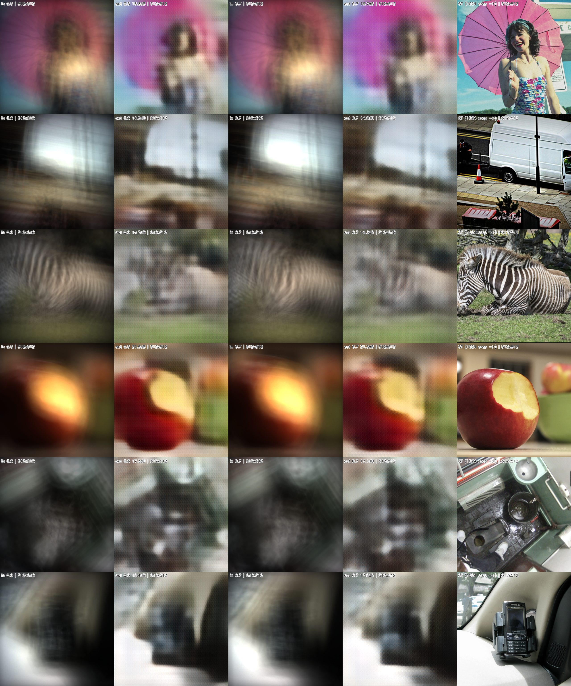

그림 H1a. 런 1, 전체 프레임: 이전 Wiener-NAF 체크포인트에서 이어서 학습한 NAFNet; 처음부터 학습하기로 해서 epoch 0 뒤 중단. 입력: 센서 원본 5472×3648을 어파인 변환해 512×512로. 체크포인트: `PL_04_naf_ft_20261106-080416.pth`, `PL_06_naf_ft_20261106-080416.pth`. 소스: `PrivacyLensless/history_plot.py`; 산출물: `figs/history/01_raw_naf_ft_full.jpg`.

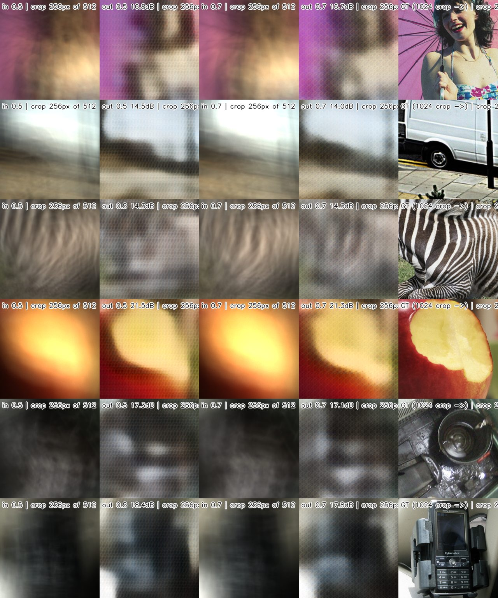

그림 H1b. 런 1, 중앙 확대: 이전 Wiener-NAF 체크포인트에서 이어서 학습한 NAFNet; 처음부터 학습하기로 해서 epoch 0 뒤 중단. 입력: 센서 원본 5472×3648을 어파인 변환해 512×512로. 체크포인트: `PL_04_naf_ft_20261106-080416.pth`, `PL_06_naf_ft_20261106-080416.pth`. 소스: `PrivacyLensless/history_plot.py`; 산출물: `figs/history/01_raw_naf_ft_crop.jpg`.

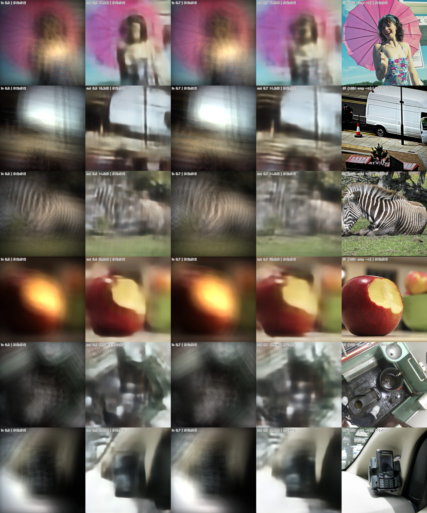

그림 H2a. 런 2, 전체 프레임: Restormer(트랜스포머), 배치 2; 느리고 NAFNet보다 뒤처져 epoch 5에서 중단. 입력: 센서 원본 5472×3648을 어파인 변환해 512×512로. 체크포인트: `PL_04_restormer_20261106-081330.pth`, `PL_06_restormer_20261106-081548.pth`. 소스: `PrivacyLensless/history_plot.py`; 산출물: `figs/history/02_raw_restormer_full.jpg`.

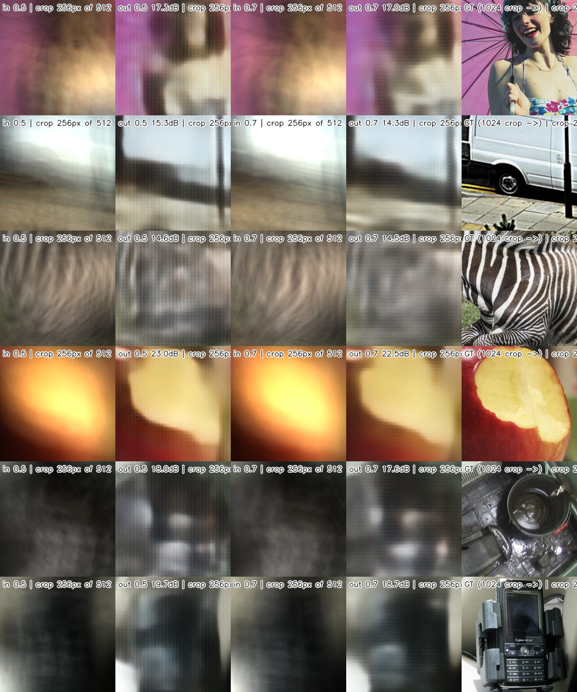

그림 H2b. 런 2, 중앙 확대: Restormer(트랜스포머), 배치 2; 느리고 NAFNet보다 뒤처져 epoch 5에서 중단. 입력: 센서 원본 5472×3648을 어파인 변환해 512×512로. 체크포인트: `PL_04_restormer_20261106-081330.pth`, `PL_06_restormer_20261106-081548.pth`. 소스: `PrivacyLensless/history_plot.py`; 산출물: `figs/history/02_raw_restormer_crop.jpg`.

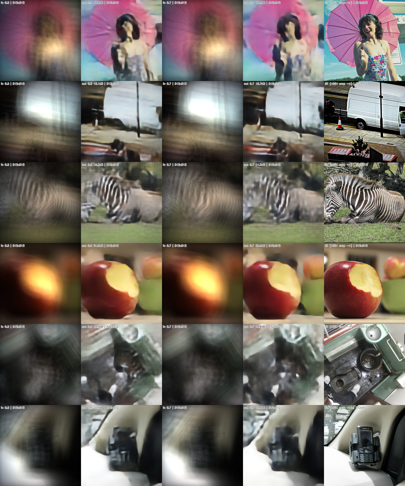

그림 H3a. 런 3, 전체 프레임: NAFNet, 처음부터 학습(기준선). 입력: 센서 원본 5472×3648을 어파인 변환해 512×512로. 체크포인트: `PL_04_naf_20261106-083210.pth`, `PL_06_naf_20261106-083210.pth`. 소스: `PrivacyLensless/history_plot.py`; 산출물: `figs/history/03_raw_naf_full.jpg`.

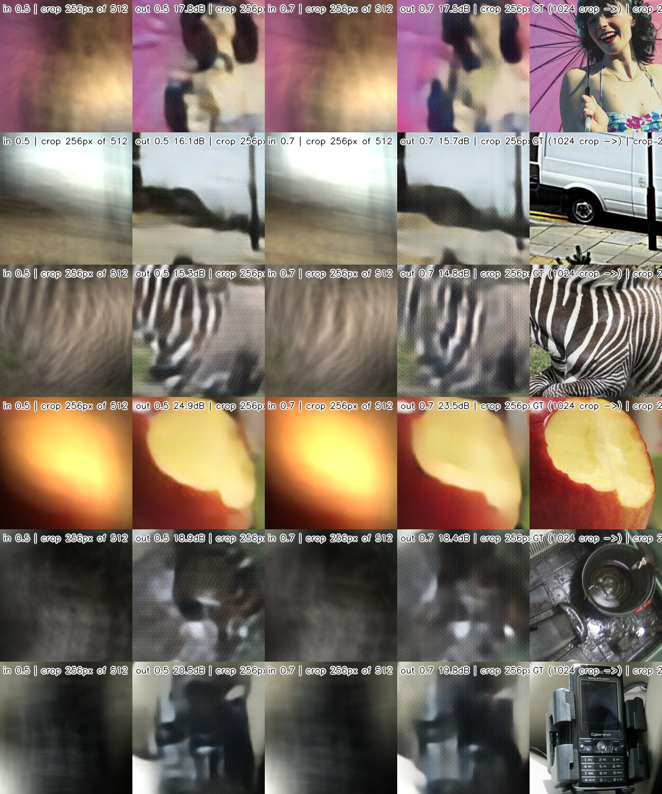

그림 H3b. 런 3, 중앙 확대: NAFNet, 처음부터 학습(기준선). 입력: 센서 원본 5472×3648을 어파인 변환해 512×512로. 체크포인트: `PL_04_naf_20261106-083210.pth`, `PL_06_naf_20261106-083210.pth`. 소스: `PrivacyLensless/history_plot.py`; 산출물: `figs/history/03_raw_naf_crop.jpg`.

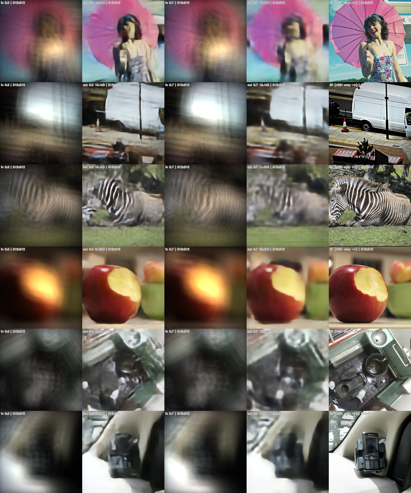

그림 H4a. 런 4, 전체 프레임: CGNet(CascadedGaze), 처음부터 학습. 입력: 센서 원본 5472×3648을 어파인 변환해 512×512로. 체크포인트: `PL_04_cgnet_20261106-124133.pth`, `PL_06_cgnet_20261106-124133.pth`. 소스: `PrivacyLensless/history_plot.py`; 산출물: `figs/history/04_raw_cgnet_full.jpg`.

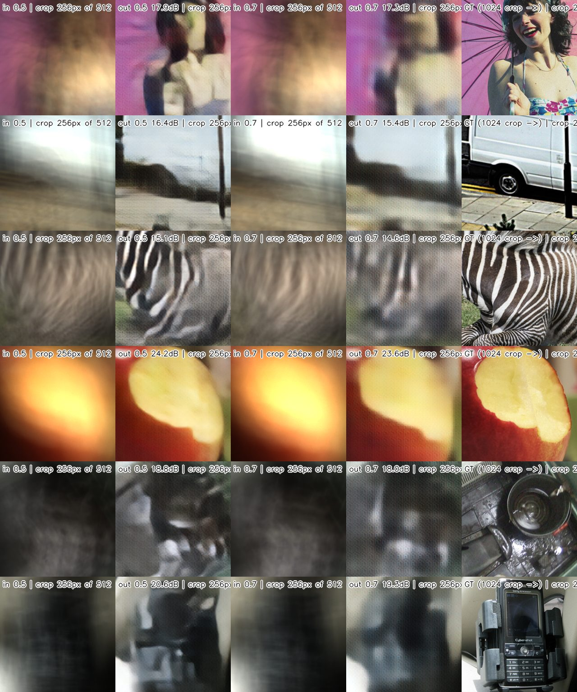

그림 H4b. 런 4, 중앙 확대: CGNet(CascadedGaze), 처음부터 학습. 입력: 센서 원본 5472×3648을 어파인 변환해 512×512로. 체크포인트: `PL_04_cgnet_20261106-124133.pth`, `PL_06_cgnet_20261106-124133.pth`. 소스: `PrivacyLensless/history_plot.py`; 산출물: `figs/history/04_raw_cgnet_crop.jpg`.

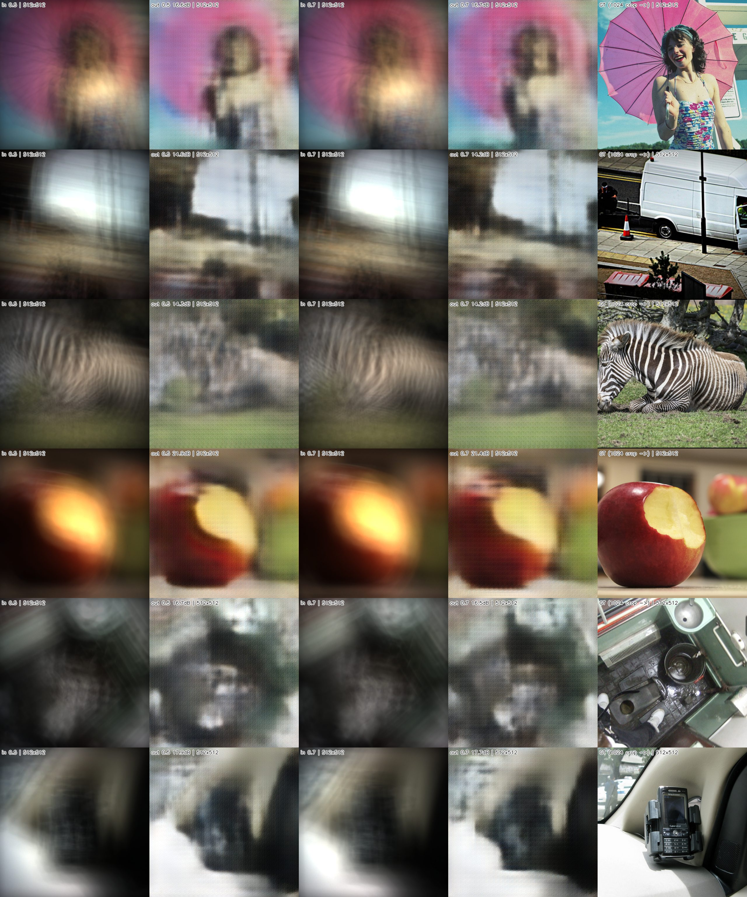

그림 H5a. 런 5, 전체 프레임: 과적합 대응용 경량 NAFNet(1.75M 파라미터); 과소적합. 입력: 센서 원본 5472×3648을 어파인 변환해 512×512로. 체크포인트: `PL_04_naf_s_20261107-021421.pth`, `PL_06_naf_s_20261107-021421.pth`. 소스: `PrivacyLensless/history_plot.py`; 산출물: `figs/history/05_raw_naf_s_full.jpg`.

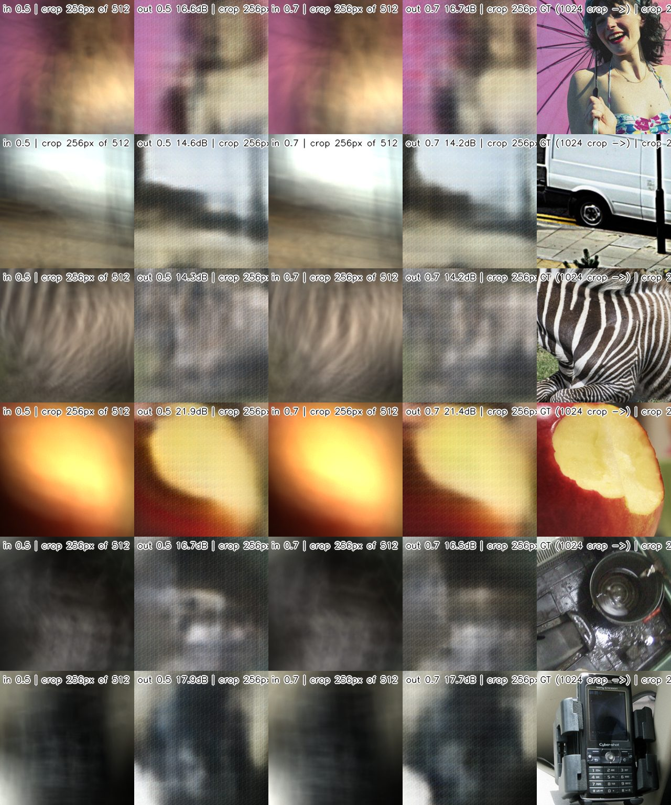

그림 H5b. 런 5, 중앙 확대: 과적합 대응용 경량 NAFNet(1.75M 파라미터); 과소적합. 입력: 센서 원본 5472×3648을 어파인 변환해 512×512로. 체크포인트: `PL_04_naf_s_20261107-021421.pth`, `PL_06_naf_s_20261107-021421.pth`. 소스: `PrivacyLensless/history_plot.py`; 산출물: `figs/history/05_raw_naf_s_crop.jpg`.

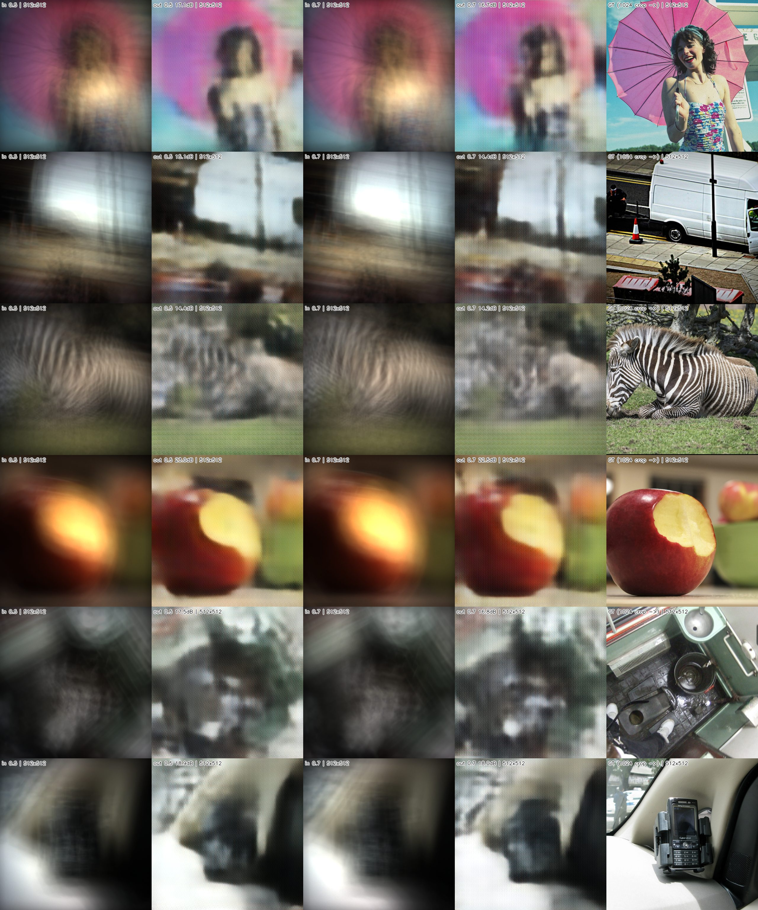

그림 H6a. 런 6, 전체 프레임: 중간 크기 NAFNet(11.6M 파라미터); 여전히 기본 NAFNet보다 낮음. 입력: 센서 원본 5472×3648을 어파인 변환해 512×512로. 체크포인트: `PL_04_naf_m_20261107-024530.pth`, `PL_06_naf_m_20261107-024530.pth`. 소스: `PrivacyLensless/history_plot.py`; 산출물: `figs/history/06_raw_naf_m_full.jpg`.

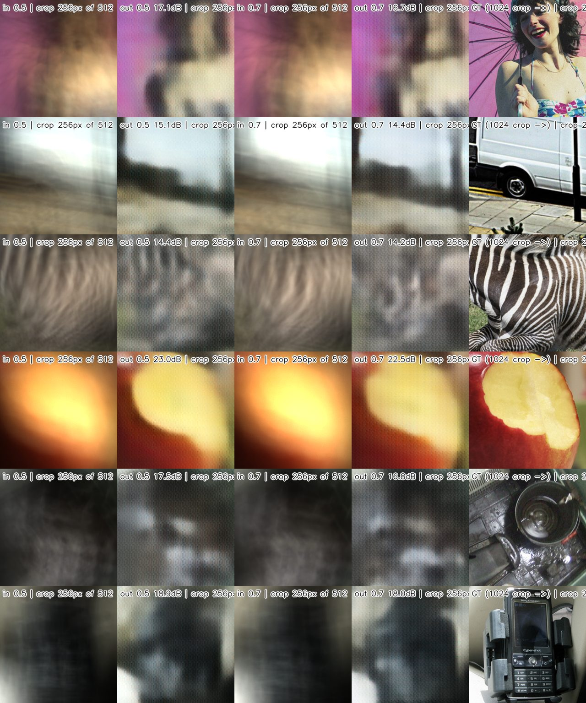

그림 H6b. 런 6, 중앙 확대: 중간 크기 NAFNet(11.6M 파라미터); 여전히 기본 NAFNet보다 낮음. 입력: 센서 원본 5472×3648을 어파인 변환해 512×512로. 체크포인트: `PL_04_naf_m_20261107-024530.pth`, `PL_06_naf_m_20261107-024530.pth`. 소스: `PrivacyLensless/history_plot.py`; 산출물: `figs/history/06_raw_naf_m_crop.jpg`.

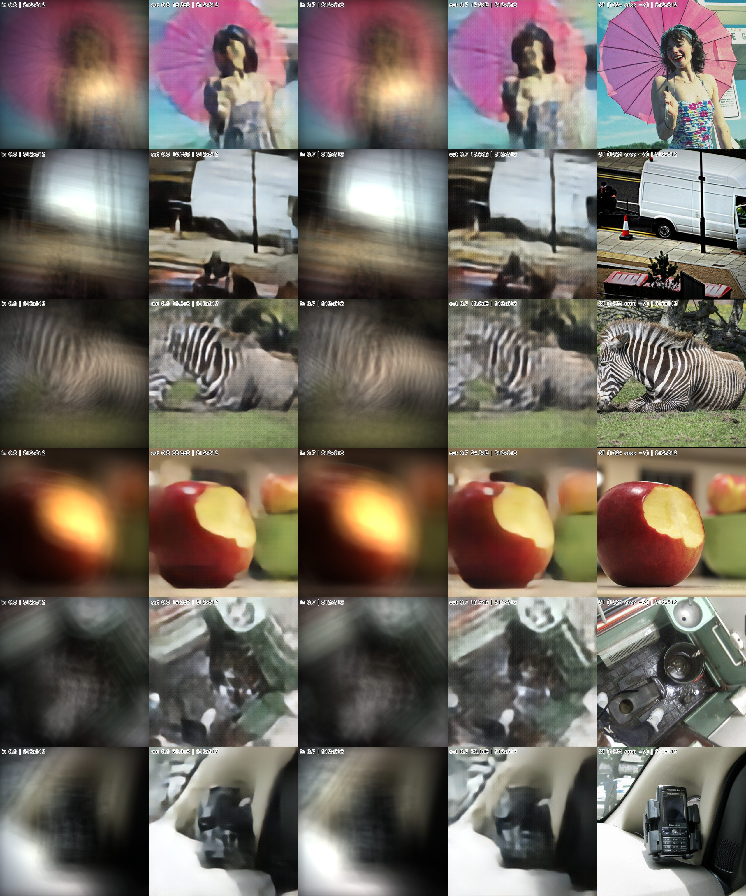

그림 H7a. 런 7, 전체 프레임: NAFNet + 선형광 mixup(p 0.5) + EMA 0.999. 입력: 센서 원본 5472×3648을 어파인 변환해 512×512로. 체크포인트: `PL_04_naf-me_20261107-075705.pth`, `PL_06_naf-me_20261107-075705.pth`. 소스: `PrivacyLensless/history_plot.py`; 산출물: `figs/history/07_raw_naf-me_full.jpg`.

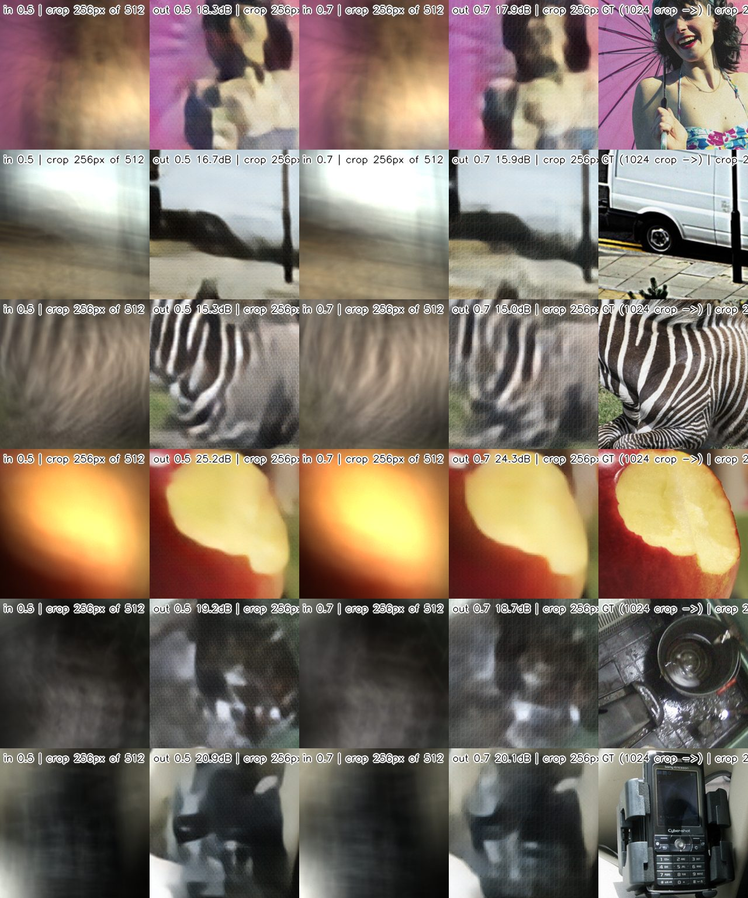

그림 H7b. 런 7, 중앙 확대: NAFNet + 선형광 mixup(p 0.5) + EMA 0.999. 입력: 센서 원본 5472×3648을 어파인 변환해 512×512로. 체크포인트: `PL_04_naf-me_20261107-075705.pth`, `PL_06_naf-me_20261107-075705.pth`. 소스: `PrivacyLensless/history_plot.py`; 산출물: `figs/history/07_raw_naf-me_crop.jpg`.

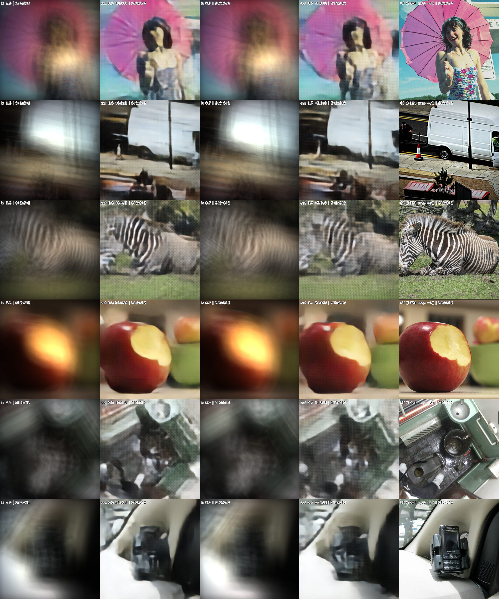

그림 H8a. 런 8, 전체 프레임: NAFNet + mixup + EMA + FFT 손실 0.2(raw 최고). 입력: 센서 원본 5472×3648을 어파인 변환해 512×512로. 체크포인트: `PL_04_naf-mef_20261107-075705.pth`, `PL_06_naf-mef_20261107-075705.pth`. 소스: `PrivacyLensless/history_plot.py`; 산출물: `figs/history/08_raw_naf-mef_full.jpg`.

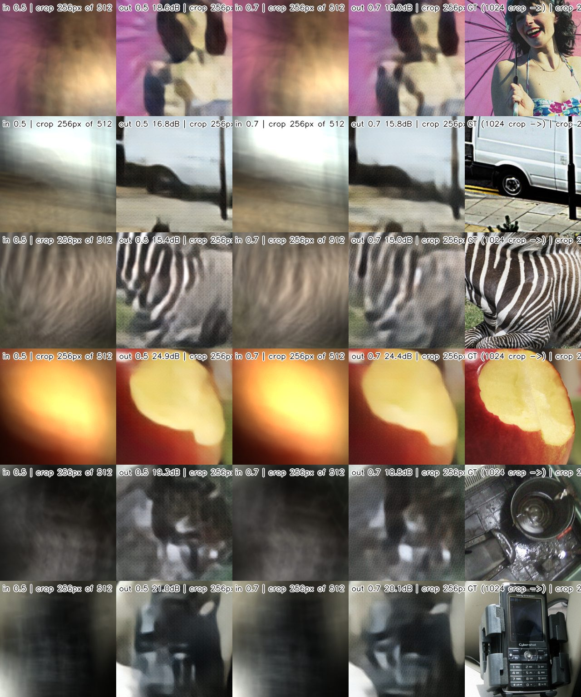

그림 H8b. 런 8, 중앙 확대: NAFNet + mixup + EMA + FFT 손실 0.2(raw 최고). 입력: 센서 원본 5472×3648을 어파인 변환해 512×512로. 체크포인트: `PL_04_naf-mef_20261107-075705.pth`, `PL_06_naf-mef_20261107-075705.pth`. 소스: `PrivacyLensless/history_plot.py`; 산출물: `figs/history/08_raw_naf-mef_crop.jpg`.

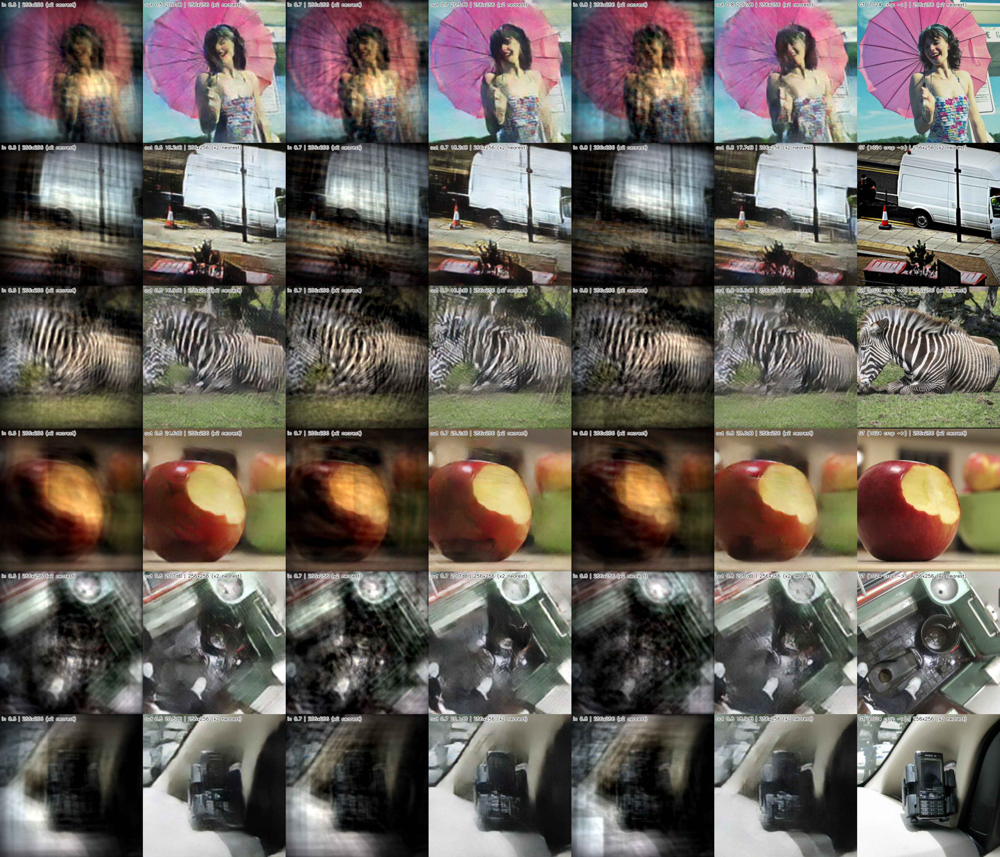

그림 H9a. 런 9, 전체 프레임: NAFNet + EMA + FFT 손실, 256 Wiener recon. 입력: Wiener recon 256×256(nearest 2배로 표시). 체크포인트: `PL_recon04_naf-ef_20261107-174145.pth`, `PL_recon06_naf-ef_20261107-174145.pth`, `PL_recon07_naf-ef_20261107-174145.pth`. 소스: `PrivacyLensless/history_plot.py`; 산출물: `figs/history/09_recon256_naf-ef_full.jpg`.

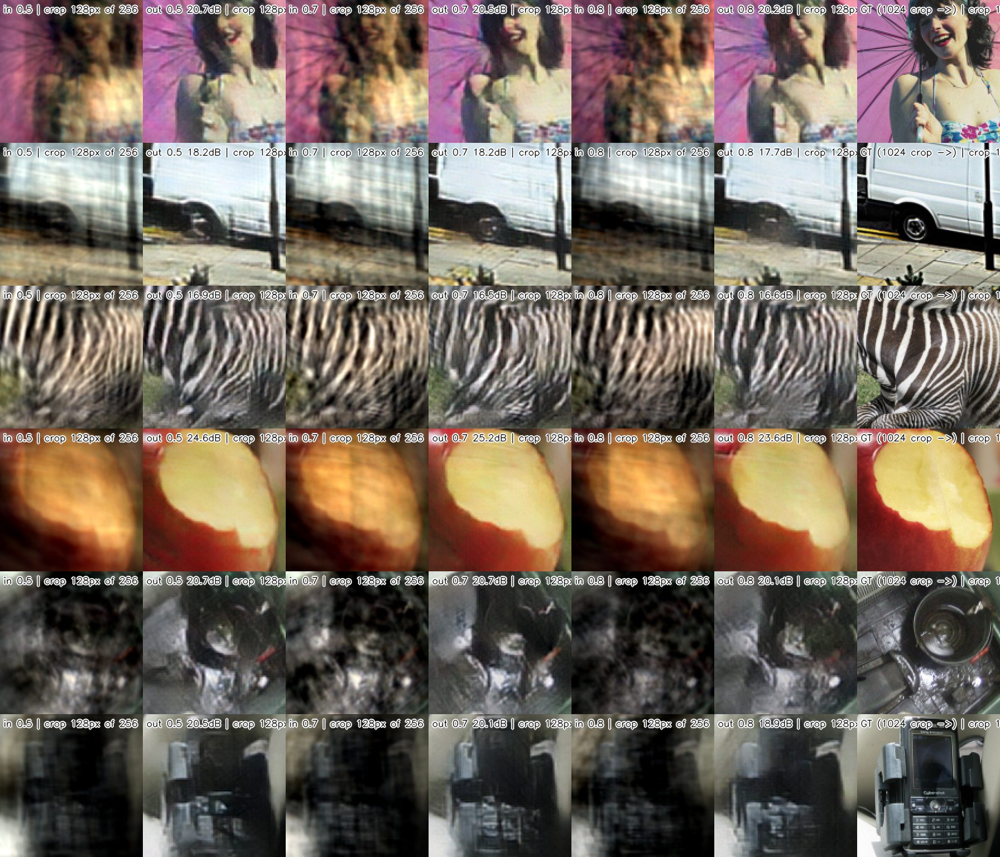

그림 H9b. 런 9, 중앙 확대: NAFNet + EMA + FFT 손실, 256 Wiener recon. 입력: Wiener recon 256×256(nearest 2배로 표시). 체크포인트: `PL_recon04_naf-ef_20261107-174145.pth`, `PL_recon06_naf-ef_20261107-174145.pth`, `PL_recon07_naf-ef_20261107-174145.pth`. 소스: `PrivacyLensless/history_plot.py`; 산출물: `figs/history/09_recon256_naf-ef_crop.jpg`.

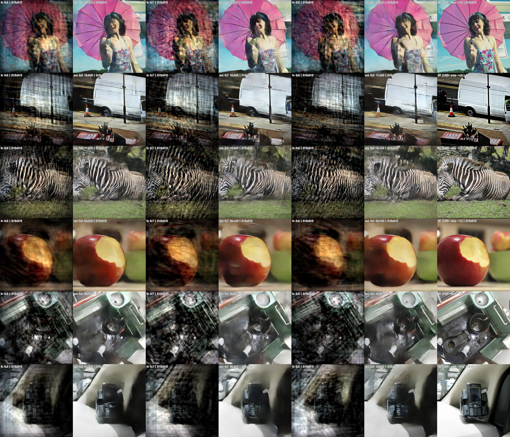

그림 H10a. 런 10, 전체 프레임: 같은 설정, 512 Wiener recon, 배치 4. 입력: Wiener recon 512×512. 체크포인트: `PL_recon512_04_naf-ef_20261108-054058.pth`, `PL_recon512_06_naf-ef_20261108-054058.pth`, `PL_recon512_07_naf-ef_20261108-054436.pth`. 소스: `PrivacyLensless/history_plot.py`; 산출물: `figs/history/10_recon512_naf-ef_full.jpg`.

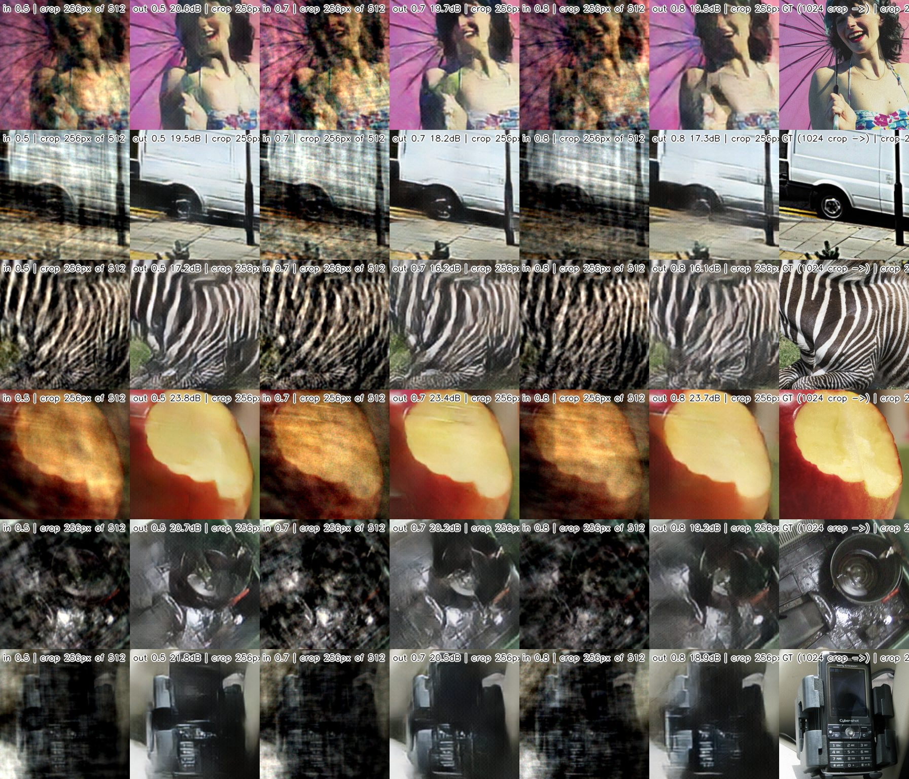

그림 H10b. 런 10, 중앙 확대: 같은 설정, 512 Wiener recon, 배치 4. 입력: Wiener recon 512×512. 체크포인트: `PL_recon512_04_naf-ef_20261108-054058.pth`, `PL_recon512_06_naf-ef_20261108-054058.pth`, `PL_recon512_07_naf-ef_20261108-054436.pth`. 소스: `PrivacyLensless/history_plot.py`; 산출물: `figs/history/10_recon512_naf-ef_crop.jpg`.

## 한계

- **512 결과는 시드 하나예요.** 배치 크기가 256 런과 다르고(4 vs 8), 최고점도 더 일러요(epoch 12–13).
- **모든 런이 최고점 이후 과적합돼요.** raw에서 쓸 수 있던 주된 정규화인 mixup은 recon 이미지가 비선형이라 쓸 수 없어요.
- **세 거리 모두 약 0.45 cycles/px 이상에서는 coherence가 0이에요.** 이 구성에서는 어느 거리에서도 글씨 수준의 디테일은 복원되지 않아요.

## 재현

```bash
cd PrivacyLensless
python register.py <captures_1014_DD> reg_recon512_DD.json <gpu> <recon_1014_DD_512> 1
python cache.py <captures_1014_DD> reg_recon512_DD.json <out>/recon512_DD <recon_1014_DD_512> 512
python train.py --data recon512_DD --model naf --bs 4 --norm none --ema 0.999 --fft 0.2 --suffix=-ef   # 256: --data reconDD --bs 8
python eval512.py <gpu>; python zoom512.py <gpu>
python spectrum.py <gpu> recon:04,06,07 s0=<stem> s1=<stem> s2=<stem> ens=<s0+s1+s2>; python plot_seeds.py
```

DD ∈ {04 (마스크 0.5), 06 (마스크 0.7), 07 (마스크 0.8)}. 파이프라인 래퍼는 `run512.sh`이고, 실행 기록은 W&B 프로젝트 `privacy-lensless-camera`에 있어요.
