# Privacy lensless camera: how much scene detail survives at mask distance 0.5, 0.7 and 0.8

## Bottom line

We trained one decoder per mask distance on captured Wiener reconstructions. Every decoder used the same architecture and recipe, started cold, and was scored on the same 300 held-out scenes.

- **Overall quality ranks 0.5 > 0.7 > 0.8.**
  - At 256 px the PSNR gap is 0.3 dB (0.5 vs 0.7) and 0.5 dB (0.7 vs 0.8). Across three seeds the spread is ±0.05 dB, so the ranking is not seed noise.
- **At 512 px, 0.5 and 0.7 recover fine detail equally well, and 0.8 recovers less across the whole mid and high band.**
- **Training on 512 recon instead of 256 extends recovered detail from about 0.35 to about 0.45 cycles/px.**
  - Frequencies are given on the 256 grid, where 0.5 is the Nyquist limit.
  - Coherence at 0.3 cycles/px rises from about 0.1 to 0.3–0.4.
- **One 256-px observation does not hold at 512.** At 256, 0.7 appeared to recover the finest detail best. At 512 that advantage disappears, so it most likely came from the 256 recon data, not from the optics.
- **Correction:** all earlier runs on this project were trained on the raw sensor captures, not on the Wiener reconstructions. The raw decoders reached 20.19 / 19.59 dB at 512, versus 21.62 / 20.84 dB for the recon decoders (512 outputs scored at 256).

## Data and alignment

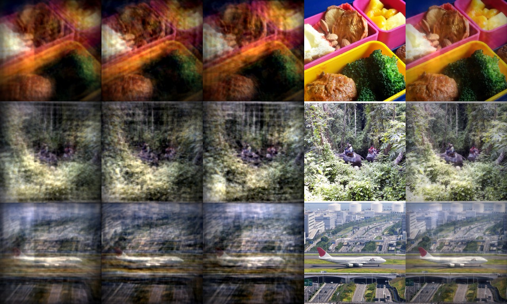

Figure 1. Three training scenes. Columns: aligned Wiener reconstructions at mask 0.5, 0.7 and 0.8; the displayed label (COCO `sqcrop_1024`); and a 50/50 blend of the 0.5 input with the label, to check alignment. Source: `PrivacyLensless/register.py`, `PrivacyLensless/cache.py`; artifact: `processed/privacy_lensless/recon{04,06,07}/`.

- **Data:** 3000 pairs per distance; the same label IDs (00000–02999) for all three distances.
- **Split:** 300 test scenes with fixed seed 0, identical across distances and resolutions.
- **Alignment:** one global affine per distance maps label coordinates to recon pixels. It is fitted by maximizing NCC against a Gaussian-blurred label, coarse to fine.
  - The fitted transform is close to identity. The scene spans about 252/256 px (506/512 at 512), with rotation of 4–11 mrad.
  - Mean NCC is 0.79–0.82 for recon, versus 0.65 for raw.
- **No exposure normalization and no mixup.** The recon PNGs were saved with per-image display normalization (0.1–99.8 percentile), so they are no longer linear in scene light. The correlation of mean brightness with the linear label is 0.79, versus 0.966 for raw.

## Training recipe

Every run uses the same recipe; only the mask distance, the input resolution and the seed change.

- **Model:** NAFNet (default width), trained from scratch for each distance.
- **Loss:** $\mathcal{L}=\mathrm{MSE}+0.05\,\mathrm{LPIPS}_{\mathrm{vgg}}+0.2\,\lVert\mathcal{F}(o)-\mathcal{F}(y)\rVert_1$, where $\mathcal{F}$ is the orthonormal 2-D FFT.
  - On raw captures, the FFT term raised mid-band coherence from 0.24 to 0.35 (mask 0.5).
- **Optimizer:** AdamW (lr 2e-4, cosine schedule, 100-epoch horizon), with EMA weights at decay 0.999.
- **Batch size:** 8 at 256 px, 4 at 512 px.
- **Checkpoint:** the best test-PSNR epoch is kept. Every run peaks early and then overfits: epoch 16–18 at 256 px, epoch 12–13 at 512 px.

**Band coherence** measures the fraction of ground-truth detail reproduced correctly in each radial frequency band. It is computed on grayscale images with a Hann window:

$$C(f)=\frac{\left|\sum_{|k|\in f} F_o(k)\,F_g^*(k)\right|^2}{\sum_{|k|\in f}|F_o(k)|^2\;\sum_{|k|\in f}|F_g(k)|^2}$$

## Result 1 — 256 px: mask distance ranking is stable across seeds

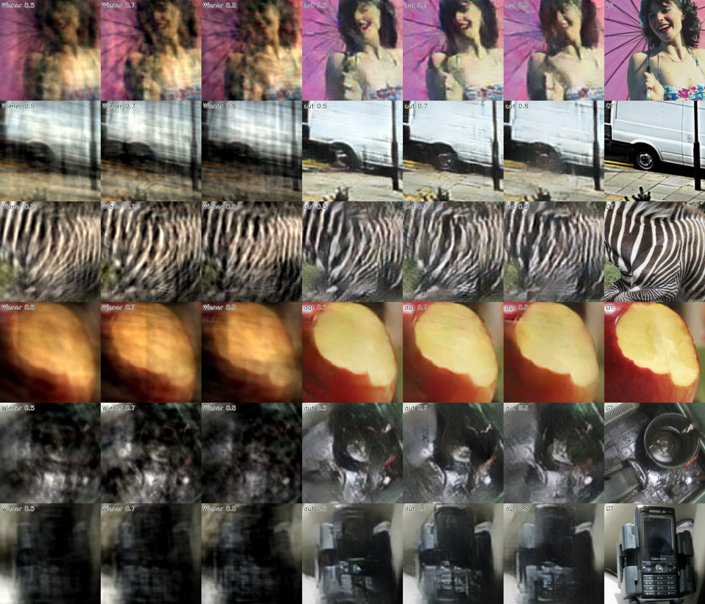

Figure 2. Center crops (2× nearest) of six test scenes. Columns: Wiener input at 0.5, 0.7 and 0.8, decoder output at 0.5, 0.7 and 0.8, and ground truth. Source: `PrivacyLensless/compare_recon.py`; artifact: `outputs/PL_recon0{4,6,7}_naf-ef_20261107-174145/`.

- The decoders recover the coarse structure: umbrella ribs, faces, the van wheel, zebra stripes and the bitten apple.
- They do not recover text, the keypad or hair strands at any distance.

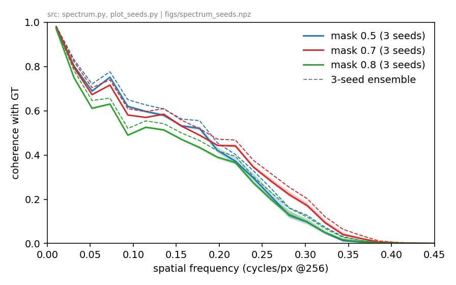

Figure 3. Band coherence on the 300 test scenes at 256 px. Solid line: mean of three seeds; shaded band: min–max across seeds; dashed line: output average of the three seeds. Source: `PrivacyLensless/spectrum.py`, `PrivacyLensless/plot_seeds.py`; artifact: `figs/spectrum_seeds.npz`.

| Mask | seed 0 | seed 1 | seed 2 | mean | 3-seed ensemble |
|---|---|---|---|---|---|
| 0.5 | 21.17 | 21.15 | 21.21 | **21.18** | 21.52 |
| 0.7 | 20.88 | 20.85 | 20.93 | **20.89** | 21.22 |
| 0.8 | 20.38 | 20.35 | 20.44 | **20.39** | 20.71 |

Test PSNR (dB) at 256 px. Source: `PrivacyLensless/ens_psnr.py`.

- **The ranking 0.5 > 0.7 > 0.8 holds for every seed.** The shaded seed bands in Figure 3 are much narrower than the gaps between distances.
- **0.8 is below the other two from 0.05 to 0.2 cycles/px,** by 0.05–0.1 in coherence.
- **Averaging the three seeds' outputs adds +0.3 dB** and raises coherence in every band, with no extra training.
- **At 256, mask 0.7 is highest between 0.22 and 0.33 cycles/px.** Figure 5 shows that this does not survive at 512.

## Result 2 — 512 px: more recovered detail; 0.5 ≈ 0.7 > 0.8

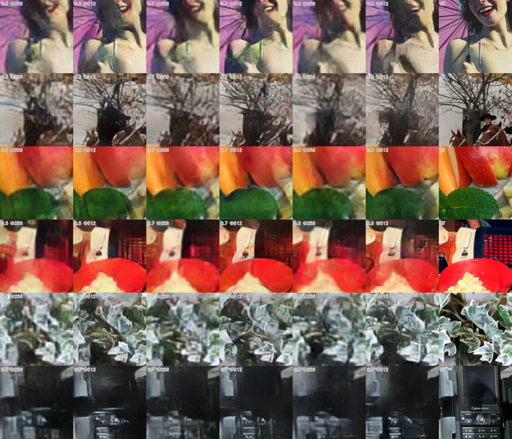

Figure 4. Center 160-px crops at 512. For each mask distance: the 256-px decoder output (nearest 2×), then the 512-px decoder output; the last column is ground truth. Source: `PrivacyLensless/zoom512.py`; artifact: `weights/PL_recon512_0{4,6,7}_naf-ef_*.pth`.

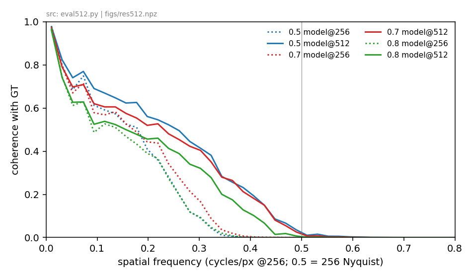

Figure 5. Band coherence, with frequency in cycles/px on the 256 grid (0.5 = 256 Nyquist). Dotted line: 256-px decoder; solid line: 512-px decoder scored at native 512. Source: `PrivacyLensless/eval512.py`; artifact: `figs/res512.npz`.

| Mask | 256 decoder | 512 decoder → 256 | 512 decoder, native 512 |
|---|---|---|---|
| 0.5 | 21.17 / 0.605 | **21.62 / 0.639** | 21.11 |
| 0.7 | 20.88 / 0.599 | 20.84 / **0.609** | 20.41 |
| 0.8 | 20.38 / 0.573 | 20.27 / **0.577** | 19.87 |

PSNR (dB) / SSIM, seed 0. In the "512 decoder → 256" column, the 512 output is area-downsampled and scored against the same 256 label as the 256 decoder.

- **The 512 decoders recover much more detail at every distance.**
  - Coherence now extends to about 0.45 cycles/px instead of about 0.35.
  - At 0.3 cycles/px it rises from 0.10 to 0.40 for mask 0.5, and from 0.10 to 0.32 for mask 0.8.
  - In Figure 4, ivy-leaf outlines, branches, keypad rows, the brush and the shoulder strap appear only in the 512 outputs.
- **PSNR improves only for mask 0.5 (+0.45 dB). For 0.7 and 0.8, SSIM rises slightly while PSNR stays flat.** PSNR is dominated by low frequencies, so gains in fine detail barely change it.
- **At 512, 0.5 and 0.7 coincide above 0.25 cycles/px, and 0.5 leads below that. 0.8 is lower by 0.05–0.1 from 0.1 to 0.45 cycles/px.**

## All decoders in training order — full frame and center crop

Every decoder trained in this project, in the order it was trained, drawn in one fixed layout. Columns: (input, output) for each mask distance, then ground truth. Rows: the same six test scenes as Figure 2. Each tile states its native resolution and each output its per-image PSNR.

- **Full frame:** 512-px tiles. 512-px runs are shown 1:1; 256-px runs are shown ×2 nearest.
- **Center crop:** the central 50% of the frame on 256-px tiles. 512-px runs are shown 1:1 (256 of 512 px); 256-px runs are shown ×2 nearest (128 of 256 px).
- **Ground truth:** the COCO `sqcrop_1024` label, area-downsampled to the run's resolution.
- **Raw runs:** the mask 0.8 data arrived after the raw runs, so they cover only 0.5 and 0.7.

| # | Started | Input (resolution) | Run | PSNR 0.5 | PSNR 0.7 | PSNR 0.8 |
|---|---|---|---|---|---|---|
| 1 | 11-06 08:04 | raw sensor capture 5472×3648, affine-warped to 512×512 | NAFNet fine-tuned from an earlier Wiener-NAF checkpoint; stopped after epoch 0 when cold start was required | 18.22 (ep0) | 17.91 (ep0) | – |
| 2 | 11-06 08:13 | raw sensor capture 5472×3648, affine-warped to 512×512 | Restormer (transformer), batch 2; stopped at epoch 5 (slow, behind NAFNet) | 18.84 (ep5) | 18.34 (ep5) | – |
| 3 | 11-06 08:32 | raw sensor capture 5472×3648, affine-warped to 512×512 | NAFNet, cold start (baseline) | 19.79 (ep15) | 19.18 (ep19) | – |
| 4 | 11-06 12:41 | raw sensor capture 5472×3648, affine-warped to 512×512 | CGNet (CascadedGaze), cold start | 19.73 (ep26) | 18.96 (ep14) | – |
| 5 | 11-07 02:14 | raw sensor capture 5472×3648, affine-warped to 512×512 | light NAFNet (1.75M params) against overfitting; underfits | 17.99 (ep27) | 17.70 (ep29) | – |
| 6 | 11-07 02:45 | raw sensor capture 5472×3648, affine-warped to 512×512 | mid NAFNet (11.6M params); still below full NAFNet | 18.50 (ep15) | 18.10 (ep17) | – |
| 7 | 11-07 07:57 | raw sensor capture 5472×3648, affine-warped to 512×512 | NAFNet + linear-light mixup (p 0.5) + EMA 0.999 | 20.10 (ep25) | 19.56 (ep23) | – |
| 8 | 11-07 07:57 | raw sensor capture 5472×3648, affine-warped to 512×512 | NAFNet + mixup + EMA + FFT loss 0.2 (best raw) | 20.19 (ep21) | 19.59 (ep23) | – |
| 9 | 11-07 17:41 | Wiener recon 256×256 (shown ×2 nearest) | NAFNet + EMA + FFT loss, on Wiener recon at 256 | 21.17 (ep17) | 20.88 (ep16) | 20.38 (ep16) |
| 10 | 11-08 05:40 | Wiener recon 512×512 | same recipe on Wiener recon at 512, batch 4 | 21.11 (ep13) | 20.41 (ep13) | 19.87 (ep11) |

Best test-PSNR checkpoint of each run (dB). Raw and 512 PSNR are measured at 512, recon-256 at 256. Source: `PrivacyLensless/history_plot.py`; artifact: `figs/history/runs.csv`.

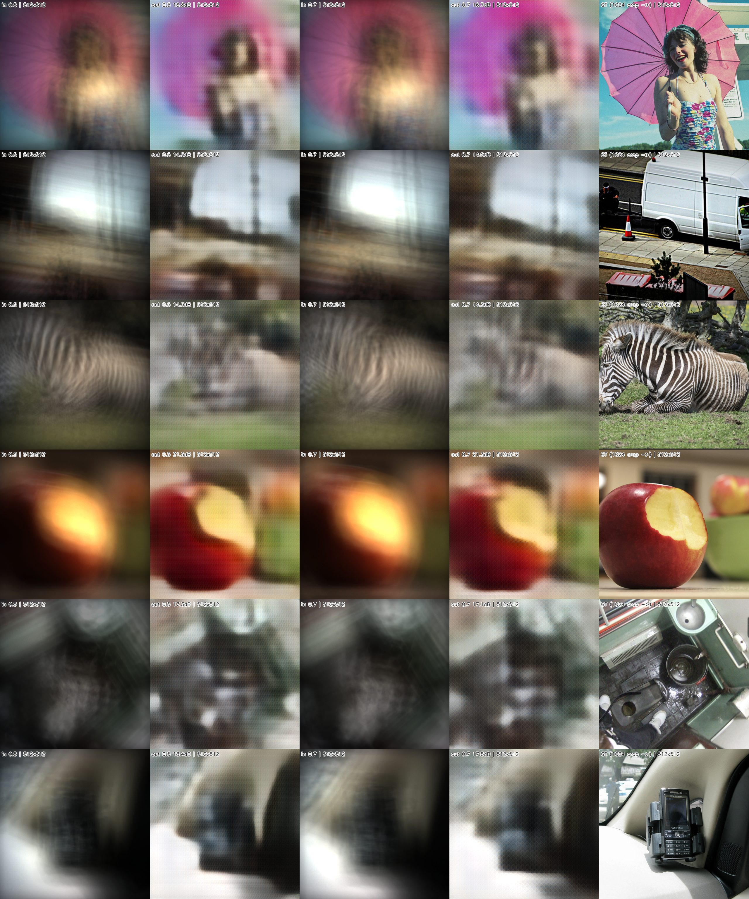

Figure H1a. Run 1, full frame: NAFNet fine-tuned from an earlier Wiener-NAF checkpoint; stopped after epoch 0 when cold start was required. Input: raw sensor capture 5472×3648, affine-warped to 512×512. Checkpoints: `PL_04_naf_ft_20261106-080416.pth`, `PL_06_naf_ft_20261106-080416.pth`. Source: `PrivacyLensless/history_plot.py`; artifact: `figs/history/01_raw_naf_ft_full.jpg`.

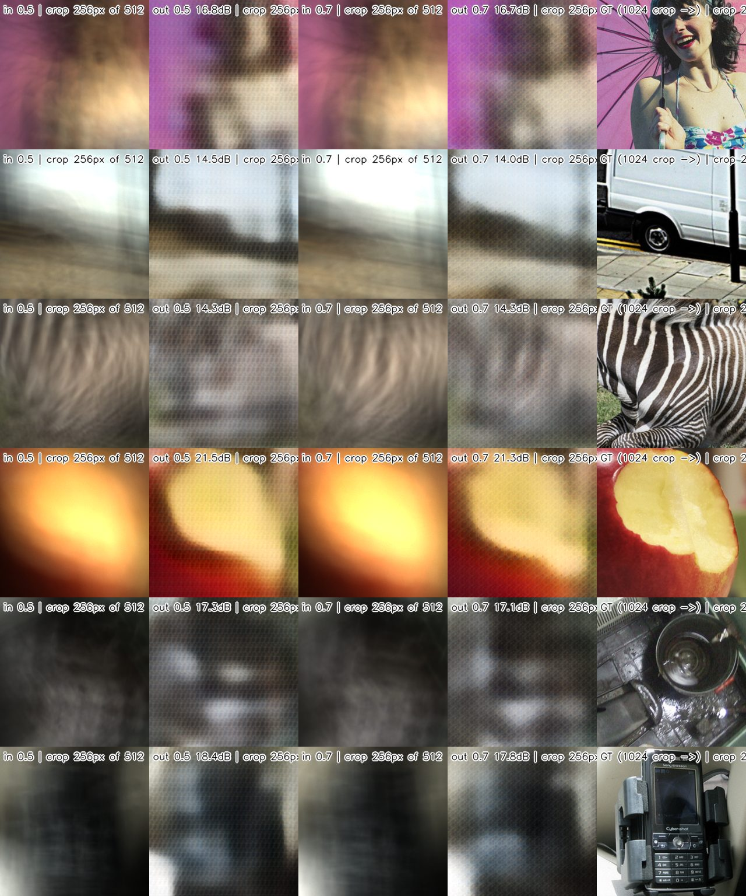

Figure H1b. Run 1, center crop: NAFNet fine-tuned from an earlier Wiener-NAF checkpoint; stopped after epoch 0 when cold start was required. Input: raw sensor capture 5472×3648, affine-warped to 512×512. Checkpoints: `PL_04_naf_ft_20261106-080416.pth`, `PL_06_naf_ft_20261106-080416.pth`. Source: `PrivacyLensless/history_plot.py`; artifact: `figs/history/01_raw_naf_ft_crop.jpg`.

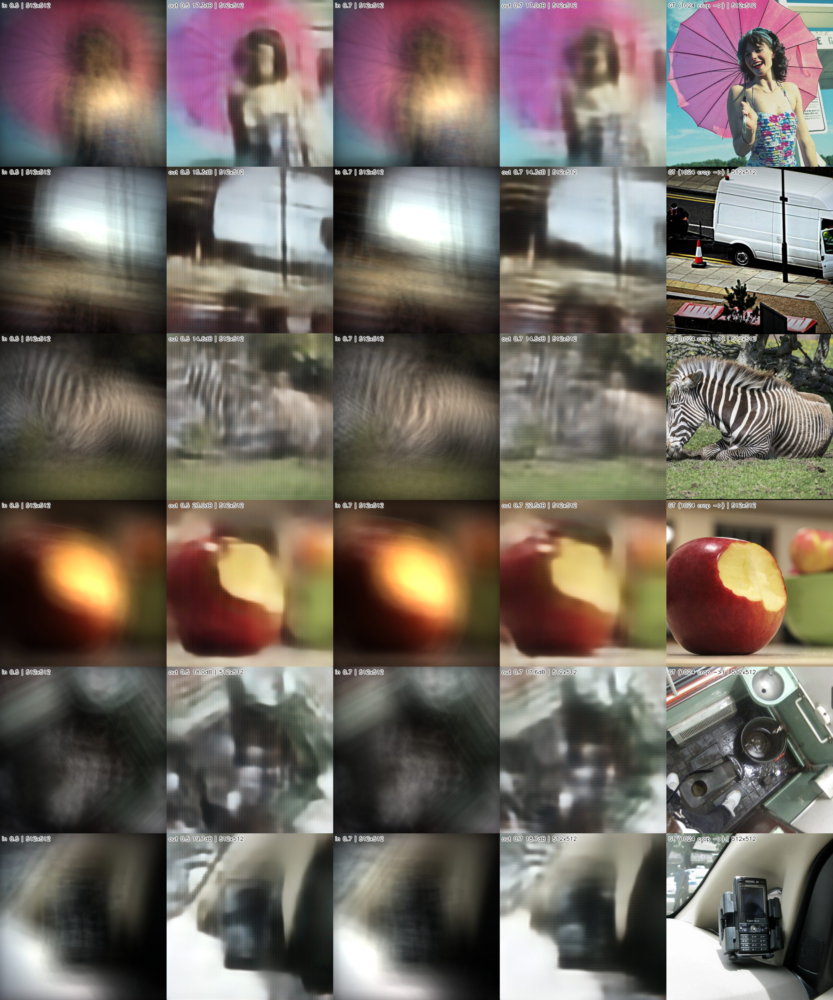

Figure H2a. Run 2, full frame: Restormer (transformer), batch 2; stopped at epoch 5 (slow, behind NAFNet). Input: raw sensor capture 5472×3648, affine-warped to 512×512. Checkpoints: `PL_04_restormer_20261106-081330.pth`, `PL_06_restormer_20261106-081548.pth`. Source: `PrivacyLensless/history_plot.py`; artifact: `figs/history/02_raw_restormer_full.jpg`.

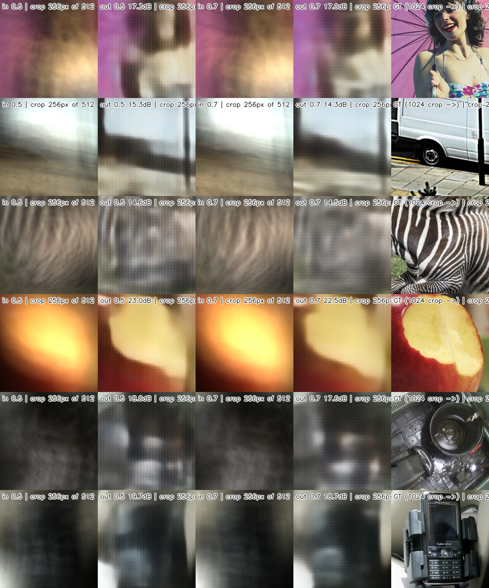

Figure H2b. Run 2, center crop: Restormer (transformer), batch 2; stopped at epoch 5 (slow, behind NAFNet). Input: raw sensor capture 5472×3648, affine-warped to 512×512. Checkpoints: `PL_04_restormer_20261106-081330.pth`, `PL_06_restormer_20261106-081548.pth`. Source: `PrivacyLensless/history_plot.py`; artifact: `figs/history/02_raw_restormer_crop.jpg`.

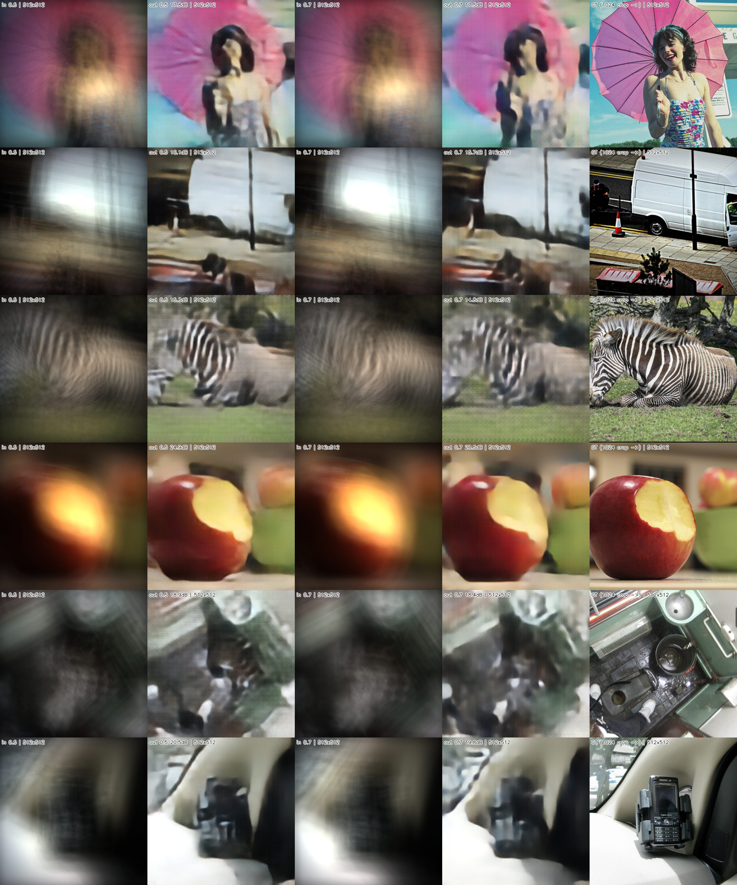

Figure H3a. Run 3, full frame: NAFNet, cold start (baseline). Input: raw sensor capture 5472×3648, affine-warped to 512×512. Checkpoints: `PL_04_naf_20261106-083210.pth`, `PL_06_naf_20261106-083210.pth`. Source: `PrivacyLensless/history_plot.py`; artifact: `figs/history/03_raw_naf_full.jpg`.

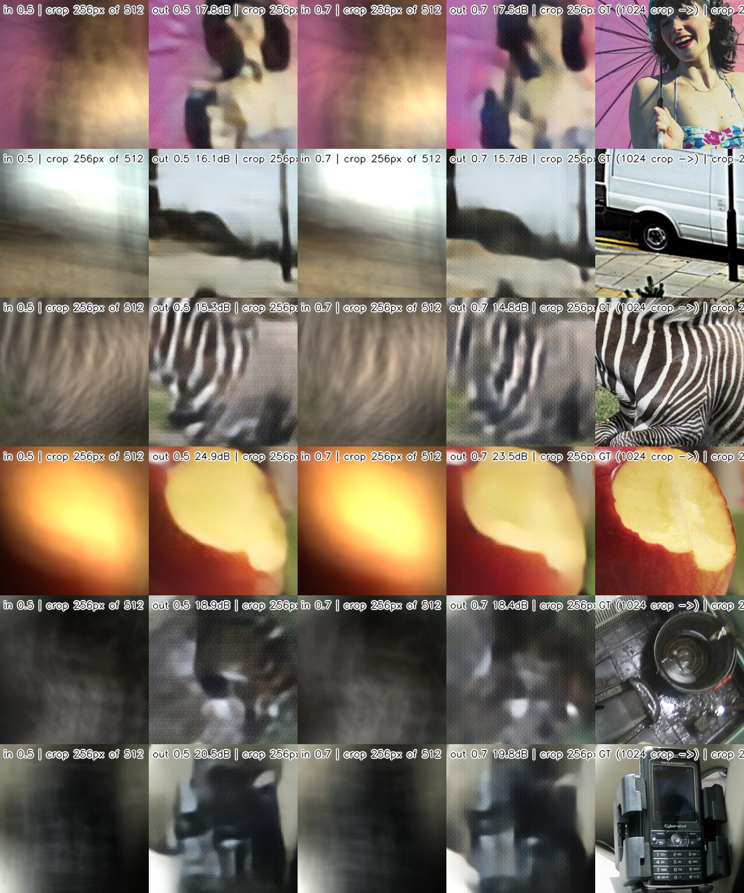

Figure H3b. Run 3, center crop: NAFNet, cold start (baseline). Input: raw sensor capture 5472×3648, affine-warped to 512×512. Checkpoints: `PL_04_naf_20261106-083210.pth`, `PL_06_naf_20261106-083210.pth`. Source: `PrivacyLensless/history_plot.py`; artifact: `figs/history/03_raw_naf_crop.jpg`.

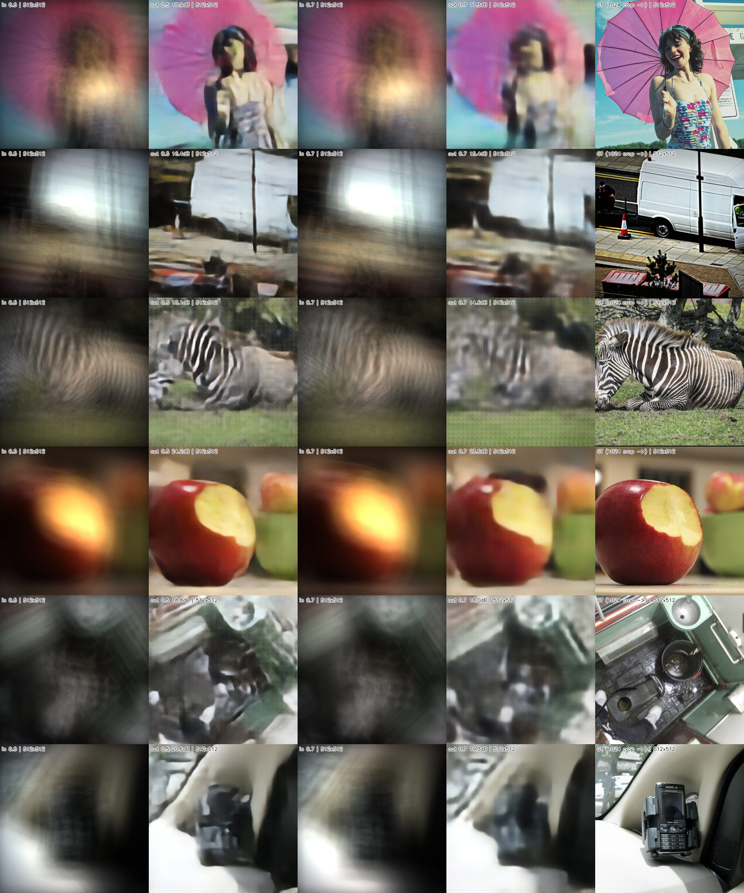

Figure H4a. Run 4, full frame: CGNet (CascadedGaze), cold start. Input: raw sensor capture 5472×3648, affine-warped to 512×512. Checkpoints: `PL_04_cgnet_20261106-124133.pth`, `PL_06_cgnet_20261106-124133.pth`. Source: `PrivacyLensless/history_plot.py`; artifact: `figs/history/04_raw_cgnet_full.jpg`.

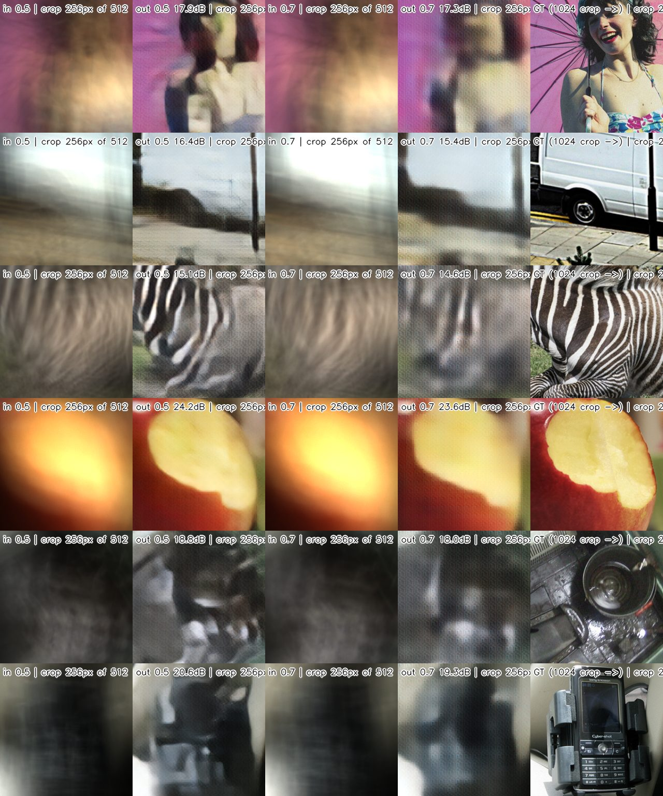

Figure H4b. Run 4, center crop: CGNet (CascadedGaze), cold start. Input: raw sensor capture 5472×3648, affine-warped to 512×512. Checkpoints: `PL_04_cgnet_20261106-124133.pth`, `PL_06_cgnet_20261106-124133.pth`. Source: `PrivacyLensless/history_plot.py`; artifact: `figs/history/04_raw_cgnet_crop.jpg`.

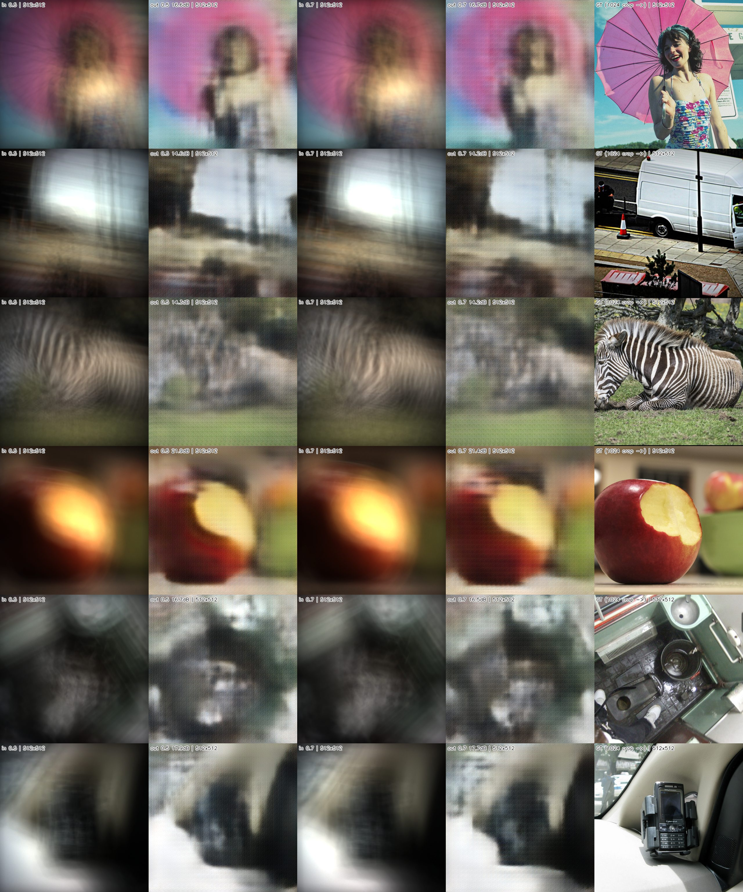

Figure H5a. Run 5, full frame: light NAFNet (1.75M params) against overfitting; underfits. Input: raw sensor capture 5472×3648, affine-warped to 512×512. Checkpoints: `PL_04_naf_s_20261107-021421.pth`, `PL_06_naf_s_20261107-021421.pth`. Source: `PrivacyLensless/history_plot.py`; artifact: `figs/history/05_raw_naf_s_full.jpg`.

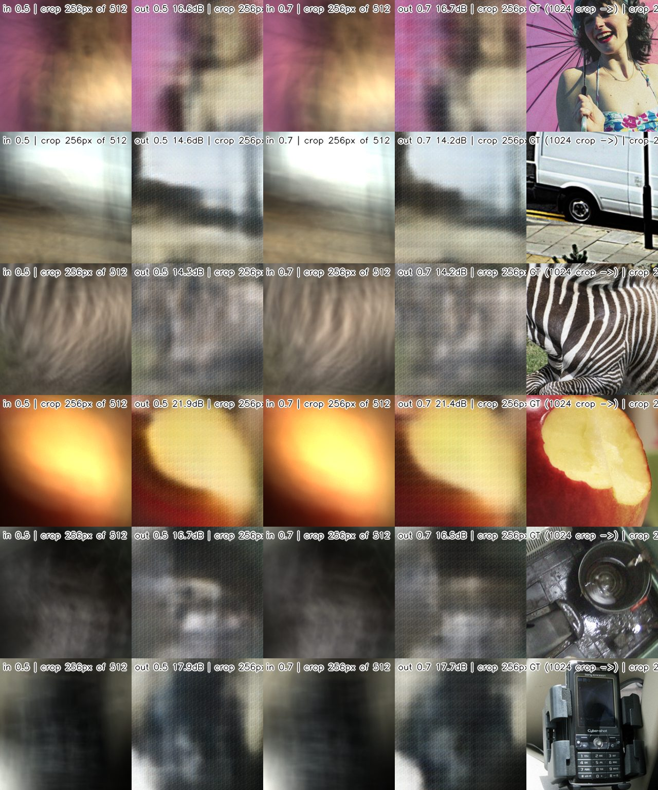

Figure H5b. Run 5, center crop: light NAFNet (1.75M params) against overfitting; underfits. Input: raw sensor capture 5472×3648, affine-warped to 512×512. Checkpoints: `PL_04_naf_s_20261107-021421.pth`, `PL_06_naf_s_20261107-021421.pth`. Source: `PrivacyLensless/history_plot.py`; artifact: `figs/history/05_raw_naf_s_crop.jpg`.

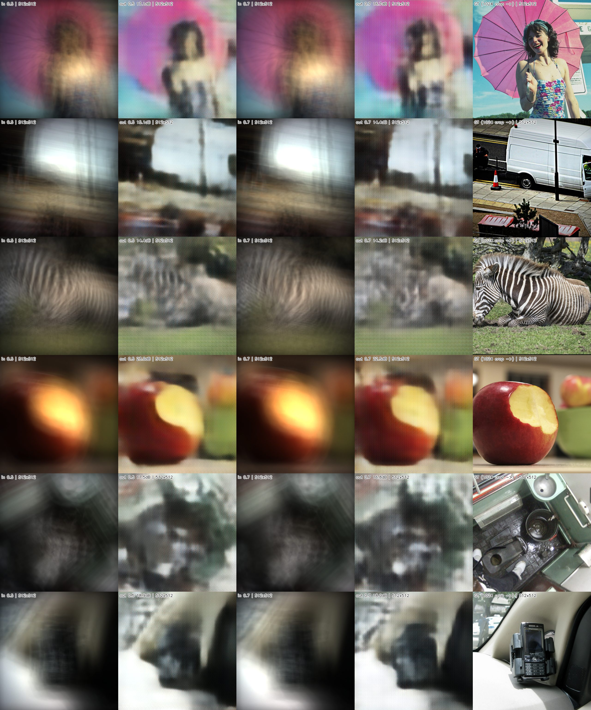

Figure H6a. Run 6, full frame: mid NAFNet (11.6M params); still below full NAFNet. Input: raw sensor capture 5472×3648, affine-warped to 512×512. Checkpoints: `PL_04_naf_m_20261107-024530.pth`, `PL_06_naf_m_20261107-024530.pth`. Source: `PrivacyLensless/history_plot.py`; artifact: `figs/history/06_raw_naf_m_full.jpg`.

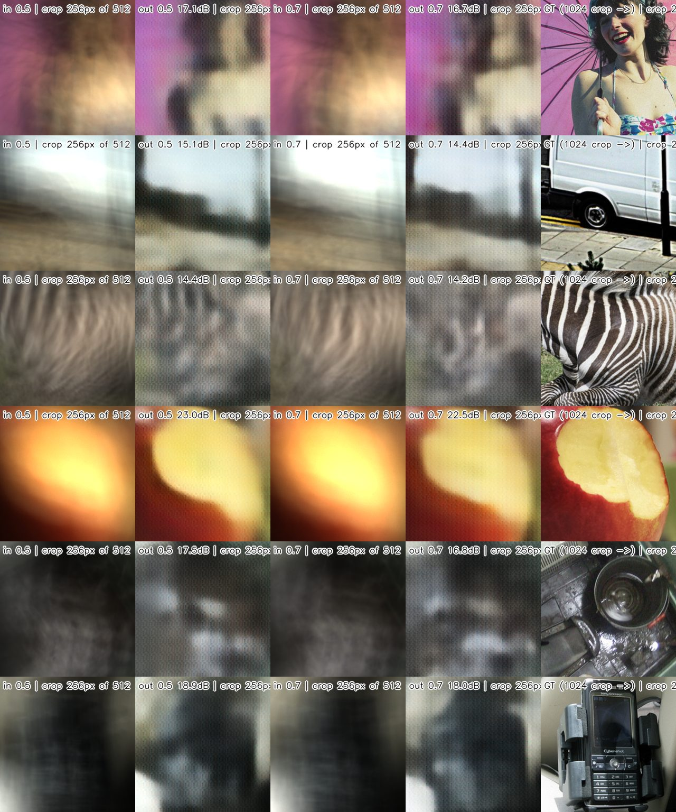

Figure H6b. Run 6, center crop: mid NAFNet (11.6M params); still below full NAFNet. Input: raw sensor capture 5472×3648, affine-warped to 512×512. Checkpoints: `PL_04_naf_m_20261107-024530.pth`, `PL_06_naf_m_20261107-024530.pth`. Source: `PrivacyLensless/history_plot.py`; artifact: `figs/history/06_raw_naf_m_crop.jpg`.

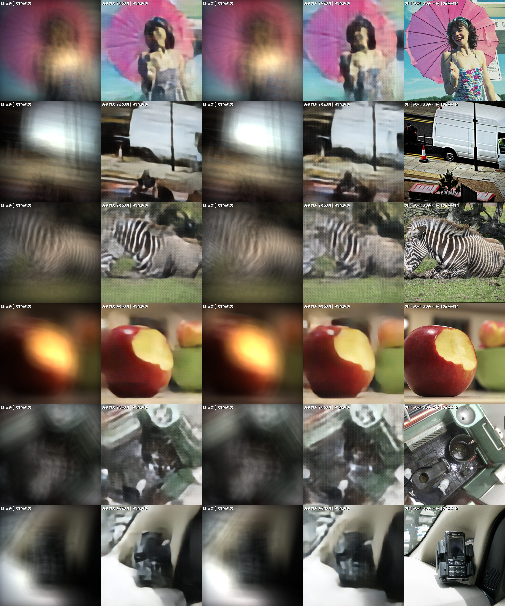

Figure H7a. Run 7, full frame: NAFNet + linear-light mixup (p 0.5) + EMA 0.999. Input: raw sensor capture 5472×3648, affine-warped to 512×512. Checkpoints: `PL_04_naf-me_20261107-075705.pth`, `PL_06_naf-me_20261107-075705.pth`. Source: `PrivacyLensless/history_plot.py`; artifact: `figs/history/07_raw_naf-me_full.jpg`.

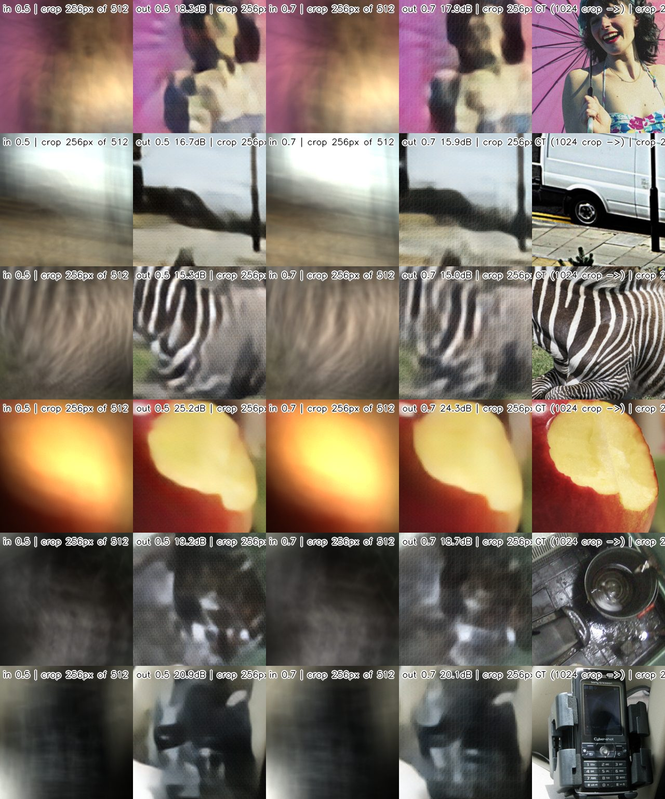

Figure H7b. Run 7, center crop: NAFNet + linear-light mixup (p 0.5) + EMA 0.999. Input: raw sensor capture 5472×3648, affine-warped to 512×512. Checkpoints: `PL_04_naf-me_20261107-075705.pth`, `PL_06_naf-me_20261107-075705.pth`. Source: `PrivacyLensless/history_plot.py`; artifact: `figs/history/07_raw_naf-me_crop.jpg`.

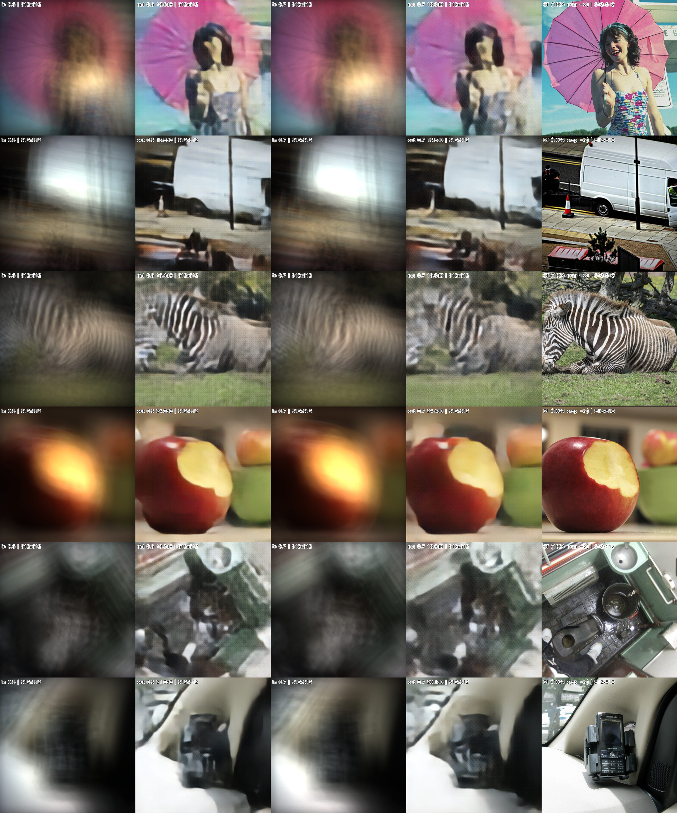

Figure H8a. Run 8, full frame: NAFNet + mixup + EMA + FFT loss 0.2 (best raw). Input: raw sensor capture 5472×3648, affine-warped to 512×512. Checkpoints: `PL_04_naf-mef_20261107-075705.pth`, `PL_06_naf-mef_20261107-075705.pth`. Source: `PrivacyLensless/history_plot.py`; artifact: `figs/history/08_raw_naf-mef_full.jpg`.

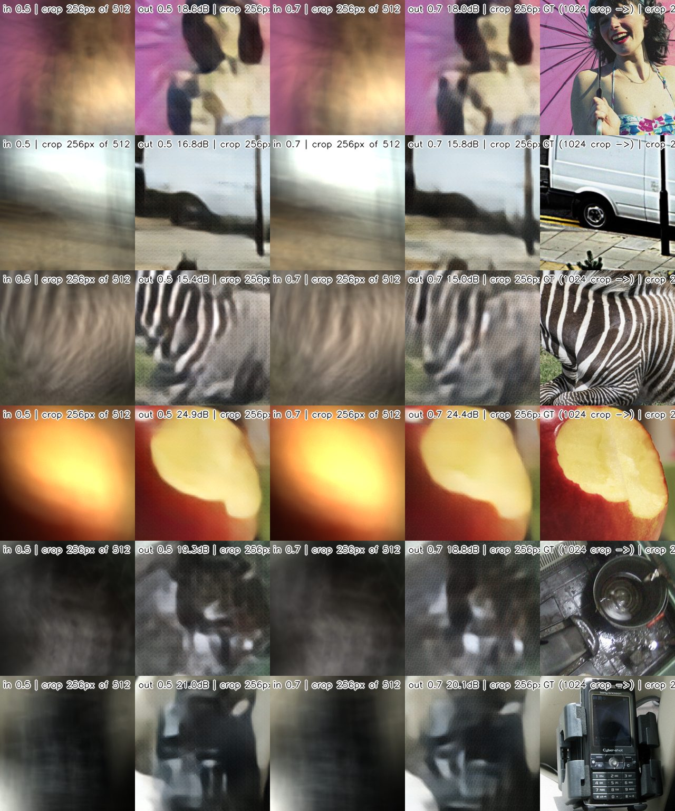

Figure H8b. Run 8, center crop: NAFNet + mixup + EMA + FFT loss 0.2 (best raw). Input: raw sensor capture 5472×3648, affine-warped to 512×512. Checkpoints: `PL_04_naf-mef_20261107-075705.pth`, `PL_06_naf-mef_20261107-075705.pth`. Source: `PrivacyLensless/history_plot.py`; artifact: `figs/history/08_raw_naf-mef_crop.jpg`.

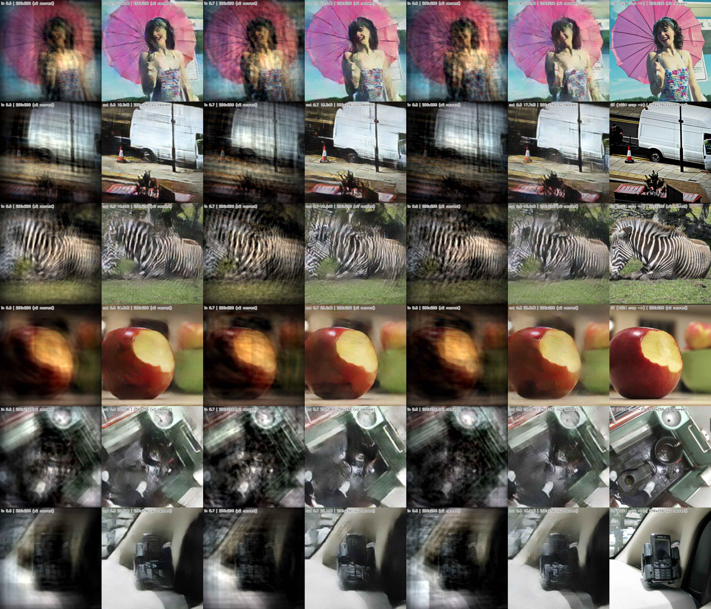

Figure H9a. Run 9, full frame: NAFNet + EMA + FFT loss, on Wiener recon at 256. Input: Wiener recon 256×256 (shown ×2 nearest). Checkpoints: `PL_recon04_naf-ef_20261107-174145.pth`, `PL_recon06_naf-ef_20261107-174145.pth`, `PL_recon07_naf-ef_20261107-174145.pth`. Source: `PrivacyLensless/history_plot.py`; artifact: `figs/history/09_recon256_naf-ef_full.jpg`.

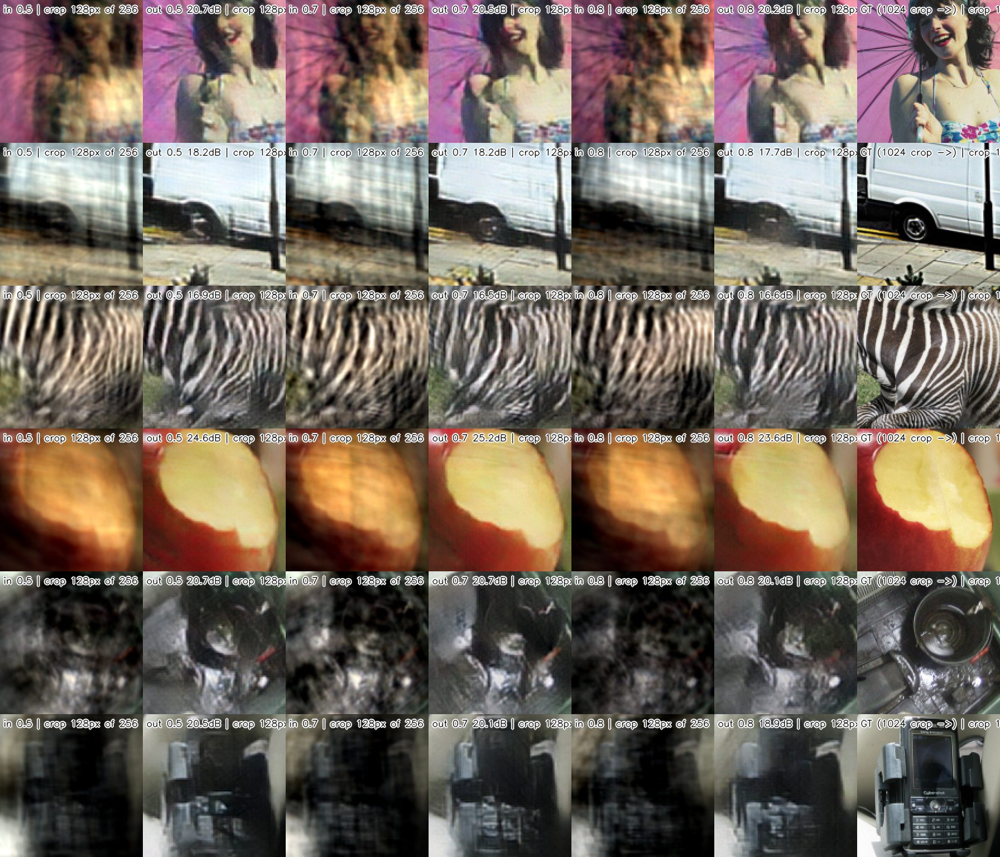

Figure H9b. Run 9, center crop: NAFNet + EMA + FFT loss, on Wiener recon at 256. Input: Wiener recon 256×256 (shown ×2 nearest). Checkpoints: `PL_recon04_naf-ef_20261107-174145.pth`, `PL_recon06_naf-ef_20261107-174145.pth`, `PL_recon07_naf-ef_20261107-174145.pth`. Source: `PrivacyLensless/history_plot.py`; artifact: `figs/history/09_recon256_naf-ef_crop.jpg`.

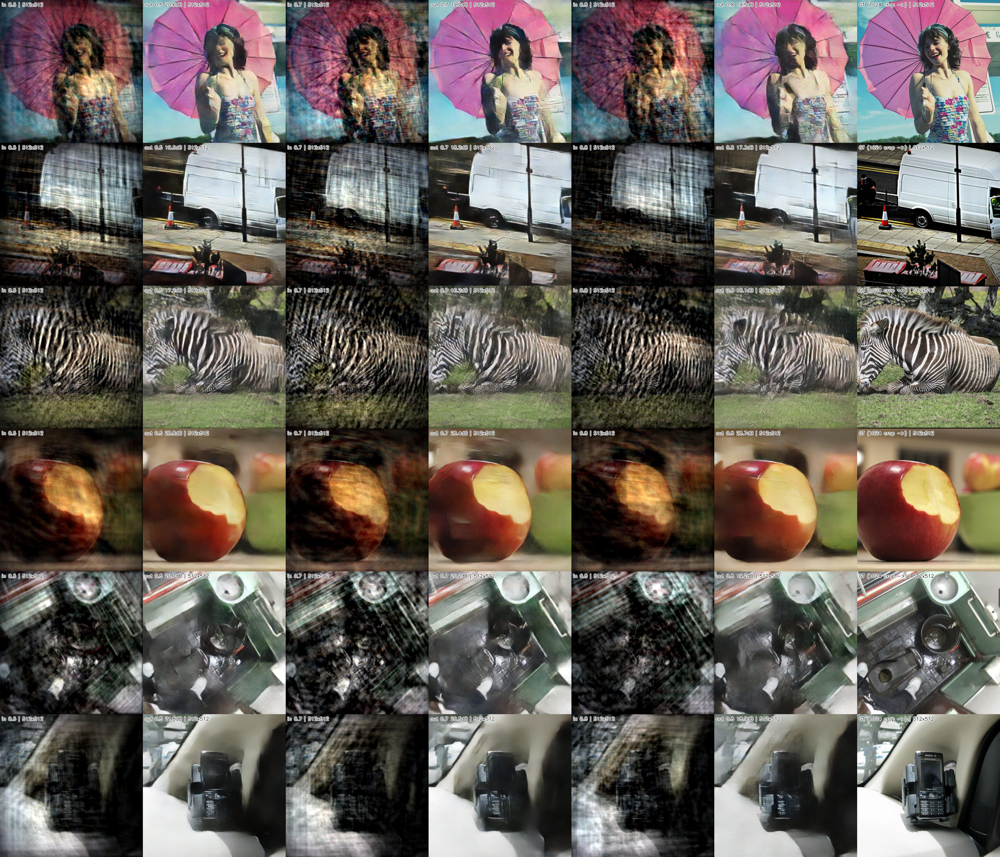

Figure H10a. Run 10, full frame: same recipe on Wiener recon at 512, batch 4. Input: Wiener recon 512×512. Checkpoints: `PL_recon512_04_naf-ef_20261108-054058.pth`, `PL_recon512_06_naf-ef_20261108-054058.pth`, `PL_recon512_07_naf-ef_20261108-054436.pth`. Source: `PrivacyLensless/history_plot.py`; artifact: `figs/history/10_recon512_naf-ef_full.jpg`.

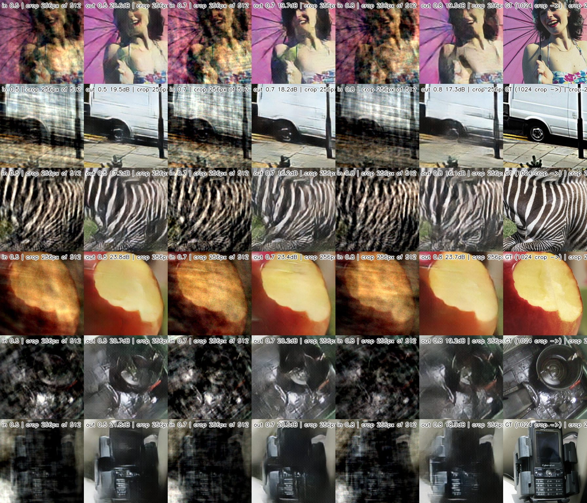

Figure H10b. Run 10, center crop: same recipe on Wiener recon at 512, batch 4. Input: Wiener recon 512×512. Checkpoints: `PL_recon512_04_naf-ef_20261108-054058.pth`, `PL_recon512_06_naf-ef_20261108-054058.pth`, `PL_recon512_07_naf-ef_20261108-054436.pth`. Source: `PrivacyLensless/history_plot.py`; artifact: `figs/history/10_recon512_naf-ef_crop.jpg`.

## Limitations

- **The 512 results come from one seed.** Batch size differs from the 256 runs (4 vs 8), and the runs peak earlier (epoch 12–13).
- **Every run overfits after its peak.** Mixup, the main regularizer available for raw captures, is not valid here because the recon images are nonlinear.
- **Coherence is zero above about 0.45 cycles/px at all three distances.** Text-level detail is not recovered at any distance in this setup.

## Reproduction

```bash
cd PrivacyLensless
python register.py <captures_1014_DD> reg_recon512_DD.json <gpu> <recon_1014_DD_512> 1
python cache.py <captures_1014_DD> reg_recon512_DD.json <out>/recon512_DD <recon_1014_DD_512> 512
python train.py --data recon512_DD --model naf --bs 4 --norm none --ema 0.999 --fft 0.2 --suffix=-ef   # 256: --data reconDD --bs 8
python eval512.py <gpu>; python zoom512.py <gpu>
python spectrum.py <gpu> recon:04,06,07 s0=<stem> s1=<stem> s2=<stem> ens=<s0+s1+s2>; python plot_seeds.py
```

DD ∈ {04 (mask 0.5), 06 (mask 0.7), 07 (mask 0.8)}. The pipeline wrapper is `run512.sh`. Runs are logged to W&B project `privacy-lensless-camera`.
